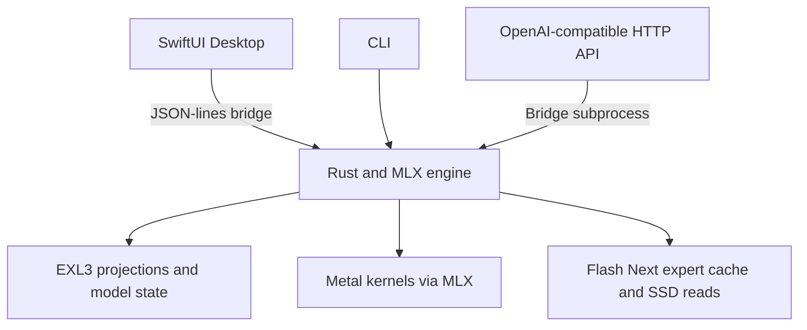

<p align="center">
  <picture>
    <source media="(prefers-color-scheme: dark)" srcset="apps/MLXL3Studio/Resources/AppIcon.png">
    
  </picture>
</p>

# MLXL3 v2: EXL3 inference on Apple Silicon

MLXL3 runs EXL3 language and vision models locally on macOS. It includes a
SwiftUI desktop app, a Rust inference engine using MLX on Metal, a
command-line client, and an OpenAI-compatible HTTP API. Supported families
include Qwen, LFM2, LFM3, LFM3-VL, Gemma 4 and Ling.

[Download Desktop beta 15](https://github.com/0xZKnw/mlxl3/releases/tag/v2.0.0-beta.15)
· [Engine 2.0.5 beta](https://github.com/0xZKnw/mlxl3/releases/tag/engine-v2.0.5-beta.1)
· [Release notes](docs/release-v2.0.0-beta.15.md)
· [Website](https://mlxl3.0xzknw.tech/)
· [Discord](https://discord.gg/9hU46NVNnY)
· [MIT license](LICENSE)

**Requirements:** Apple Silicon, macOS **26.2+**, and enough unified memory
for the selected model. The DMG bundles the engine, MLX libraries, Metal assets
and conversion environment. Model weights are downloaded separately. No Python,
Homebrew or separate MLX installation is needed to use the app.

## Install and run your first model

1. Download the **v2 beta DMG** above and drag **MLXL3 Desktop** into Applications.
2. Open **Models → Hugging Face**, or import a complete local EXL3 folder.
3. Choose the repository revision and quantization, download it, then load it
   from the model selector.
4. Write a message. Use **+** to attach files or configure tools.

The builds are ad-hoc signed, not notarized. If macOS blocks first launch,
approve this specific app in **System Settings → Privacy & Security**.

Desktop **2.0.0-beta.15 / build 46** bundles engine **2.0.5**. App and engine
updates have separate stable/beta channels in Settings. Updating an engine
validates its manifest, hashes, architecture, protocol and app compatibility;
a failed startup can fall back to the bundled runtime. Engine releases do not
replace the Desktop download channel.

Managed models live in
`~/Library/Application Support/io.mlxl3.desktop/Models`. Imported folders can
stay on another disk. An EXL3 checkpoint needs its configuration, tokenizer,
quantization descriptor and every weight shard; copying only a `.safetensors`
file is insufficient.

## Models and compatibility

EXL3 support depends on the model architecture and tensor layout, as well as
the container format. These are the implemented runtime families:

| Family | Configuration type | Input / execution |
|---|---|---|
| LFM2 / LFM2.5, dense and MoE | `lfm2`, `lfm2_moe` | Text; convolution, recurrent state and routed experts |
| LFM3-1.7B | `lfm3` | Text; gated attention, sliding window and seven-tap convolutions |
| LFM3-VL-2B | `lfm3_vl` | Text and images; vision encoder, projector and LFM3 decoder |
| Qwen 3.5 / 3.6 / 3.8 | `qwen3_5`, `qwen3_5_moe` | Text; hybrid Gated DeltaNet/attention, dense and MoE |
| Qwen 3.8 Flash Next | `qwen4_exp` | MLX inference, SSD expert streaming and bounded cache |
| Gemma 4 | `gemma4` | Text and native tool-call parsing; image/audio inputs excluded |
| Ling / Bailing | `bailing_hybrid` | Text, routed experts and Ling-native tool-call parsing |

The Desktop catalogue recommends these pinned exports:

| Model | Projection bpw | Repository |
|---|---:|---|
| LFM3-1.7B Heretic NX | 8 | [0xzknw/LFM3-1.7B-Heretic-NX-EXL3-8bpw](https://huggingface.co/0xzknw/LFM3-1.7B-Heretic-NX-EXL3-8bpw) |
| LFM3-1.7B original | 8 | [0xzknw/LFM3-1.7B-EXL3-8bpw](https://huggingface.co/0xzknw/LFM3-1.7B-EXL3-8bpw) |
| LFM3-VL-2B | 8 | [0xzknw/LFM3-VL-2B-EXL3-8bpw](https://huggingface.co/0xzknw/LFM3-VL-2B-EXL3-8bpw) |
| LFM2.5-24B-A2B | 4 | [0xzknw/LFM2.5-24B-A2B-EXL3-4bpw](https://huggingface.co/0xzknw/LFM2.5-24B-A2B-EXL3-4bpw) |
| Qwen3.6-35B-A3B | 2.49 | [UnstableLlama/Qwen3.6-35B-A3B-exl3-2.49bpw](https://huggingface.co/UnstableLlama/Qwen3.6-35B-A3B-exl3-2.49bpw) |
| Qwen3.8-27B | 2.00 | [turboderp/Qwen3.8-27B-exl3](https://huggingface.co/turboderp/Qwen3.8-27B-exl3) |
| Qwen3.8 Flash Next | 2.05, SSD | [turboderp/Qwen3.8-Flash-Next-exl3](https://huggingface.co/turboderp/Qwen3.8-Flash-Next-exl3) |

The LFM3 text and vision cards open **8 bpw** by default and offer **4**, **4.49**
and **8 bpw** as separate repositories. Heretic NX is available at 8 bpw. Projection bpw excludes embeddings, output
heads, scales and metadata; it is not the whole-file bitrate. Model licenses
apply separately from MLXL3's license. For LFM3-VL, use the calibrated 8 bpw
checkpoint: the 4 bpw vision export is uncalibrated and 4.49 bpw has not met
the native feature-parity threshold.

### LFM3-VL image input

Use the calibrated [LFM3-VL-2B EXL3 8 bpw](https://huggingface.co/0xzknw/LFM3-VL-2B-EXL3-8bpw) checkpoint. Load the vision model, then attach PNG, JPEG
or WebP images through **+**, or drag them onto the composer. Images appear in
the draft and sent message; click one for the larger preview. Documents and
images can be sent together.

Desktop limits are **eight images / 8 MiB per conversation**, with at most
64 million source pixels per image. The engine separately bounds decoded and
resized image inputs. Image bytes are embedded in local history, so moving or
deleting the original file does not break later turns. A text-only model cannot
silently continue an image conversation. Remote image URLs, video and audio
model input are unsupported.

## Benchmarks: measured results and scope

Measurements are tied to a checkpoint, source revision, prompt, generation
budget, hardware and execution mode. Decode rate, prefill rate and time to first
token are different metrics. Process footprint, active GPU allocation and model
file size are also different quantities.

On an **Apple M5 / 24 GiB**, macOS 27.2, the MLX 0.32.2 engine from commit
`a3cffdcaa7ba` produced the following results. Each model used the same text
prompt, a 4,096-token context, greedy decoding, 128 output tokens, one warmup
and three measured runs. MTP, DFlash, tools and prompt reuse were off.

| Model | Prefill median | Decode median (range) | TTFT median | Total median | Peak footprint |
|---|---:|---:|---:|---:|---:|
| LFM3 1.7B original · 8 bpw | 886.35 tok/s | 49.47 (46.94–51.20) tok/s | 0.069 s | 2.64 s | 2.58 GiB |
| LFM3 1.7B Heretic NX · 8 bpw | 868.87 tok/s | 46.80 (46.31–48.65) tok/s | 0.071 s | 2.78 s | 2.58 GiB |
| LFM3-VL 2B · 8 bpw, text | 885.66 tok/s | 46.62 (46.07–48.32) tok/s | 0.069 s | 2.79 s | 2.76 GiB |
| Qwen3.8 27B · 2 bpw | 73.74 tok/s | 8.33 (8.13–9.13) tok/s | 1.411 s | 16.67 s | 11.19 GiB |
| Qwen3.6 35B-A3B · 2.49 bpw | 223.11 tok/s | 42.75 (41.08–44.15) tok/s | 0.278 s | 3.25 s | 13.02 GiB |
| Qwen3.8 Flash Next · 2.05 bpw | 9.97 tok/s | 10.05 (9.87–10.24) tok/s | 10.433 s | 23.17 s | 9.67 GiB |

The VL row measures **text-only** input. Tokenizers rendered the same prompt
as 61–104 tokens depending on the model, so prefill rates and TTFT are not
identical-work comparisons. TTFT and total exclude model loading; footprint is
the largest process lifetime peak among measured runs, not model file size or
total system memory. SSD and OS caches were not controlled. These are small
local samples, not universal speed claims. The [measurement record](docs/measurements/v2-models-20261111/)
contains each run, exact weights and revisions, the prompt, quality checks and
reproduction commands.

### MTP and DFlash2 observations

On the same Apple M5 / 24 GiB and engine 2.0.5, Qwen3.6 35B-A3B EXL3
2.49 bpw produced these rates with a 4,096-token context, greedy decoding and
128 output tokens:

| Prompt | Mode | Decode median (range) | TTFT median | Total median |
|---|---|---:|---:|---:|
| Snapshot, 62 prompt tokens | Ordinary | 50.60 (50.27–50.61) tok/s | 0.243 s | 2.752 s |
| Snapshot, 62 prompt tokens | MTP1 | 75.12 (74.45–75.75) tok/s | 0.243 s | 1.935 s |
| Snapshot, 62 prompt tokens | DFlash2 Auto | 70.56 (70.22–70.69) tok/s | 0.251 s | 2.051 s |
| French, 27 prompt tokens | MTP1 | 70.71 (70.60–71.04) tok/s | 0.128 s | 1.925 s |
| French, 27 prompt tokens | DFlash2 Auto | 61.11 (60.74–61.21) tok/s | 0.138 s | 2.216 s |

MTP and DFlash2 used the same prompts in alternating passes and matched output
hashes. The ordinary run also matched the snapshot output but ran separately;
swap in use rose from about 2.48 to 6.97 GiB between its preflight and the
speculative passes. Do not treat this as a controlled speedup comparison.
The [measurement record](docs/measurements/v2-speculative-20261111/) includes
each sample, draft identity, acceptance counts and reproduction commands.

The same engine and Mac were also measured with Qwen3.8 27B EXL3 2 bpw:

| Prompt | Mode | Decode median (range) | TTFT median | Total median |
|---|---|---:|---:|---:|
| Snapshot, 104 prompt tokens | Ordinary | 8.88 (8.61–9.04) tok/s | 1.310 s | 15.612 s |
| Snapshot, 104 prompt tokens | MTP1 | 12.73 (12.57–13.23) tok/s | 1.329 s | 11.312 s |
| Snapshot, 104 prompt tokens | DFlash2 Auto | 6.55 (6.36–6.60) tok/s | 1.378 s | 20.766 s |
| French, 69 prompt tokens | MTP1 | 12.76 (12.49–12.97) tok/s | 1.103 s | 11.052 s |
| French, 69 prompt tokens | DFlash2 Auto | 6.00 (5.85–6.23) tok/s | 1.099 s | 22.253 s |

Both speculative modes produced matching outputs, and the ordinary snapshot
output matched too. The ordinary run was not interleaved, swap use changed
substantially, and individual speculative samples varied by up to about 6.5%.
These results show that DFlash2 can be slower for a given workload; they do not
establish a universal ranking. See the [27B record](docs/measurements/v2-speculative-20261111/qwen27/)
for all samples and conditions.

The following are **historical campaigns**, measured on an Apple M5 with 24 GiB;
they do not benchmark the v2 executable above. The modes use different draft
weights and can increase memory use. Rates measure decode after the first token;
they do not include model loading or represent the complete response time.

For Qwen3.6 35B-A3B EXL3 2.49 bpw, engine 1.4.3 used greedy decoding, a
4,096-token context, 128 output tokens, a warmup per prompt and two repetitions
in each of four alternating passes. MTP1 and DFlash2 Auto were measured using
the same target and prompts:

| Prompt | MTP1 decode | DFlash2 Auto decode | Total MTP1 / DFlash2 |
|---|---:|---:|---:|
| French, 27 prompt tokens | 70.52 tok/s | 61.28 tok/s | 1.93 / 2.21 s |
| Technical document, 2,825 prompt tokens | 56.64 tok/s | 42.55 tok/s | 8.01 / 9.27 s |

Outputs matched for these samples, but the long-prompt MTP control drifted by
5.32%, above the campaign's 3% limit. The ordering is therefore an observation,
not a confirmed general ranking. The full [protocol and results](docs/dflash2-stable-validation.md)
include TTFT, memory, acceptance and the unexecuted confirmation.

For Qwen3.8 Flash Next EXL3 2.05 bpw, a separate 1 November campaign used two
short prompts, 128 output tokens and an explicitly configured 3 GiB expert
cache. Its measured executable had additional experimental Hot/Wide/Unique
options enabled, so these are not default-setting v2 numbers:

| Prompt | Ordinary decode | MTP1 decode | DFlash2 decode |
|---|---:|---:|---:|
| MAIN, 87 prompt tokens | 11.47 tok/s | 12.09 tok/s | 12.65 tok/s |
| HOLD, 82 prompt tokens | 11.37 tok/s | 11.26 tok/s | 12.15 tok/s |

Each process warmed each prompt once; ordinary decoding had two measured
processes and MTP/DFlash2 had three. Values are aggregate decode rates, with
small samples and different draft residency between modes. See the
[campaign record](docs/measurements/post-p09-dynamic-cold-20261101/README.md)
for all settings, prefill tradeoffs and source identities.

The historical Qwen3.8 27B 2 bpw MTP1 campaign recorded 11.08 tok/s in French
and 10.94 tok/s for code on its own workload; its
[measurement record](docs/qwen27-max-optimisations-20261016.md) describes the
conditions. It is not paired with the v2 baseline above. The listed LFM models
do not currently expose these MTP/DFlash2 paths in MLXL3; no speculative rates
are implied for them. Use the built-in tuner on compatible targets to compare
modes for your model, Mac and workload.

One fully recorded **Apple M5 / 24 GiB** campaign for LFM2.5-24B-A2B EXL3
4 bpw used two 266-token templated prompts, 128 generated tokens, one warmup
per prompt and five measured repetitions, without MTP, DFlash or prompt reuse:

| Workload | Decode, median | Prefill, median | First token, median | Total response, median |
|---|---:|---:|---:|---:|
| French | 58.38 tok/s | 42.84 tok/s | 6.21 s | 8.39 s |
| Code | 58.34 tok/s | 42.95 tok/s | 6.19 s | 8.35 s |

These are **historical October 14 measurements**, not a fresh measurement of
every v2 build. The [complete report](docs/lfm25-measurements-2026-10-14.md)
records source identity, file hashes, numerical quality checks and the
56.64–59.65 tok/s decode range. It does not claim an A/B speedup.

Other recorded campaigns include
[Qwen27B MTP and activation-layout experiments](docs/qwen27-max-optimisations-20261016.md),
[Flash Next SSD streaming](docs/flash-next-ssd-implementation.md) and
[the merged native/MTP composition](docs/pr161-fixes-2026-11-08.md).
Their workloads and settings differ; the reports preserve rejected experiments,
control drift and opt-in status. They are not an interchangeable leaderboard.
The [optimization journal](opti.md) records the experiments and decisions.

## Desktop workspaces

The capabilities below describe the current source; the latest published beta
may not yet include every change.

- **Chat:** streaming responses and reasoning, Markdown/code/math rendering,
  saved conversations, editing, regeneration, branches and export.
- **Agent:** work on an isolated project copy, inspect files and diffs, retain
  Git checkpoints, restore versions and export ZIP. Applying changes to the
  original project requires review; conflicting external edits are refused.
- **Server:** start the local HTTP API with a resident model.
- **Lab:** inspect locally recorded generation samples and their settings.

Model details render Hugging Face cards with Markdown, HTML and repository
images. Card scripts are disabled, and external links open in the browser.

Projects keep instructions and documents together. Saved profiles restore
sampling settings. Text/PDF retrieval includes source excerpts and page
references. Scanned PDFs need prior text extraction; attaching a PDF does not
turn it into native vision input. File attachments are limited to eight per
message, 20 MiB per source file, 256 KiB extracted text per file and 512 KiB
text per message. The model's context limit still applies.

On-device dictation and reply speech use macOS services. Agent/project and
versioned artifact features require working Git. Appearance settings include
12 themes, preset or custom accent colors, conversation fonts and bubble
styles, message spacing, reading width, text size and sidebar width. Choices
apply immediately and persist locally; the appearance reset restores defaults.

### MTP and DFlash

For eligible Qwen targets, enable **MTP** or **DFlash2** in Generation settings.
Matching heads/drafts are downloaded and verified separately from target
weights. The modes are mutually exclusive and use target verification before
accepting proposed tokens. Tune records a configuration for the current model,
head, runtime, context and Mac; a speculative path is not automatically faster.

Hardware and OS gates matter: M5 cooperative-input TensorOps require macOS
26.3+, and the packed Q4 DFlash path requires macOS 26.4+. See the
[Apple Silicon support and validation matrix](docs/apple-silicon-stability-20261030.md).

## Native command-line inference

Use the extracted engine's `mlxl3`, or the copy bundled with the app:

```sh
export MLXL3_BIN="/Applications/MLXL3 Desktop.app/Contents/Resources/runtime/mlxl3"
"$MLXL3_BIN" runtime-info
"$MLXL3_BIN" register lfm3 /absolute/path/to/LFM3-1.7B-EXL3-8bpw
"$MLXL3_BIN" run lfm3 --prompt 'Explain how a ring buffer works.' --max-tokens 128
```

The CLI also accepts a complete checkpoint directory directly. LFM3-VL accepts
repeated `--image` arguments with a prompt:

```sh
"$MLXL3_BIN" run /absolute/path/to/LFM3-VL-2B-EXL3-8bpw \
  --image /absolute/path/to/photo.png \
  --prompt 'Describe this image.' --max-tokens 128
```

Browse and resume Hugging Face downloads without a separate HF CLI:

```sh
"$MLXL3_BIN" hub search 'LFM3 EXL3'
"$MLXL3_BIN" hub details 0xzknw/LFM3-1.7B-Heretic-NX-EXL3-8bpw
"$MLXL3_BIN" hub download 0xzknw/LFM3-1.7B-Heretic-NX-EXL3-8bpw --revision 25511dcbc1f7c099509361cf1e2e9de034c56e22
"$MLXL3_BIN" hub pending all
"$MLXL3_BIN" hub resume DOWNLOAD_ID
```

Downloads resolve an immutable commit, validate sizes and SHA-256, and publish
only a complete selected variant. Private/gated repositories need a saved
Hugging Face token and any required license acceptance.

## OpenAI-compatible local API

```sh
"$MLXL3_BIN" serve lfm3 --host 127.0.0.1 --port 8000 --api-key local-secret
curl http://127.0.0.1:8000/v1/chat/completions \
  -H 'Authorization: Bearer local-secret' \
  -H 'Content-Type: application/json' \
  -d '{"model":"lfm3","messages":[{"role":"user","content":"Explain a mutex."}],"stream":true}'
```

The API exposes `/v1/models`, `/v1/chat/completions`, `/v1/capabilities`,
`/health` and `/ready`. Chat Completions support JSON and SSE streaming;
LFM3-VL accepts image content parts with local base64 data URLs. JSON object
and schema response modes validate the generated output; they are **not
grammar-constrained decoding**. Query `/v1/capabilities` for the actual engine.
OpenAI-style `tools` calls, custom stop sequences and audio are not supported.
A non-loopback host requires an API key. One model stays resident per server.

## Tools, storage and network boundaries

Chat inference runs on the Mac. Hub actions contact Hugging Face; update checks
and downloads contact GitHub. Optional MCP servers may receive prompts/tool
arguments and make their own network requests. MCP is off by default; enabling
it is a saved choice. Local stdio MCP servers run with the user's permissions.

The shared MCP configuration is `~/.config/mlxl3/mcp.json`. Manage servers in
the Desktop or with `mlxl3 mcp list`, `mlxl3 mcp add` and `mlxl3 mcp check`.
Agent file/command tools operate within their task copy under macOS sandboxing;
external MCP servers retain their own trust boundary.

History and image attachments are stored locally. Keep backups before a
version downgrade: old applications do not preserve every newer history field.
The app can export conversations without changing the model files.

## Runtime architecture



Rust owns checkpoint validation, tokenization/templates, generation, streaming,
state, downloads and tool protocols. Quantized projections are evaluated from
their EXL3 representation; inference does not first export a dense BF16 model.
All supported models use MLX in v2, including Flash Next. The independent native
Metal engine and hybrid dispatcher remain in the source tree but are not shipped
in this release. Desktop rejects incompatible native engine updates and falls
back to its bundled MLX engine.

MLXL3 is an independent Apple Silicon runtime. ExLlamaV3 provides the EXL3
format and numerical reference; adapted components retain their upstream
notices. See [third-party provenance](THIRD_PARTY_NOTICES.md).

## Safetensors-to-EXL3 conversion

**Models → Quantization Studio** inspects a local source or Hugging Face model,
then offers supported conversion settings and a separate output directory.
Simple mode exposes 3/4/6 bpw; Expert adds calibration, head precision, excluded
modules and optional held-out quality checks. Conversion unloads the chat model,
uses the bundled conversion environment and runs only while requested.

The supplied adapters cover **LFM2, LFM2-MoE and native Ling/Bailing**.
Inference support does not imply conversion support: LFM3, Qwen and Gemma
imports are not automatically convertible by these adapters. A Safetensors
extension alone is insufficient. See the
[LFM conversion guide](docs/lfm26-local-quantization.md),
[LFM2.5 MoE measurements](docs/lfm25-moe-quantization.md) and
[Ling conversion guide](docs/ling-local-quantization.md).

## Build and verify

Development requires Rust **1.89+**, Swift **6.2+**, a compatible macOS SDK
and Xcode Command Line Tools. The inference helper links MLX **0.32.2**;
Python **3.12** supplies build/conversion dependencies, not the chat runtime.

```sh
python3.12 -m venv .venv
.venv/bin/pip install -e '.[dev,bundle]' -c packaging/constraints-macos.txt
export MLXL3_BUILD_PYTHON="$PWD/.venv/bin/python"
export MLXL3_MLX_ROOT="$PWD/.venv/lib/python3.12/site-packages/mlx"
export MLXL3_ENGINE_BACKEND=mlx
scripts/build-engine.sh
scripts/build-macos-dmg.sh
```

For portable CPU/chat checks, without an inference backend:

```sh
cargo test --locked --no-default-features --features chat
cargo clippy --locked --all-targets --no-default-features --features chat -- -D warnings
```

Additional checks:

```sh
cargo fmt --check
cargo kani --lib --no-default-features
PYTHONPATH=src:apps/MLXL3Studio/Vendor/PonyExl3 .venv/bin/python -m pytest -q
MLXL3_TEST_PYTHON="$PWD/.venv/bin/python" scripts/check-desktop.sh
```

An installed SDK can be selected with `MLXL3_MACOS_SDK`. Kani checks bounded
properties of actual Rust helpers with explicit domains and unwinding bounds;
it does not prove MLX, Metal, I/O races or the complete application. Physical
GPU tests and checkpoint/logit comparisons are recorded separately. CI runs
Rust, Python, Desktop/protocol, packaging and proof checks on PRs and main.

For controlled engine comparisons, use
[`benchmarks/compare_native.py`](benchmarks/compare_native.py), which checks
token/text parity, validates timings, bounds process waits and retains failed
campaigns. Run GPU benchmarks separately from builds and other inference.

## Limits and further reading

- Native inference and Desktop require Apple Silicon/macOS. M1–M4 have less
  physical performance coverage than M5; M5 timings are not predictions for them.
- Gemma multimodal input, remote image fetching, video/audio model input and
  complete TeX/browser compatibility are outside the current scope.
- SSD-streamed models depend on cache size, storage and memory pressure.
  Model file size is not an estimate of peak process memory.
- Greedy target verification does not establish an acceleration gain on every
  prompt. Experimental settings retain their individual qualification limits.

[LFM3 text/vision integration](docs/lfm3-integration-2026-11-05.md)
· [LFM3 kernel and numerical checks](docs/lfm3-kernels-2026-11-06.md)
· [Flash SSD design](docs/flash-next-ssd-implementation.md)
· [Optimization history](opti.md)
· [All releases](https://github.com/0xZKnw/mlxl3/releases)

## Repository and credits

| Path | Contents |
|---|---|
| `apps/MLXL3Studio/` | SwiftUI application and native UI checks |
| `native/src/`, `native/shaders/` | Rust engine and Metal kernels |
| `src/mlxl3_quantizer/` | Conversion adapters and calibration helpers |
| `scripts/`, `benchmarks/`, `tests/` | Build tools, campaigns and regression checks |
| `docs/`, `opti.md` | Release notes, numerical evidence and experiment history |

Created by [0xZKnw](https://github.com/0xZKnw). Thanks to
[ExLlamaV3](https://github.com/turboderp-org/exllamav3),
[Apple MLX](https://github.com/ml-explore/mlx),
[PonyExl3](https://github.com/beamivalice/PonyExl3),
[MTPLX](https://github.com/youssofal/mtplx),
[SwiftMath](https://github.com/mgriebling/SwiftMath) and model authors for the
components and references recorded in [THIRD_PARTY_NOTICES.md](THIRD_PARTY_NOTICES.md).
MLXL3 uses the [MIT license](LICENSE); upstream components and model weights
retain their respective licenses.
