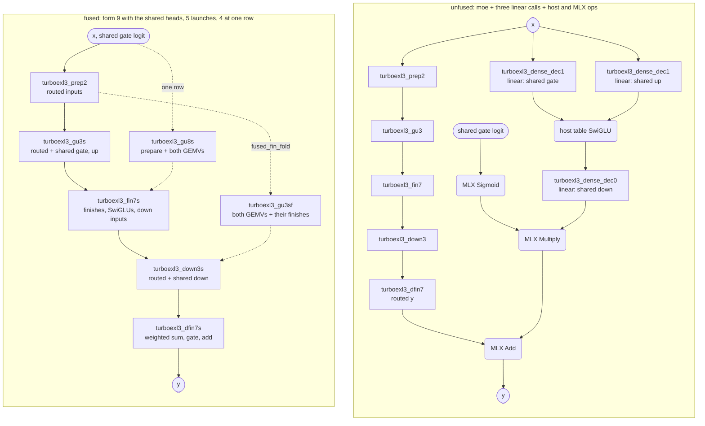
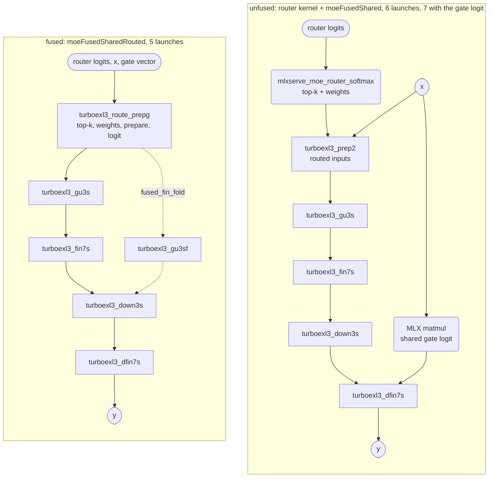
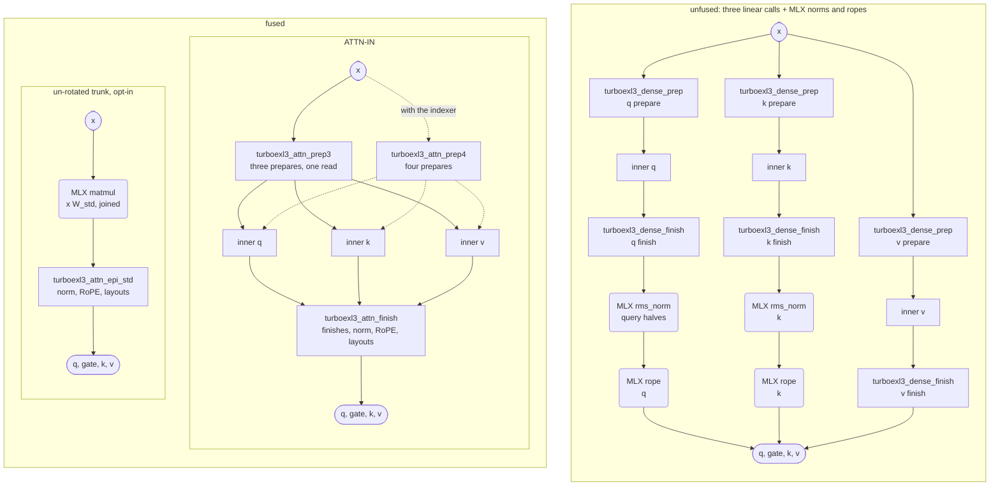
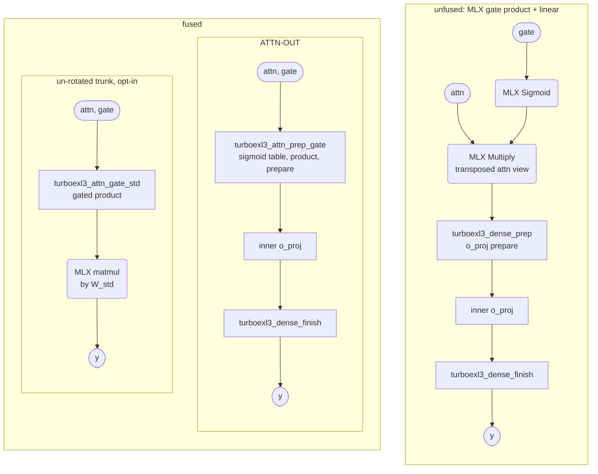
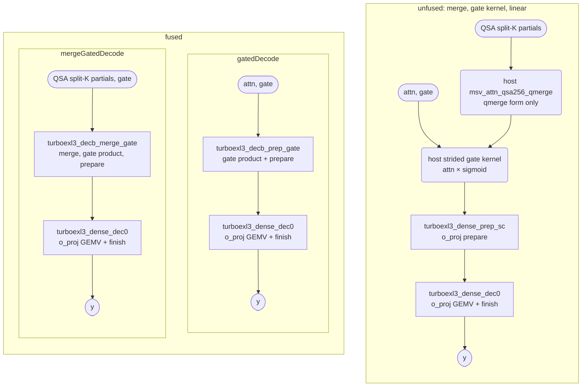
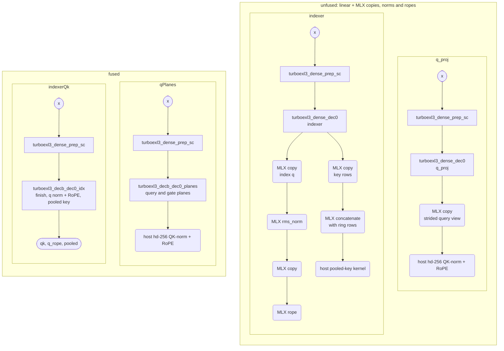

# Qwen3.8-Flash-Next kernels

The paths only Qwen3.8 uses, all in `src/models/qwen38/`: the shared expert and router heads inside the core's routed
decode launches (`shared.zig`, on `src/core/decode.zig`'s `Kernels3`), the attention projections, the decode-row merges
and the GDN tail. Their entries close this page. How to read the diagrams
and the exactness classes: [the engines page](../../core/engines.md#how-to-read-this-page).

## 1. Shared expert and router inside the decode launches (rows 1–4)

`moeFusedShared` computes `y = routed + sigmoid(logit) · shared(x)` for a gated shared expert. The gate, up and down of
the shared expert are dense EXL3 projections. The shared expert gets no launch of its own. Its GEMVs ride the gate and
up launch and the down launch of form 9 as extra grid rows. Its finishes ride the finish launches (`fin7s`, `dfin7s`).

**Why it is faster.** The host chain runs the routed chain, three `linear` calls, its table SwiGLU, and MLX's Sigmoid,
Multiply and Add. The fused path runs only the 5 launches of form 9 (4 at one row).

From two rows, the field `fused_fin_fold` (on by default) also moves `fin7s` into the gate and up launch, as
`turboexl3_gu3sf`. In that launch, the threadgroup that completes a routed (row-slot, block) runs `fin7` for it. The
threadgroup that completes a block of the shared expert runs the shared finish of that block for each row. A small
launch, `turboexl3_vfold_zero`, first sets the arrival counters to zero. It reads only a weight, so it runs beside the
prepare launch. So the path keeps 5 launches, but it is one dependent level shorter.

Each `linear` call on the unfused side is drawn as its DEC-ONE GEMV launch; the diagram leaves out its launch that
zeroes counters or prepares. Look at the right side: the shared expert adds no box, only work inside the five routed
launches. The dotted arrows from `turboexl3_prep2` are the path with `fused_fin_fold`. The diagram leaves out its
launch that zeroes the counters.

`moeFusedSharedRouted` also folds the host's softmax router into the prepare launch. With `gate_vec`, it also folds
the logit of the shared gate. It serves the rows whose prepare is a launch of its own: 2–4 rows by default. At one row
the prepare rides `gu8s`, so there is no prepare launch to fold into, and the entry refuses.

On the left, the router kernel and the MLX matmul of the logit run before the chain and beside it. On the right,
`turboexl3_route_prepg` does both inside the prepare launch. That saves one dependent level, and one launch (two with
the logit). The dotted arrows on the right are again the path with `fused_fin_fold`.

| kernel | what it computes | launches it replaces |
|---|---|---|
| `turboexl3_gu3s` | `gu3`, plus grid rows for the shared gate and up: each K slice (one 128-block of hidden) is prepared in the kernel (dense `prep_s`) and runs as the slice of dense `dgemv` | the prepare and GEMV of the `linear` calls for the shared gate and up |
| `turboexl3_gu8s` | `gu8`, plus the same head (one row) | as `gu3s`, plus `turboexl3_prep2` |
| `turboexl3_fin7s` | `fin7`, plus the shared rows: dense `dfinish` of gate and up, the host's table SwiGLU, and dense `prep_s` of the product | the gate and up finishes, the SwiGLU kernel, and the prepare of the down `linear` call |
| `turboexl3_gu3sf` | `gu3s`, then the statements of `fin7s` in the threadgroups that complete its planes, with an arrival counter for each routed (row-slot, block) and for each shared block; in each shared block, the threadgroups of its first output tiles also publish the input sums that the deferred map needs | `gu3s` and `fin7s` |
| `turboexl3_vfold_zero` | zeroes the counters for `gu3sf`; it reads only a weight, so it waits on nothing | — |
| `turboexl3_down3s` | `down3`, plus the slices of the shared down GEMV | the GEMV of the down `linear` call |
| `turboexl3_dfin7s` | `dfin7`, and the shared down's `dfinish` in one more simdgroup; then the routed y in the output dtype + sigmoid(logit) × down, with MLX's sigmoid by table | the down finish, MLX Sigmoid, Multiply and Add |
| `turboexl3_route_prep` | the router's selection, softmax and renormalized weights, then `prep2`; one threadgroup for each (block of hidden, row) | `mlxserve_moe_router_softmax`, `turboexl3_prep2` |
| `turboexl3_route_prepg` | `route_prep`, plus the logit of the shared gate in the order of MLX's `bf16` gemv | as `route_prep`, plus the MLX matmul of the logit |
| `turboexl3_sgu`, `turboexl3_sfin`, `turboexl3_sdown` | the three heads in launches of their own, beside the launches of form 9 (`moeSharedSide`) | a test [variant](../../core/glossary.md#variant); the same bytes |
| `turboexl3_gu8t`, `turboexl3_gu3t`, `turboexl3_gu3p`, `turboexl3_prep2t`, `turboexl3_fin7t`, `turboexl3_down3t`, `turboexl3_dfin7t` | the v2 heads inside the launches of form 9: one simdgroup for each (K slice, group of output tiles), with no threadgroup reduction (`moeShared2`) | a test variant; the same bytes |
| `turboexl3_sgu2`, `turboexl3_sgu2p`, `turboexl3_sprep2`, `turboexl3_sfin2`, `turboexl3_sdown2` | the v2 heads beside the launches of form 9 (`moeSharedSide2`) | a test variant; the same bytes |

**Refusals.** `moeFusedShared` serves a call only when all of these hold:

- the call has at most `shared_rows_max` (4) rows;
- the intermediate width of the shared expert is the routed width;
- each gate and up K slice is one 128-block of hidden;
- the down split is whole slices of 4 parts;
- the output is `bf16` or `f16`.

The router fold also needs these:

- k ≤ 31, and at least k but at most 2048 experts;
- logits in x's dtype, and `slot_stats` off;
- with the gate vector: `bf16` at 2–4 rows, with D > 64 and D ≥ 16 × rows (D is the hidden size). MLX's matmul runs
  that gemv only at those shapes.

Both entries refuse any other call before any launch.

**Exactness.**

- `moeFusedShared` is byte-identical to the host chain. That chain is the routed y of form 3, the three `linear`
  calls, the host's table SwiGLU, and MLX's Sigmoid, Multiply and Add.
  - The heads run the decode statements of `dense.zig` (`prep_s`, `dgemv`, `dfinish`), with the shared expert's own K
    split (`Dense.ksFor`) and its MUL1 deferral.
  - Each slice computes exactly what a threadgroup of its own computes. So the number of K slices per threadgroup (the
    field `shared_spt`) is launch shape only.
  - The SwiGLU and the gate tail repeat the host's statements in the output dtype.
  - The GPU test covers rows 1–4, both MUL1 decodes of the routed experts, and form 9's tiles 1 and 2. It also covers
    three settings of slices per threadgroup, `fused_fin_fold` on and off, and the side and v2 variants under every
    launch-shape knob.
  - `turboexl3_gu3sf` runs the statements of `fin7` and of the shared finish head, in their order. They read the
    same planes and input sums that `gu3s` writes and `fin7s` reads, but inside one launch, through coherent device
    memory. Each value has one writer. The threadgroup that runs a finish is the last to count at its block, so every
    writer of its inputs has counted before it (DEC-ONE's arrival idiom). So its bytes are those of `fin7s`. A CPU
    test holds its text to the pieces of `gu3s` and `fin7s`.
- `moeFusedSharedRouted` is byte-identical to the router kernel followed by `moeFusedShared`.
  - `turboexl3_route_prep` is built from verbatim slices of the router's text and of the body of `prep2`. The router
    slices (softmax mode) are the selection, the softmax tree and the renormalized weights. Each slice runs on the same
    lanes as in its own kernel.
  - The gate logit repeats the column order and the fold of MLX's `gemv_bfloat16_bm1_bn8_sm1_sn32_tm{1,4}_tn4`.
  - The GPU test compares the launch's outputs with the router kernel plus `prep2`. It uses 512 experts, rows 1–4, 8
    and 16, `bf16` and `f16` logits, and exact ties. It compares the logit with MLX's matmul. It compares the whole
    call, with `fused_fin_fold` on and off, with the router plus `moeShared` (the fold off) at rows 2–4.

## 2. Attention projections at prefill rows (17+)

ATTN-IN (`attnIn`) computes q, k and v from one x. Each q head is `[query | gate]`. The finish applies the [QK
RMSNorm](../../core/glossary.md#qk-norm) and partial [RoPE](../../core/glossary.md#rope). ATTN-OUT (`linearGated`) computes `o_proj` over
`T(attn · sigmoid(gate))`, and it forms that product inside its prepare.

"inner" in the diagrams is `linear`'s inner product at these rows: `turboexl3_dense_rs_gemm` (17–32 rows), or
`turboexl3_dense_dequant` + MLX matmul (33 rows and more). With `nax` false, 17–32 rows also take dequantize + matmul.
The entries refuse the GEMV rows and a `Dense` that runs the fused GEMM (a test setting), so the host keeps its chain
there. They also refuse a rotary width other than 32, 64, 128 or 256, and norm weights in
a dtype other than T.

**Why it is faster.** ATTN-IN reads x once for three prepares. It runs one finish for three projections, with the norm
and RoPE inside. That removes two prepare launches, two finish launches, and the norm and rope launches of MLX. Each
launch that it removes also removes one pass of the activations through device memory. ATTN-OUT moves MLX's Sigmoid
and Multiply into its prepare.

On the left, each projection has its own prepare and finish, and MLX normalizes and rotates q and k afterwards. On the
right, one prepare and one finish serve all three projections. The dotted arrows show the four-member prepare, which
also serves the [indexer](../../core/glossary.md#qsa).

The sigmoid and the multiply move into the prepare of `o_proj`. In the un-rotated box, the gated product goes straight
to one matmul by W_std.

| kernel | what it computes | launches it replaces |
|---|---|---|
| `turboexl3_attn_prep3` | the prepared copies of q, k and v from one read of x, in natural order | `turboexl3_dense_prep` × 3 |
| `turboexl3_attn_prep4` | the same, with the QSA indexer projection as a fourth member (`attnPrep4`; the indexer then runs `linearPreparedIdx`) | `turboexl3_dense_prep` × 4 |
| `turboexl3_attn_finish` | for each unit of 256 columns: the members' finishes, then RMSNorm and the NeoX rotation of the q and k heads. q, k and v come out head-major `[1, H, S, 256]`, and the gate `[1, S, H, 256]` | `turboexl3_dense_finish` × 3, MLX rms_norm × 2, MLX rope × 2 |
| `turboexl3_attn_prep_gate` | `T(attn · sigmoid(gate))` (MLX's sigmoid by table, the product in T), then the prepare of `o_proj` | MLX Sigmoid, MLX Multiply, `turboexl3_dense_prep` |
| `turboexl3_attn_epi_std` | the epilogue of `attn_finish`, verbatim, over products in the standard basis (one joined product, or each member's own) | `turboexl3_attn_prep3`, three inner products, `turboexl3_attn_finish` |
| `turboexl3_attn_gate_std` | the gated product alone, for one MLX matmul by the W_std of `o_proj` | `turboexl3_attn_prep_gate`, the inner product, `turboexl3_dense_finish` |

**Exactness.**

- ATTN-IN and ATTN-OUT are byte-identical to the host chain.
  - The prepare of each member runs the statements of dense `text_prep` on the same `f16` value of x. The inner
    products are `linear`'s own launches.
  - The finish runs the statements of `text_finish` on each 128-block. Then it runs MLX's `rms_single_row` order at
    axis 256: `f32` squares in index order, two simd sums, and `precise::rsqrt`. Then it rotates against angle rows
    that MLX's own rope produced.
  - These are the statements of the host's QK-norm + RoPE kernel for [head dim](../../core/glossary.md#head-dim) 256
    (`QK_NORM_ROPE_256_SOURCE`). The host's own test pins that kernel to the composed MLX chain.
  - The product of ATTN-OUT is MLX's Sigmoid by table and its Multiply in T. Both are exact in `f32` before the one
    rounding.
  - The GPU test covers 17, 31, 32, 33, 1328 and 8192 rows, two sets of rates, and both gate layouts. It checks the
    four-member prepare against each member's own prepare and against the indexer's `linear`.
- The `_std` kernels repeat the epilogue and the gate product verbatim. But their inputs are products of the
  un-rotated trunk, so the un-rotated bars of [the dense projections](../../core/engines.md#3-dense-projections) hold their outputs to `attnIn` and `linearGated`.

## 3. Decode-row merges (rows 1–16)

At the GEMV rows of a gated, QK-normed attention layer, four entries merge neighboring launches of the host into the
launches of the dense projection. Each entry is byte-identical to its chain whether DEC-ONE takes the call or not. The
diagrams draw the unfused `linear` calls with DEC-ONE's prepare in its own launch (`prep_sc` → `dec0`).

| entry | what it merges | what it saves |
|---|---|---|
| `gatedDecode` | the host's strided gate kernel, into the prepare of `o_proj` | one launch in every DEC-ONE setting, and one dependent level where `linear` prepares in a launch of its own (`prep_sc` → `dec0`, or the three-launch chain) |
| `mergeGatedDecode` | also the split-K merge of the QSA core | one launch and one level more than `gatedDecode` |
| `qPlanes` | the copy of the strided query view | one launch and one level |
| `indexerQk` | the four launches of the index queries (copy, rms_norm, copy, rope) and the three of the pooled key (copy, concatenate, kernel) | seven launches |

On the left, the gate kernel runs before the prepare of `o_proj`, and in the qmerge form the merge runs before it. On
the right, one launch runs the merge, the gate product and the prepare, and `dec0` follows.

On the left, MLX copies, norms and rotations follow each projection. On the right, the finish inside the GEMV launch
writes the two planes. For the indexer, it normalizes and rotates the index queries and builds the pooled key.

| kernel | what it computes | launches it replaces |
|---|---|---|
| `turboexl3_decb_prep_gate` | the statement of the host's strided gate kernel, then the statements of `prep_sc` (lane order, block sums, DEC-ONE's counters) | the strided gate kernel, and the prepare of `linear` (`prep_sc` or `prep_s`) |
| `turboexl3_decb_merge_gate` | the split-K merge of the QSA core (the statements of `msv_attn_qsa256_qmerge` and its rounding to T), the gate product, and the prepare of `o_proj` | `msv_attn_qsa256_qmerge`, the strided gate kernel, the prepare of `linear` |
| `turboexl3_decb_dec0_planes`, `turboexl3_decb_dec1_planes`, `turboexl3_decb_dfinish_planes` | the finish of `q_proj` in DEC-ONE (`dec0`, `dec1`) or in the chain (`dfinish`), which stores the query and gate halves of each head as two contiguous planes | the row-contiguous copy of the strided query view |
| `turboexl3_decb_dec0_idx`, `turboexl3_decb_dec1_idx`, `turboexl3_decb_dfinish_idx` | the finish of the indexer projection; then the norm and rotation of each index query head (the statements of the host's `QK_NORM_ROPE_SOURCE` for head dim 128); then the one pooled block key that the call completes (the statements of `QSA_POOL_ROPE_SOURCE`) | the index-q copy, rms_norm, copy and rope; the pooled-key copy, concatenate and kernel |

The `dec1_*` and `dfinish_*` variants serve the other DEC-ONE settings. `dec1_*` runs when DEC-ONE prepares inside its
launch (beside `dec_zero`). `dfinish_*` runs when DEC-ONE is off (after `prep_s` and `dgemv`).

**Refusals.** All four entries refuse calls of more than 16 rows, and a `Dense` in the row-slot variant (a test
setting). The qmerge form
also needs 1 to 64 splits and `f32` partials. The indexer entry also needs these:

- the index queries, the pooled key, or both, as its outputs;
- a `bf16` output;
- rotary dims that are a multiple of 8, at most 128;
- a block ratio from 1 to 8, with fewer [ring rows](../../core/glossary.md#qsa-merge) than the ratio;
- with the pooled key: all rows of the block in the call and, with DEC-ONE, in DEC-ONE's first row chunk.

**Exactness.** The merges are byte-identical to the host's chains at every rounding point. The statements that set
values come from `dense.zig` or from the host: the strided gate kernel, `msv_attn_qsa256_qmerge`,
`QK_NORM_ROPE_SOURCE` and `QSA_POOL_ROPE_SOURCE`. They are spliced or copied verbatim, and CPU tests pin the texts. The
GPU tests compare the bits at rows 1–6, 8, 9 and 16; the indexer test also uses 0 to 3 ring rows. Each test runs
in three DEC-ONE settings: off, on with the prepare inside, and on with the prepare in its own launch.

## `src/models/qwen38/attn_io.zig`

The attention projections at prefill rows: ATTN-IN, the four-member prepare, ATTN-OUT and their un-rotated forms.

### `turboexl3_attn_epi_std`

<!-- kernel-facts: turboexl3_attn_epi_std -->

| fact | from the code |
|---|---|
| made at | `src/models/qwen38/attn_io.zig:161` (`fn stdKernelsGet`) |
| inputs | `zq`, `zk`, `zv`, `qw`, `kw`, `angles`, `eps` |
| outputs | `oq`, `og`, `ok`, `ov` |
| source | `text_epi_attn` = `qwen38:attn_io/epi_attn_head` ++ `qwen38:attn_io/finish_attn_tail` (3228 B, `da424bee4fd4`) |
| header | `decode.header` = `lane/helpers` ++ `decode/common` ++ `decode/gemv_core` (18000 B, `771237d24284`) |

<!-- /kernel-facts -->

- **Used by:** Qwen3.8-Flash-Next, opt-in: `root.attnInStd` (`attn_io.attnInStd`), ATTN-IN over the un-rotated trunk at
  the 12 full-attention layers, at more than 16 rows (it refuses `rows <= decode.Kernels.max_rows`). The host opts in by
  un-rotating the trunk at load (`root.trunkUnrot`, the plugin's `unrotate` member); no `Config` field selects it. The
  plugin's `attn_in` member takes it when the host passes the joined standard-basis product (`opts.std`), or when q, k
  and v are all un-rotated and the call has more than `dense.unrot_min_rows` (32) rows; otherwise `attn_in` runs
  `turboexl3_attn_finish`. Built at its first call (`stdKernelsGet`).
- **Shapes and dtypes:** zq, zk, zv T [rows, QS], [rows, KS], [rows, VS] (T bf16 or f16: the standard-basis products,
  one joined product passed three times or each member's own plain matmul), holding q|gate (2 · HQ · 256 wide, each head
  [query | gate]), k and v (HK · 256 each) at columns QO, KO, VO (multiples of 128); qw, kw T [256] (the q and k RMSNorm
  weights); angles f32 [rows · RD] (cos | sin per row, the host's `ropeAngleRows`); eps f32 (0-dim). Out: oq T [1, HQ,
  rows, 256] (normed and rotated), og T [1, rows, HQ, 256] (the gate halves), ok T [1, HK, rows, 256] (normed and
  rotated), ov T [1, HK, rows, 256].
- **Grid and threadgroup:** `((2 · HQ + 2 · HK) · 64, rows, 1)` / `(64, 1, 1)`: one 64-thread unit (two simdgroups, one
  256-wide head) per query head, gate half, k head and v head (`finishUnits`), per row.
- **Template args:** HQ (query heads), HK (k / v heads), HD (256, `attn_io.head_dim`), RD (the rotated dims: 32, 64, 128
  or 256, `ropeDimsServed`), QS / QO, KS / KO, VS / VO (each member's row stride and column offset in its array; KS here
  is k's stride, not a K split), OUT_T (T). No trellis is read, so no rate, codebook or window. The tests run Qwen3.8's
  geometry: HQ 24, HK 2, RD 64.
- **Replaces:** on the opt-in trunk it stands where the rotated ATTN-IN runs `turboexl3_attn_prep3`, three inner
  products and `turboexl3_attn_finish`: the host's plain matmul(s) by W_std come first, then this one launch. Its units
  and every statement from y[] on are `turboexl3_attn_finish`'s epilogue (`finish_attn_tail` verbatim); the finish is
  replaced by a read of the product.
- **Bits:** its own rounding (the un-rotated trunk: each weight rounds once to T, each output once). Held to `attnIn`
  (rotated) within rel RMS <= 2^-7.5 and max |diff| <= 2 bf16 steps of max|reference|'s binade (`unrot_bar_rms`,
  `unrot_bar_steps` in `src/core/gpu_test.zig`); the joined product against the members' own products within the same
  bars.
- **Pinned by:** `src/core/gpu_test.zig` "turboexl3 gpu un-rotated trunk: a join is one buffer whose members are
  zero-copy views, ..." (GPU: `attnInStd` over the QSA join and over the members' own products against `attnIn` at 33,
  1328, 4096 and 8192 rows, within the bars); `src/models/qwen38/attn_io.zig` "turboexl3 attn_io un-rotated trunk texts:
  the standard-basis epilogue is ATTN-IN's finish epilogue ..." (CPU: the text ends with `finish_attn_tail`, its head
  keeps `finish_attn_head`'s declarations without the butterfly, svh or f16 round, and the signature's names carry no
  `_shape` / `_strides` / `_ndim` suffix).

### `turboexl3_attn_finish`

<!-- kernel-facts: turboexl3_attn_finish -->

| fact | from the code |
|---|---|
| made at | `src/models/qwen38/attn_io.zig:135` (`fn kernelsGet`) |
| inputs | `zq`, `zk`, `zv`, `svq`, `svk`, `svv`, `qw`, `kw`, `angles`, `eps` |
| outputs | `oq`, `og`, `ok`, `ov` |
| source | `text_finish_attn` = `qwen38:attn_io/finish_attn_head` ++ `qwen38:attn_io/finish_attn_tail` (3849 B, `a2f266f9027c`) |
| header | `decode.header` = `lane/helpers` ++ `decode/common` ++ `decode/gemv_core` (18000 B, `771237d24284`) |

<!-- /kernel-facts -->

- **Used by:** Qwen3.8-Flash-Next: `root.attnIn` (`attn_io.attnIn`, ATTN-IN step 3) at the 12 full-attention layers, at
  prefill rows (more than 16; it refuses the GEMV rows and a `Dense` with `fused_prefill`, a test setting), through the
  plugin's `attn_in` member when the call is not on the un-rotated trunk. The same launch runs when `Epilogue.prep`
  hands it the copies `root.attnPrep4` wrote.
- **Shapes and dtypes:** zq f16 [rows, 2 · HQ · 256] (q_proj's inner product, each head [query 256 | gate 256]); zk, zv
  f16 [rows, HK · 256]; svq f16 [2 · HQ · 256], svk, svv f16 [HK · 256]; qw, kw T [256] (T bf16 or f16, the activation
  dtype); angles f32 [rows · RD] (cos | sin per row, `ropeAngleRows`: MLX's own rope over a unit probe); eps f32
  (0-dim). Out: oq T [1, HQ, rows, 256] (normed and rotated), og T [1, rows, HQ, 256] (the gate halves), ok T [1, HK,
  rows, 256] (normed and rotated), ov T [1, HK, rows, 256].
- **Grid and threadgroup:** `((2 · HQ + 2 · HK) · 64, rows, 1)` / `(64, 1, 1)`: unit u < HQ is query head u (q_proj
  blocks 4u, 4u+1), HQ <= u < 2 HQ the gate half of head u − HQ (blocks 4h+2, 4h+3), then HK k heads, then HK v heads
  (blocks 2h, 2h+1); simdgroup sg finishes the unit's block sg.
- **Template args:** HQ, HK, HD (256), RD (32, 64, 128 or 256), OUT_T (T). Every rate, codebook and window (the trellis
  is read upstream, by the inner products). The tests run Qwen3.8's geometry: hidden 2560, HQ 24, HK 2, RD 64.
- **Replaces:** the host chain's three `turboexl3_dense_finish` launches and MLX's rms_norm (2) and rope (2), with MLX's
  reshape, split and transposes between them: on the q and k paths the levels finish → rms_norm → rope become one. At
  17–32 rows the host's chain runs its hd-256 QK-norm+RoPE kernel in place of MLX's rms_norm and rope
  (`attn_io_test.zig`'s header). The outputs come out in the layouts their consumers read, so the KV cache's
  `slice_update` copies a contiguous chunk instead of reading v through a transposed view.
- **Bits:** byte-identical to the host chain (`root.linear` per projection, then MLX's reshape, split, rms_norm,
  transpose and rope): each block runs `text_finish`'s statements (f16 round, H128, × svh, f16 round, OUT_T), then MLX's
  `rms_single_row` order at axis 256 and the NeoX rotation against MLX's own cos and sin, one rounding (the statements
  of the host's `QK_NORM_ROPE_256_SOURCE`).
- **Pinned by:** `src/models/qwen38/attn_io_test.zig` "turboexl3 gpu attn_io: the fused q|gate, k, v projections with
  the norm + RoPE finish, ..." (GPU, bytes of q, gate, k and v at 8192 (offsets 0 and 8192), 1328, 31, 17, 32 and 33
  rows; rates q/k/v 112, and 96/80/128 up to 1328 rows); "turboexl3 gpu attn_io: what it does not serve is refused
  before any launch (GEMV rows, ..." (GPU: 16 rows, RD 48 and f32 norms refused); "turboexl3 gpu attn_io: the
  four-member prepare writes each member's own prepared rows, ..." (GPU: ATTN-IN over the given copies equals ATTN-IN,
  bit for bit); `src/core/gpu_test.zig` "turboexl3 gpu resident trunk: ATTN-IN and ATTN-OUT over resident W_hat give the
  per-call path's bytes (TURBOEXL3_GPU=1)" (GPU, bytes); `src/models/qwen38/attn_io.zig` "turboexl3 attn_io: the
  prepares and the finish repeat dense's prepare / finish statements (the Hadamard, the roundings)" (CPU, the finish's
  input and output roundings and the butterfly), "turboexl3 attn_io: the epilogue is the host's hd-256 norm + rope
  statements (MLX's rms_single_row and rope_impl roundings)" (CPU, the epilogue's statements) and "turboexl3 attn_io:
  the finish's units cover every 128-block of q_proj, k_proj and v_proj once (Qwen3.8 and other head counts)" (CPU, the
  unit map).

### `turboexl3_attn_gate_std`

<!-- kernel-facts: turboexl3_attn_gate_std -->

| fact | from the code |
|---|---|
| made at | `src/models/qwen38/attn_io.zig:163` (`fn stdKernelsGet`) |
| inputs | `attn`, `gate`, `sigtab` |
| outputs | `xg` |
| source | `text_gate_plain` = `qwen38:attn_io/gate_plain` (668 B, `506154a55c35`) |
| header | `decode.header` = `lane/helpers` ++ `decode/common` ++ `decode/gemv_core` (18000 B, `771237d24284`) |

<!-- /kernel-facts -->

- **Used by:** Qwen3.8-Flash-Next, opt-in: `root.linearGatedStd` (`attn_io.linearGatedStd`), ATTN-OUT over the
  un-rotated trunk at the full-attention layers' o_proj, at more than 16 rows (it refuses `rows <=
  decode.Kernels.max_rows`). The host opts in with `root.trunkUnrot` (the plugin's `unrotate` member); no `Config` field
  selects it. The plugin's `gated_out` member takes it at more than 32 rows (`dense.unrot_min_rows`) when o_proj is
  un-rotated; otherwise `turboexl3_attn_prep_gate`. Built at its first call (`stdKernelsGet`).
- **Shapes and dtypes:** attn T [1, H, rows, HD] (the attention core's head-major output, T bf16 or f16); gate T,
  element (row, h, d) at gate[row · GROW + h · GHEAD + GOFF + d] (q_proj's [1, rows, 2 · H · HD] or ATTN-IN's [1, rows,
  H, HD]); sigtab T [65536] (MLX's sigmoid of every 16-bit pattern). Out: xg T [rows, H · HD], which one MLX matmul by
  o_proj's resident W_std T [H · HD, out] then reads.
- **Grid and threadgroup:** `((H · HD / 128) · 32, rows, 1)` / `(32, 1, 1)`: one simdgroup per (128-block, row).
- **Template args:** DIM (H · HD), HD (a multiple of 128), GROW, GHEAD, GOFF (the gate's layout: GROW 2 · H · HD, GHEAD
  2 · HD, GOFF HD on q_proj; GROW H · HD, GHEAD HD, GOFF 0 on ATTN-IN's gate), T. No trellis is read. The tests run
  Qwen3.8's H 24, HD 256.
- **Replaces:** on the opt-in trunk it stands where the rotated ATTN-OUT runs `turboexl3_attn_prep_gate`, the inner
  product and `turboexl3_dense_finish`: this launch writes the gated product once in the standard basis, then one MLX
  matmul by W_std follows.
- **Bits:** the product is `text_prep_gate`'s product statements verbatim (MLX's Sigmoid by its table, its Multiply in
  T), with no prepare; the output after the plain matmul is its own rounding, held to `linearGated` within rel RMS <=
  2^-7.5 and max |diff| <= 2 bf16 steps of max|reference|'s binade (`src/core/gpu_test.zig`'s un-rotated bars).
- **Pinned by:** `src/core/gpu_test.zig` "turboexl3 gpu un-rotated trunk: a join is one buffer whose members are
  zero-copy views, ..." (GPU: `linearGatedStd` against `linearGated` at 33, 1328, 4096 and 8192 rows, within the bars);
  `src/models/qwen38/attn_io.zig` "turboexl3 attn_io un-rotated trunk texts: the standard-basis epilogue is ATTN-IN's
  finish epilogue ..." (CPU: the product lines are `text_prep_gate`'s, the store is in T, no suh, no butterfly; the
  names carry no `_shape` / `_strides` / `_ndim` suffix).

### `turboexl3_attn_prep3`

<!-- kernel-facts: turboexl3_attn_prep3 -->

| fact | from the code |
|---|---|
| made at | `src/models/qwen38/attn_io.zig:133` (`fn kernelsGet`) |
| inputs | `x`, `suh0`, `suh1`, `suh2` |
| outputs | `xp0`, `xp1`, `xp2` |
| source | `text_prep3` = `qwen38:attn_io/prep3` (1182 B, `6b33ee16e5e9`) |
| header | `decode.header` = `lane/helpers` ++ `decode/common` ++ `decode/gemv_core` (18000 B, `771237d24284`) |

<!-- /kernel-facts -->

- **Used by:** Qwen3.8-Flash-Next: `root.attnIn` (`attn_io.attnIn` step 1, `attn_io.prepare3`) at the 12 full-attention
  layers, at prefill rows, when `Epilogue.prep` is null (the plugin's `attn_in` member without `opts.prep`); refused
  with the GEMV rows and `fused_prefill`, as `attnIn` refuses them.
- **Shapes and dtypes:** x T [rows, in] (T bf16 or f16); suh0, suh1, suh2 f16 [in] (q_proj's, k_proj's and v_proj's
  prepare vectors). Out: xp0, xp1, xp2 f16 [rows, in], natural order (LANE_ORDER 0), the three rotated copies.
- **Grid and threadgroup:** `((in / 128) · 32, rows, 1)` / `(32, 1, 1)`: one simdgroup per (128-block, row).
- **Template args:** DIM (in; 2560 in the tests' Qwen3.8 geometry). No trellis is read, so every rate, codebook and
  window downstream.
- **Replaces:** the three `turboexl3_dense_prep` launches (LANE_ORDER 0) of `linear` per member, each reading x: 3
  launches in 1 level become 1 launch that reads x once.
- **Bits:** byte-identical: each copy is `Dense.prepare`'s, dense `text_prep`'s statements at LANE_ORDER 0 on the one
  f16 value of x (f16(x) · suh, H128, × HAD_SCALE, f16).
- **Pinned by:** `src/models/qwen38/attn_io_test.zig` "turboexl3 gpu attn_io: the fused q|gate, k, v projections with
  the norm + RoPE finish, ..." (GPU, through ATTN-IN's bytes); "turboexl3 gpu attn_io: the four-member prepare writes
  each member's own prepared rows, ..." (GPU: ATTN-IN with this prepare equals ATTN-IN over `prepare4`'s copies);
  `src/models/qwen38/attn_io.zig` "turboexl3 attn_io: the prepares and the finish repeat dense's prepare / finish
  statements (the Hadamard, the roundings)" (CPU: the butterfly, the 4-point stage, the f16 input rounding, the suh
  product and the output rounding).

### `turboexl3_attn_prep4`

<!-- kernel-facts: turboexl3_attn_prep4 -->

| fact | from the code |
|---|---|
| made at | `src/models/qwen38/attn_io.zig:149` (`fn prep4KernelGet`) |
| inputs | `x`, `suh0`, `suh1`, `suh2`, `suh3` |
| outputs | `xp0`, `xp1`, `xp2`, `xp3` |
| source | `text_prep4` = `qwen38:attn_io/prep4` (1223 B, `5147798afc93`) |
| header | `decode.header` = `lane/helpers` ++ `decode/common` ++ `decode/gemv_core` (18000 B, `771237d24284`) |

<!-- /kernel-facts -->

- **Used by:** Qwen3.8-Flash-Next: `root.attnPrep4` (`attn_io.prepare4`) at the attention layers with the QSA indexer,
  at prefill rows; the plugin's `attn_prep` member (which refuses an un-rotated fourth linear). Its xp0..xp2 go to
  `root.attnIn` as `Epilogue.prep`, xp3 to `root.linearPreparedIdx` (the indexer's inner product and finish). Refused
  before any launch at the GEMV rows, with `fused_prefill`, and where the indexer's `linear` path reads no prepared
  natural-order rows (`preparedServes`). Built at its first call (`prep4KernelGet`).
- **Shapes and dtypes:** x T [rows, in] (T bf16 or f16); suh0..suh3 f16 [in] (q_proj, k_proj, v_proj, the indexer). Out:
  xp0..xp3 f16 [rows, in], natural order. In the tests the indexer is 2560 → 640 (4 index heads of 128 and the key
  head).
- **Grid and threadgroup:** `((in / 128) · 32, rows, 1)` / `(32, 1, 1)`: one simdgroup per (128-block, row).
- **Template args:** DIM (in). No trellis is read.
- **Replaces:** four `turboexl3_dense_prep` launches (or `turboexl3_attn_prep3` plus the indexer's own
  `turboexl3_dense_prep`): x is read once for the four copies, 1 launch.
- **Bits:** byte-identical: every member's statements are `text_prep3`'s (so dense `text_prep`'s at LANE_ORDER 0); each
  copy equals `Dense.prepare` of its member.
- **Pinned by:** `src/models/qwen38/attn_io_test.zig` "turboexl3 gpu attn_io: the four-member prepare writes each
  member's own prepared rows, ..." (GPU: each copy against `Dense.prepare` bit for bit, the indexer's
  `linearPreparedIdx` over xp3 against `root.linear`, ATTN-IN over xp0..xp2 against ATTN-IN, at 17, 31, 32, 33, 1328,
  2100 and 8192 (twice) rows, rates q/k/v/indexer 112/112/112/80 and 96/80/128/64 up to 2100 rows; refusals at 16 rows
  and for a 2048-wide indexer, with `prep4_calls` unchanged); `src/models/qwen38/attn_io.zig` "turboexl3 attn_io:
  text_prep4 is text_prep3 with a fourth member (every arithmetic line verbatim, ..." (CPU: every line of `text_prep3`
  but its member loop and selection, the four-way selection, the roundings, the names).

### `turboexl3_attn_prep_gate`

<!-- kernel-facts: turboexl3_attn_prep_gate -->

| fact | from the code |
|---|---|
| made at | `src/models/qwen38/attn_io.zig:137` (`fn kernelsGet`) |
| inputs | `attn`, `gate`, `sigtab`, `suh` |
| outputs | `xp` |
| source | `text_prep_gate` = `qwen38:attn_io/prep_gate` (1220 B, `601d54307261`) |
| header | `decode.header` = `lane/helpers` ++ `decode/common` ++ `decode/gemv_core` (18000 B, `771237d24284`) |

<!-- /kernel-facts -->

- **Used by:** Qwen3.8-Flash-Next: `root.linearGated` (`attn_io.linearGated`, ATTN-OUT) at the full-attention layers'
  o_proj, at prefill rows (refused at the GEMV rows and with `fused_prefill`); the plugin's `gated_out` member at more
  than 16 rows, unless o_proj is un-rotated and the call has more than 32 rows (then `turboexl3_attn_gate_std`).
- **Shapes and dtypes:** attn T [1, H, rows, HD] (the attention core's head-major output, T bf16 or f16); gate T,
  element (row, h, d) at gate[row · GROW + h · GHEAD + GOFF + d]; sigtab T [65536] (MLX's sigmoid of every 16-bit
  pattern); suh f16 [H · HD] (o_proj's). Out: xp f16 [rows, H · HD], natural order.
- **Grid and threadgroup:** `((H · HD / 128) · 32, rows, 1)` / `(32, 1, 1)`: one simdgroup per (128-block, row).
- **Template args:** DIM (H · HD), HD (a multiple of 128), GROW, GHEAD, GOFF (q_proj's [1, rows, 2 H HD]: 2 H HD, 2 HD,
  HD; ATTN-IN's gate [1, rows, H, HD]: H HD, HD, 0), T. The tests run Qwen3.8's H 24, HD 256 (DIM 6144).
- **Replaces:** MLX's Sigmoid and Multiply (on the transposed attn view) and o_proj's `turboexl3_dense_prep`: 3 launches
  in 3 levels become 1. The inner product and `turboexl3_dense_finish` stay `linear`'s launches.
- **Bits:** byte-identical to MLX's Sigmoid, Multiply and `linear`: the sigmoid by the host's table of MLX's sigmoid,
  the product in T (both exact in f32 before the one rounding), then dense `text_prep`'s statements at LANE_ORDER 0.
- **Pinned by:** `src/models/qwen38/attn_io_test.zig` "turboexl3 gpu attn_io: the fused q|gate, k, v projections with
  the norm + RoPE finish, ..." (GPU: ATTN-OUT's y bytes with the gate read from q_proj and from ATTN-IN's gate, rates o
  112 and 64); `src/core/gpu_test.zig` "turboexl3 gpu resident trunk: ATTN-IN and ATTN-OUT over resident W_hat give the
  per-call path's bytes (TURBOEXL3_GPU=1)" (GPU, bytes); `src/models/qwen38/attn_io.zig` "turboexl3 attn_io: the
  prepares and the finish repeat dense's prepare / finish statements (the Hadamard, the roundings)" (CPU), "turboexl3
  attn_io: the epilogue is the host's hd-256 norm + rope statements (MLX's rms_single_row and rope_impl roundings)"
  (CPU: the product in T, the sigmoid by table) and "turboexl3 attn_io: the gated prepare's gate layouts address the
  q_proj gate half and ATTN-IN's gate" (CPU, the two layouts).

## `src/models/qwen38/decb.zig`

The decode-row merges (rows 1 to 16) on DEC-ONE's launches.

### `turboexl3_decb_dec0_idx`

<!-- kernel-facts: turboexl3_decb_dec0_idx -->

| fact | from the code |
|---|---|
| made at | `src/models/qwen38/decb.zig:181` (`fn kernelsGet`) |
| inputs | `xp`, `xs`, `w`, `svh`, `cnt`, `qn`, `qeps`, `angles`, `kn`, `ring`, `pcos`, `psin`, `peps`, `invr`, `ln` |
| outputs | `y`, `z`, `oq`, `op` |
| source | `text_dec0_idx` = `dense/dec_head` ++ `qwen38:decb/idx_dec_decl` ++ `dense/dec_gemv0` ++ `dense/dec_gemv_arrive_1` ++ `dense/dec_tile` ++ `dense/dec_gemv_arrive_2` ++ `dense/dec_xsum0` ++ `dense/dec_finish_v` ++ `qwen38:decb/idx_dec_finish_1` ++ `qwen38:decb/idx_qrope` ++ `qwen38:decb/idx_dec_finish_2` ++ `qwen38:decb/idx_pool` ++ `qwen38:decb/idx_dec_finish_3` (9228 B, `28ce4602bd28`) |
| header | `decode.header5` = `lane/helpers` ++ `decode/common` ++ `decode/gemv_core` ++ `decode/form5` (26594 B, `41efbbbbd943`) |

<!-- /kernel-facts -->

- **Used by:** Qwen3.8-Flash-Next: `root.decodeMergeIndexer` (`decode_merge.indexerQk`; the plugin's `indexer` member),
  the QSA indexer projection at decode rows. Taken when DEC-ONE takes the call (`Config.dec_one`, rows <= `dec_rows`
  (4)) and `Dense.decCfgs` puts the prepare in `turboexl3_dense_prep_sc`'s own launch: the indexer's out (640 in the
  tests) is <= `dec_prep_out` (1024), so that happens only where `Dense.decPrepFits` fails. Refused before any launch:
  rows > 16, `Dense.rowslot`, an output not bf16, neither `qepi` nor `pool`, rotary dims that are not a multiple of 8
  from 8 to 128, a ratio outside 1..8 or ln >= ratio, and with `pool` a block whose call rows (ratio − ln) exceed the
  rows or DEC-ONE's row chunk RB.
- **Shapes and dtypes:** xp f16 [rows, in] (lane order), xs f32 [rows, in / 128] and cnt u32 [max((out / 128) · chunks,
  8)] from `prep_sc`; w the trellis U16 or I16 [in / 16, out / 16, NHW]; svh f16 [out]; qn bf16 [128] (the index query
  norm); qeps f32 (0-dim); angles f32 [rows · RD] (cos | sin per row; an f32 [8] stand-in without `qepi`); kn bf16 [128]
  (the pooled key norm); ring bf16 [1, ln, 128] (the ring's leftover rows of the block; kn stands in when ln = 0 or
  without `pool`); pcos, psin bf16 [1, RD] (the block's cos / sin row; kn stands in without `pool`); peps f32 (0-dim);
  invr f32 (0-dim, f32(1 / ratio) computed in f64); ln int (0-dim). Out: y bf16 [rows, (heads + 1) · 128] (qk,
  `linear`'s bytes); z f32 [KS · rows, out] (the partial planes, scratch); oq bf16 [1, heads, rows, 128] (q_rope; [8]
  without `qepi`); op bf16 [1, 1, 128] (the pooled key; [8] without `pool`).
- **Grid and threadgroup:** `((OUT / 16 / BT) · 128, chunks, KS)` / `(128, 1, 1)`, with RB = `Dense.rbFor(rows)`, BT =
  `Dense.btFor(RB)` and chunks = ceil(rows / RB) (decb's `tiling`).
- **Template args:** NHW, CODEBOOK, WBITS, IN, OUT, KS (K split), BT, RB, ROWS, DEFER (the deferred MUL1 map), OUT_T
  (bf16), then NQB (index query heads), QEPI, POOL (which epilogues run), RD (rotated dims), HALF (RD / 2), RATIO (rows
  per pooled key, at most 8). Every rate, codebook and window the `Dense` serves; the tests run the indexer 2560 → 640
  (4 query heads + the key block), RD 64, ratio 4, at K5 and K7.
- **Replaces:** `turboexl3_dense_dec0` followed by the host's index-q copy, MLX rms_norm, copy and MLX rope (4 launches)
  and the pooled key's copy, concatenate and host pooled-key kernel (3 launches): seven launches. The finish's last
  arriver normalizes and rotates each query head; the key block's chunk-0 last arriver builds the pooled key from the
  rows its simdgroups staged.
- **Bits:** byte-identical to `Dense.linear`, then slice, reshape, MLX rms_norm, transpose and MLX rope for q_rope, and
  the composed pooled key (f32 mean over the block in row order, bf16, rms_norm, the bf16 cos / sin rotation: the host's
  `qsaPooledRopeComposed`); the statements are dense's `dec_finish_v` and the host's `QK_NORM_ROPE_SOURCE` (hd 128) and
  `QSA_POOL_ROPE_SOURCE`, names mapped.
- **Pinned by:** `src/models/qwen38/decb_test.zig` "turboexl3 gpu decode merges: the indexer projection's finish
  normalizing and rotating the index queries ..." (GPU, bytes of qk, q_rope and pooled in its prepare-in-own-launch arm,
  with `dec_rows` raised to 16: rows 1–6, 8, 9 and 16, ln 0–3, the three epilogue modes, rates n 80 and 112; a pooled
  call whose block passes the first chunk is refused and logged; 17 rows refused); `src/models/qwen38/decb.zig`
  "turboexl3 decode merges texts: dense's split finishes are its old texts, and every variant carries ..." (CPU:
  DEC-ONE's GEMV, arrival and `dec_finish_v` spliced verbatim, the store's value), "turboexl3 decode merges texts: the
  indexer epilogues are the host's hd-128 QK-norm+RoPE and pooled-key statements, names mapped" (CPU) and "turboexl3
  decode merges texts: the signatures' names are used and no name is followed by MLX's shape / strides / ndim suffixes"
  (CPU).

### `turboexl3_decb_dec0_planes`

<!-- kernel-facts: turboexl3_decb_dec0_planes -->

| fact | from the code |
|---|---|
| made at | `src/models/qwen38/decb.zig:178` (`fn kernelsGet`) |
| inputs | `xp`, `xs`, `w`, `svh`, `cnt` |
| outputs | `yq`, `yg`, `z` |
| source | `text_dec0_planes` = `dense/dec_head` ++ `dense/dec_gemv0` ++ `dense/dec_gemv_arrive_1` ++ `dense/dec_tile` ++ `dense/dec_gemv_arrive_2` ++ `dense/dec_xsum0` ++ `dense/dec_finish_v` ++ `qwen38:decb/planes_store_dec` (6384 B, `e7352682e47c`) |
| header | `decode.header5` = `lane/helpers` ++ `decode/common` ++ `decode/gemv_core` ++ `decode/form5` (26594 B, `41efbbbbd943`) |

<!-- /kernel-facts -->

- **Used by:** Qwen3.8-Flash-Next: `root.decodeMergeQPlanes` (`decode_merge.qPlanes`; the plugin's `q_planes` member),
  q_proj of the full-attention layers and the MTP head at decode rows. Taken when DEC-ONE takes the call
  (`Config.dec_one`, rows <= `dec_rows` (4)) and `Dense.decCfgs` puts the prepare in `turboexl3_dense_prep_sc`'s own
  launch: q_proj's out (12288 in the tests) is above `dec_prep_out` (1024), so rows 2–4, and row 1 where
  `Dense.decPrepFits` fails. Refused: rows > 16, `Dense.rowslot`, out != 2 · heads · hd, hd not a multiple of 128.
- **Shapes and dtypes:** xp f16 [rows, in] (lane order), xs f32 [rows, in / 128] and cnt u32 [max((out / 128) · chunks,
  8)] from `prep_sc`; w the trellis U16 or I16 [in / 16, out / 16, NHW]; svh f16 [out]. Out: yq, yg OUT_T [rows, heads ·
  hd] (each head's query half and gate half as contiguous planes; `root` reshapes them to [1, rows, heads, hd]); z f32
  [KS · rows, out] (the partial planes, scratch). OUT_T is x's dtype, bf16 or f16.
- **Grid and threadgroup:** `((OUT / 16 / BT) · 128, chunks, KS)` / `(128, 1, 1)`, with RB = `Dense.rbFor(rows)`, BT =
  `Dense.btFor(RB)`, chunks = ceil(rows / RB).
- **Template args:** NHW, CODEBOOK, WBITS, IN, OUT, KS, BT, RB, ROWS, DEFER, OUT_T (DEC-ONE's list), then PW (2 · hd, a
  head's width), PH (hd), NHP (heads). Every rate, codebook and window; the tests run q_proj 2560 → 12288 (24 heads of
  [query 256 | gate 256]) at K7 and K6.
- **Replaces:** `turboexl3_dense_dec0` followed by the row-contiguous copy of the strided query view that the host's
  hd-256 QK-norm+RoPE kernel reads: one launch and one level.
- **Bits:** byte-identical to `Dense.linear` + reshape, split and each half made contiguous: `dec_finish_store`'s value,
  relaid out.
- **Pinned by:** `src/models/qwen38/decb_test.zig` "turboexl3 gpu decode merges: q_proj's finish writing the query and
  gate planes equals linear + split, ..." (GPU, bytes of both planes in the prepare-in-own-launch arm with `dec_rows`
  raised to 16: rows 1–6, 8, 9 and 16, rates n 112 and 96; 17 rows refused); `src/models/qwen38/decb.zig` "turboexl3
  decode merges texts: dense's split finishes are its old texts, and every variant carries ..." (CPU), "turboexl3 decode
  merges texts: the signatures' names are used and no name is followed by MLX's shape / strides / ndim suffixes" (CPU)
  and "turboexl3 decode merges texts: the q_proj planes address each head's query and gate halves, every column once"
  (CPU, the plane map).

### `turboexl3_decb_dec1_idx`

<!-- kernel-facts: turboexl3_decb_dec1_idx -->

| fact | from the code |
|---|---|
| made at | `src/models/qwen38/decb.zig:182` (`fn kernelsGet`) |
| inputs | `x`, `suh`, `w`, `svh`, `cnt`, `qn`, `qeps`, `angles`, `kn`, `ring`, `pcos`, `psin`, `peps`, `invr`, `ln` |
| outputs | `y`, `z`, `xsx`, `oq`, `op` |
| source | `text_dec1_idx` = `dense/dec_head` ++ `qwen38:decb/idx_dec_decl` ++ `dense/dec_prep1` ++ `dense/dec_gemv1` ++ `dense/dec_gemv_arrive_1` ++ `dense/dec_tile` ++ `dense/dec_gemv_arrive_2` ++ `dense/dec_xsum1` ++ `dense/dec_finish_v` ++ `qwen38:decb/idx_dec_finish_1` ++ `qwen38:decb/idx_qrope` ++ `qwen38:decb/idx_dec_finish_2` ++ `qwen38:decb/idx_pool` ++ `qwen38:decb/idx_dec_finish_3` (10748 B, `6765c9aa771b`) |
| header | `decode.header5` = `lane/helpers` ++ `decode/common` ++ `decode/gemv_core` ++ `decode/form5` (26594 B, `41efbbbbd943`) |

<!-- /kernel-facts -->

- **Used by:** Qwen3.8-Flash-Next: `root.decodeMergeIndexer` (`decode_merge.indexerQk`; the plugin's `indexer` member)
  when DEC-ONE takes the call (`Config.dec_one`, rows <= 4) and `Dense.decCfgs` puts the prepare inside the launch (rows
  <= `dec_prep_rows` (1) or out <= `dec_prep_out` (1024), and `Dense.decPrepFits`), beside `turboexl3_dense_dec_zero`.
  With the indexer's out of 640 in the tests, this is DEC-ONE's indexer kernel wherever the prepare fits. Refused as
  `turboexl3_decb_dec0_idx`, and also when the epilogue's staging (RB rows of one bf16 128-block) does not fit beside
  DEC-ONE's threadgroup memory (`idxInsideFits`, 32 KB).
- **Shapes and dtypes:** x bf16 [rows, in]; suh f16 [in]; w the trellis U16 or I16 [in / 16, out / 16, NHW]; svh f16
  [out]; cnt u32 [max((out / 128) · chunks, 8)] from `dec_zero`; qn, qeps, angles, kn, ring, pcos, psin, peps, invr, ln
  as `turboexl3_decb_dec0_idx`'s. Out: y bf16 [rows, (heads + 1) · 128]; z f32 [KS · rows, out] (scratch); xsx f32
  [max((out / 128) · chunks · RB · (in / 128), 8)] with DEFER, else [8] (the published block sums, scratch); oq bf16 [1,
  heads, rows, 128] ([8] without `qepi`); op bf16 [1, 1, 128] ([8] without `pool`).
- **Grid and threadgroup:** `((OUT / 16 / BT) · 128, chunks, KS)` / `(128, 1, 1)`, RB = `Dense.rbFor(rows)`, BT =
  `Dense.btFor(RB)`.
- **Template args:** as `turboexl3_decb_dec0_idx`: NHW, CODEBOOK, WBITS, IN, OUT, KS, BT, RB, ROWS, DEFER, OUT_T (bf16),
  NQB, QEPI, POOL, RD, HALF, RATIO. Every rate, codebook and window.
- **Replaces:** `turboexl3_dense_dec1` (with `dec_zero` beside it) followed by the index-q copy, rms_norm, copy and rope
  and the pooled key's copy, concatenate and kernel: seven launches.
- **Bits:** byte-identical to `Dense.linear` and the host's index-query and pooled-key chains, as
  `turboexl3_decb_dec0_idx`.
- **Pinned by:** `src/models/qwen38/decb_test.zig` "turboexl3 gpu decode merges: the indexer projection's finish
  normalizing and rotating the index queries ..." (GPU, bytes in the prepare-inside arm, `dec_prep_rows` and `dec_rows`
  raised to 16; cases as for `dec0_idx`); `src/models/qwen38/decb.zig` "turboexl3 decode merges texts: dense's split
  finishes are its old texts, and every variant carries ..." (CPU: `dec_prep1`, `dec_gemv1`, the arrival and
  `dec_finish_v` verbatim), "turboexl3 decode merges texts: the indexer epilogues are the host's hd-128 QK-norm+RoPE and
  pooled-key statements, names mapped" (CPU) and "turboexl3 decode merges texts: the signatures' names are used and no
  name is followed by MLX's shape / strides / ndim suffixes" (CPU).

### `turboexl3_decb_dec1_planes`

<!-- kernel-facts: turboexl3_decb_dec1_planes -->

| fact | from the code |
|---|---|
| made at | `src/models/qwen38/decb.zig:179` (`fn kernelsGet`) |
| inputs | `x`, `suh`, `w`, `svh`, `cnt` |
| outputs | `yq`, `yg`, `z`, `xsx` |
| source | `text_dec1_planes` = `dense/dec_head` ++ `dense/dec_prep1` ++ `dense/dec_gemv1` ++ `dense/dec_gemv_arrive_1` ++ `dense/dec_tile` ++ `dense/dec_gemv_arrive_2` ++ `dense/dec_xsum1` ++ `dense/dec_finish_v` ++ `qwen38:decb/planes_store_dec` (7904 B, `58f26c31f476`) |
| header | `decode.header5` = `lane/helpers` ++ `decode/common` ++ `decode/gemv_core` ++ `decode/form5` (26594 B, `41efbbbbd943`) |

<!-- /kernel-facts -->

- **Used by:** Qwen3.8-Flash-Next: `root.decodeMergeQPlanes` (`decode_merge.qPlanes`; the plugin's `q_planes` member)
  when DEC-ONE takes the call (`Config.dec_one`, rows <= 4) and `Dense.decCfgs` puts the prepare inside (rows <=
  `dec_prep_rows` (1) or out <= `dec_prep_out` (1024), and `Dense.decPrepFits`), beside `turboexl3_dense_dec_zero`: at
  q_proj's 12288 outputs, row 1 where the prepare fits.
- **Shapes and dtypes:** x T [rows, in] (T bf16 or f16); suh f16 [in]; w the trellis U16 or I16 [in / 16, out / 16,
  NHW]; svh f16 [out]; cnt u32 [max((out / 128) · chunks, 8)] from `dec_zero`. Out: yq, yg OUT_T [rows, heads · hd] (the
  query and gate planes); z f32 [KS · rows, out] (scratch); xsx f32 [max((out / 128) · chunks · RB · (in / 128), 8)]
  with DEFER, else [8] (scratch).
- **Grid and threadgroup:** `((OUT / 16 / BT) · 128, chunks, KS)` / `(128, 1, 1)`, RB = `Dense.rbFor(rows)`, BT =
  `Dense.btFor(RB)`.
- **Template args:** NHW, CODEBOOK, WBITS, IN, OUT, KS, BT, RB, ROWS, DEFER, OUT_T, PW (2 · hd), PH (hd), NHP (heads).
  Every rate, codebook and window.
- **Replaces:** `turboexl3_dense_dec1` (with `dec_zero` beside it) followed by the row-contiguous copy of the strided
  query view: one launch and one level.
- **Bits:** byte-identical to `Dense.linear` + reshape, split and the contiguous halves.
- **Pinned by:** `src/models/qwen38/decb_test.zig` "turboexl3 gpu decode merges: q_proj's finish writing the query and
  gate planes equals linear + split, ..." (GPU, bytes in the prepare-inside arm, rows 1–6, 8, 9 and 16, rates n 112 and
  96); `src/models/qwen38/decb.zig` "turboexl3 decode merges texts: dense's split finishes are its old texts, and every
  variant carries ..." (CPU), "turboexl3 decode merges texts: the signatures' names are used and no name is followed by
  MLX's shape / strides / ndim suffixes" (CPU) and "turboexl3 decode merges texts: the q_proj planes address each head's
  query and gate halves, every column once" (CPU).

### `turboexl3_decb_dfinish_idx`

<!-- kernel-facts: turboexl3_decb_dfinish_idx -->

| fact | from the code |
|---|---|
| made at | `src/models/qwen38/decb.zig:183` (`fn kernelsGet`) |
| inputs | `z`, `svh`, `xs`, `qn`, `qeps`, `angles`, `kn`, `ring`, `pcos`, `psin`, `peps`, `invr`, `ln` |
| outputs | `y`, `oq`, `op` |
| source | `text_dfinish_idx` = `dense/dfinish_v` ++ `qwen38:decb/idx_dfin_tail_1` ++ `qwen38:decb/idx_qrope` ++ `qwen38:decb/idx_dfin_tail_2` ++ `sources/had128` ++ `qwen38:decb/idx_dfin_tail_3` ++ `qwen38:decb/idx_pool` ++ `qwen38:decb/idx_dfin_tail_4` (5553 B, `e69d98338c6a`) |
| header | `decode.header` = `lane/helpers` ++ `decode/common` ++ `decode/gemv_core` (18000 B, `771237d24284`) |

<!-- /kernel-facts -->

- **Used by:** Qwen3.8-Flash-Next: `root.decodeMergeIndexer` (`decode_merge.indexerQk`; the plugin's `indexer` member)
  when DEC-ONE does not take the call: `Config.dec_one` false, or rows 5–16 (above `dec_rows`). It runs after
  `turboexl3_dense_prep_s` and `turboexl3_dense_dgemv` (or `turboexl3_dense_dgemv_lean`) on `Dense.cfgs`. Refused as
  `turboexl3_decb_dec0_idx` (without the row-chunk condition: the pooled key needs only ratio − ln <= rows).
- **Shapes and dtypes:** z f32 [KS · rows, out] (the GEMV's partial planes); svh f16 [out]; xs f32 [rows, in / 128]
  (`prep_s`'s block sums); qn, qeps, angles, kn, ring, pcos, psin, peps, invr, ln as `turboexl3_decb_dec0_idx`'s. Out: y
  bf16 [rows, (heads + 1) · 128]; oq bf16 [1, heads, rows, 128] ([8] without `qepi`); op bf16 [1, 1, 128] ([8] without
  `pool`).
- **Grid and threadgroup:** `((OUT / 128) · 32, rows, 1)` / `(32, 1, 1)`: the chain's finish launch, one simdgroup per
  (128-block, row).
- **Template args:** DIM (OUT), OUT_T (bf16), KS, ROWS, INBLK (IN / 128), DEFER (the chain finish's list), then NQB,
  QEPI, POOL, RD, HALF, RATIO. Every rate, codebook and window.
- **Replaces:** `turboexl3_dense_dfinish` followed by the index-q copy, rms_norm, copy and rope and the pooled key's
  copy, concatenate and kernel: seven launches. The key block's row-0 simdgroup finishes the block's rows 1.. itself
  (`dfinish_v`'s statements on row rq) and builds the pooled key.
- **Bits:** byte-identical to `Dense.linear` (the three-launch chain) and the host's index-query and pooled-key chains,
  as `turboexl3_decb_dec0_idx`.
- **Pinned by:** `src/models/qwen38/decb_test.zig` "turboexl3 gpu decode merges: the indexer projection's finish
  normalizing and rotating the index queries ..." (GPU, bytes in the DEC-ONE-off arm; cases as for `dec0_idx`);
  `src/models/qwen38/decb.zig` "turboexl3 decode merges texts: dense's split finishes are its old texts, and every
  variant carries ..." (CPU: the text starts with `dfinish_v`, the rows-1.. finish repeats its statements, two
  butterflies), "turboexl3 decode merges texts: the indexer epilogues are the host's hd-128 QK-norm+RoPE and pooled-key
  statements, names mapped" (CPU) and "turboexl3 decode merges texts: the signatures' names are used and no name is
  followed by MLX's shape / strides / ndim suffixes" (CPU).

### `turboexl3_decb_dfinish_planes`

<!-- kernel-facts: turboexl3_decb_dfinish_planes -->

| fact | from the code |
|---|---|
| made at | `src/models/qwen38/decb.zig:180` (`fn kernelsGet`) |
| inputs | `z`, `svh`, `xs` |
| outputs | `yq`, `yg` |
| source | `text_dfinish_planes` = `dense/dfinish_v` ++ `qwen38:decb/planes_store_dfin` (1630 B, `ac79de06776d`) |
| header | `decode.header` = `lane/helpers` ++ `decode/common` ++ `decode/gemv_core` (18000 B, `771237d24284`) |

<!-- /kernel-facts -->

- **Used by:** Qwen3.8-Flash-Next: `root.decodeMergeQPlanes` (`decode_merge.qPlanes`; the plugin's `q_planes` member)
  when DEC-ONE does not take the call: `Config.dec_one` false, or rows 5–16. It runs after `turboexl3_dense_prep_s` and
  `turboexl3_dense_dgemv` (or `turboexl3_dense_dgemv_lean`) on `Dense.cfgs`.
- **Shapes and dtypes:** z f32 [KS · rows, out] (the GEMV's partial planes); svh f16 [out]; xs f32 [rows, in / 128]
  (`prep_s`'s block sums). Out: yq, yg OUT_T [rows, heads · hd] (OUT_T x's dtype, bf16 or f16).
- **Grid and threadgroup:** `((OUT / 128) · 32, rows, 1)` / `(32, 1, 1)`.
- **Template args:** DIM (OUT), OUT_T, KS, ROWS, INBLK (IN / 128), DEFER, PW (2 · hd), PH (hd), NHP (heads). Every rate,
  codebook and window.
- **Replaces:** `turboexl3_dense_dfinish` followed by the row-contiguous copy of the strided query view: one launch and
  one level.
- **Bits:** byte-identical to `Dense.linear` (the three-launch chain) + reshape, split and the contiguous halves.
- **Pinned by:** `src/models/qwen38/decb_test.zig` "turboexl3 gpu decode merges: q_proj's finish writing the query and
  gate planes equals linear + split, ..." (GPU, bytes in the DEC-ONE-off arm, rows 1–6, 8, 9 and 16);
  `src/models/qwen38/decb.zig` "turboexl3 decode merges texts: dense's split finishes are its old texts, and every
  variant carries ..." (CPU), "turboexl3 decode merges texts: the signatures' names are used and no name is followed by
  MLX's shape / strides / ndim suffixes" (CPU) and "turboexl3 decode merges texts: the q_proj planes address each head's
  query and gate halves, every column once" (CPU).

### `turboexl3_decb_merge_gate`

<!-- kernel-facts: turboexl3_decb_merge_gate -->

| fact | from the code |
|---|---|
| made at | `src/models/qwen38/decb.zig:177` (`fn kernelsGet`) |
| inputs | `pacc`, `pml`, `gate`, `sigtab`, `suh` |
| outputs | `xp`, `xs`, `cnt` |
| source | `text_merge_gate_sc` = `qwen38:decb/merge_body` ++ `qwen38:decb/merge_gate_sc_1` ++ `sources/had128` ++ `qwen38:decb/merge_gate_sc_2` (2771 B, `927d42312a07`) |
| header | `decode.header` = `lane/helpers` ++ `decode/common` ++ `decode/gemv_core` (18000 B, `771237d24284`) |

<!-- /kernel-facts -->

- **Used by:** Qwen3.8-Flash-Next: `root.decodeMergeQmergeGated` (`decode_merge.mergeGatedDecode`; the plugin's
  `merged_gated_out` member), o_proj over the fused QSA core's split-K partials at decode rows, in every DEC-ONE
  setting: `turboexl3_dense_dec0` follows when `Dense.decTakes(rows)` (`Config.dec_one`, rows <= 4), else
  `turboexl3_dense_dgemv` (or `_lean`) and `turboexl3_dense_dfinish`. Refused: rows > 16, `Dense.rowslot`, a split count
  outside 1..64, partials not f32.
- **Shapes and dtypes:** pacc f32 [H, rows, NS, 256] (the split accumulators); pml f32 [H, rows, NS, 2] (the (m, l)
  pairs); gate T at gate[row · GROW + h · GHEAD + GOFF + d] (T bf16 or f16); sigtab T [65536]; suh f16 [H · 256]
  (o_proj's). Out: xp f16 [rows, H · 256] (lane order, LANE_ORDER 1); xs f32 [rows, H · 256 / 128] (the block sums); cnt
  u32 [NCNT] (DEC-ONE's arrival counters, zeroed).
- **Grid and threadgroup:** `(256, rows, H)` / `(256, 1, 1)`: one threadgroup per (row, head), the merge's own launch
  shape; simdgroups 0 and 1 then prepare the head's two 128-blocks.
- **Template args:** DIM (H · 256), GROW, GHEAD, GOFF (the gate's layout), T, LANE_ORDER (1), NCNT (max((out / 128) ·
  chunks, 8) with DEC-ONE, 8 without), NTH (256 · rows · H: the counter loop's stride). The head width is the merge's BD
  (256), and NS and qL are read from `pacc_shape`. The tests run Qwen3.8's H 24 (o_proj 6144 → 2560) at K7 and K5.
- **Replaces:** the host's `msv_attn_qsa256_qmerge`, its strided sigmoid-gate kernel and `linear`'s prepare
  (`turboexl3_dense_prep_sc`, `turboexl3_dense_prep_s`, or the prepare inside `turboexl3_dense_dec1`): it saves one
  launch and one dependent level more than `turboexl3_decb_prep_gate` does (docs/KERNELS.md section 6).
- **Bits:** byte-identical to the host's merge launch (its value T(acc / Z) kept where the merge stores it), its strided
  gate kernel and `Dense.linear`.
- **Pinned by:** `src/models/qwen38/decb_test.zig` "turboexl3 gpu decode merges: o_proj's prepare inside the gate kernel
  and inside the QSA merge equals ..." (GPU: `mergeGatedDecode` against the host's merge text launched as
  `turboexl3_test_qmerge`, then MLX's sigmoid and multiply and `Dense.linear`, NS 16 with empty splits, rows 1–6, 8, 9
  and 16, both gate sources, three DEC-ONE arms, rates n 112 and 80; 17 rows refused); `src/models/qwen38/decb.zig`
  "turboexl3 decode merges texts: dense's split finishes are its old texts, and every variant carries ..." (CPU: the
  merge, its T rounding, the gate product and `text_prep_s`'s statements), "turboexl3 decode merges texts: the
  signatures' names are used and no name is followed by MLX's shape / strides / ndim suffixes" (CPU; `pacc_shape`
  allowed) and "turboexl3 decode merges: the gated prepares zero exactly DEC-ONE's counters and cover every prepared
  element once" (CPU).

### `turboexl3_decb_prep_gate`

<!-- kernel-facts: turboexl3_decb_prep_gate -->

| fact | from the code |
|---|---|
| made at | `src/models/qwen38/decb.zig:176` (`fn kernelsGet`) |
| inputs | `attn`, `gate`, `sigtab`, `suh` |
| outputs | `xp`, `xs`, `cnt` |
| source | `text_prep_gate_sc` = `qwen38:decb/prep_gate_sc` ++ `sources/had128` ++ `qwen38:decb/prep_sc_tail` (1786 B, `18422e818dab`) |
| header | `decode.header` = `lane/helpers` ++ `decode/common` ++ `decode/gemv_core` (18000 B, `771237d24284`) |

<!-- /kernel-facts -->

- **Used by:** Qwen3.8-Flash-Next: `root.decodeMergeGated` (`decode_merge.gatedDecode`; the plugin's `gated_out` member
  at <= 16 rows), o_proj over the gated attention output at the full-attention layers and the MTP head at decode rows,
  in every DEC-ONE setting: `turboexl3_dense_dec0` follows when `Dense.decTakes(rows)` (`Config.dec_one`, rows <=
  `dec_rows` (4)), else `turboexl3_dense_dgemv` (or `_lean`) and `turboexl3_dense_dfinish`. Refused: rows > 16,
  `Dense.rowslot`, a gate layout out of bounds.
- **Shapes and dtypes:** attn T [1, H, rows, HD] (the attention core's head-major output, T bf16 or f16); gate T at
  gate[row · GROW + h · GHEAD + GOFF + d] (read in place); sigtab T [65536]; suh f16 [H · HD] (o_proj's). Out: xp f16
  [rows, H · HD] (lane order, LANE_ORDER 1); xs f32 [rows, H · HD / 128] (the block sums); cnt u32 [NCNT] (DEC-ONE's
  arrival counters, zeroed).
- **Grid and threadgroup:** `((H · HD / 128) · 32, rows, 1)` / `(32, 1, 1)`: one simdgroup per (128-block, row),
  `prep_sc`'s launch shape.
- **Template args:** DIM (H · HD), HD (a multiple of 128), GROW, GHEAD, GOFF, T, LANE_ORDER (1), NCNT (max((out / 128) ·
  chunks, 8) with DEC-ONE, 8 without), NTH ((DIM / 128) · 32 · rows: the counter loop's stride). The tests run Qwen3.8's
  H 24, HD 256 (o_proj 6144 → 2560) at K7 and K5.
- **Replaces:** the host's strided sigmoid-gate kernel and `linear`'s prepare: `turboexl3_dense_prep_sc` before `dec0`,
  `turboexl3_dense_prep_s` on the three-launch chain, or, where DEC-ONE prepares inside, `turboexl3_dense_dec_zero` and
  the prepare inside `turboexl3_dense_dec1` (`dec0` then follows). One launch less in every DEC-ONE setting, and one
  dependent level less where `linear` prepares in a launch of its own.
- **Bits:** byte-identical to the host's strided gate kernel (`y[i] = xv * sigtab[as_type<ushort>(gv)]` in T) +
  `Dense.linear`: the gate statement, then `text_prep_sc`'s statements (lane order, block sums, the counter zeroing).
- **Pinned by:** `src/models/qwen38/decb_test.zig` "turboexl3 gpu decode merges: o_proj's prepare inside the gate kernel
  and inside the QSA merge equals ..." (GPU: `gatedDecode` against MLX's sigmoid and multiply + `Dense.linear`, rows
  1–6, 8, 9 and 16, gate from q_proj and from a plane, three DEC-ONE arms with `dec_rows` raised to 16, rates n 112 and
  80; 17 rows refused); `src/models/qwen38/decb.zig` "turboexl3 decode merges texts: dense's split finishes are its old
  texts, and every variant carries ..." (CPU: the gate statement, every `text_prep_s` statement after x's read, the
  counter zeroing, one butterfly), "turboexl3 decode merges texts: the signatures' names are used and no name is
  followed by MLX's shape / strides / ndim suffixes" (CPU) and "turboexl3 decode merges: the gated prepares zero exactly
  DEC-ONE's counters and cover every prepared element once" (CPU, rows 1–9 and 16).

## `src/models/qwen38/gdn_out.zig`

The GDN tail at prefill rows in one launch.

### `turboexl3_gdn_out_prep`

<!-- kernel-facts: turboexl3_gdn_out_prep -->

| fact | from the code |
|---|---|
| made at | `src/models/qwen38/gdn_out.zig:67` (`fn kernelGet`) |
| inputs | `y`, `zq`, `svh`, `norm_w`, `eps`, `sigtab`, `suh` |
| outputs | `xp` |
| source | `text_prep` = `qwen38:gdn_out/prep_1` ++ `sources/had128` ++ `qwen38:gdn_out/prep_2` ++ `sources/had128` ++ `qwen38:gdn_out/prep_3` (2505 B, `36e54e2ce8e1`) |
| header | `decode.header` = `lane/helpers` ++ `decode/common` ++ `decode/gemv_core` (18000 B, `771237d24284`) |

<!-- /kernel-facts -->

- **Used by:** Qwen3.8-Flash-Next: `root.gdnOutPrep` (`gdn_out.prepare`), the GatedDeltaNet layers' tail at prefill rows
  (more than 16, on a GPU stream, 128-wide value heads, bf16 or f16), between `root.linearInnerSplit` (in_proj_z stopped
  at its inner product) and `root.linearPrepared` / `root.linearPiecePrepared` (out_proj from the prepared rows). The
  plugin's quant table (`table/table.zig`) has no member that calls it. Built at its first call (`kernelGet`).
- **Shapes and dtypes:** y T [rows, HV, 128] (the recurrence's output; `root` takes [B, S, HV, 128] with rows = B · S; T
  bf16 or f16); zq f16 [rows, HV · 128] (in_proj_z's inner product); svh f16 [HV · 128] (z's finish vector); norm_w T
  [128]; eps f32 (0-dim); sigtab T [65536] (MLX's sigmoid of every 16-bit pattern); suh f16 [HV · 128] (out_proj's).
  Out: xp f16 [rows, HV · 128], natural order (out_proj's prepared rows). Neither z nor the gated rows are written.
- **Grid and threadgroup:** `(32 · NSG, rows, HV / NSG)` / `(32 · NSG, 1, 1)`: one simdgroup per (row, value head).
- **Template args:** T, HV (value heads), DV (128), NSG (heads per threadgroup, `headsPerGroup`: 4 when HV % 4 = 0, 2
  when even, else 1; launch shape only). No trellis is read. The tests run Qwen3.8's HV 48 (NSG 4), in_proj_z 2560 →
  6144 and out_proj 6144 → 2560 at K5.
- **Replaces:** z's `turboexl3_dense_finish` (`root.linearFinish`), MLX's rms_norm, sigmoid and multiply, and out_proj's
  `turboexl3_dense_prep` (`root.linearPrep`): 5 launches in 4 dependent levels (finish → sigmoid → multiply → prepare)
  become 1.
- **Bits:** byte-identical to that chain: dense `text_finish`'s statements (f16 read, H128, × svh, f16, T), MLX's
  rms_norm order at axis 128 with precise::rsqrt, the sigmoid by the host's table and the product in T, then dense
  `text_prep`'s statements (natural order).
- **Pinned by:** `src/models/qwen38/gdn_out_test.zig` "turboexl3 gpu gdn_out: z's finish, the gated norm and out_proj's
  prepare in one launch equal linearFinish, ..." (GPU, bytes at 17, 32, 33, 1328 and 8192 rows and two 17-row sequences
  in bf16, 33 rows in f16); "turboexl3 gpu gdn_out: what it does not serve is refused before any launch (decode rows,
  another head width, f32) (TURBOEXL3_GPU=1)" (GPU: 16 rows, 64-wide heads and f32 refused);
  `src/models/qwen38/gdn_out.zig` "turboexl3 gdn_out text: dense's butterfly twice, z's finish and out_proj's prepare as
  dense writes them, the sigmoid by the table" (CPU: the butterfly twice, the finish and prepare values and HAD_SCALE as
  dense writes them, the sigmoid by table as ATTN-OUT's, `headsPerGroup`).

## `src/models/qwen38/decb_test.zig`

Kernels the decode-row merges' tests make as references (test only).

### `turboexl3_test_qmerge`

<!-- kernel-facts: turboexl3_test_qmerge -->

| fact | from the code |
|---|---|
| made at | `src/models/qwen38/decb_test.zig:185` (`test turboexl3 gpu decode merges: o_proj's prepare inside the gate kernel and inside the QSA merge equals the strided gate + linear chain byte for byte (TURBOEXL3_GPU=1)`) |
| inputs | `pacc`, `pml` |
| outputs | `out` |
| source | `merge_src` = `qwen38:decb/merge_body` ++ `qwen38:decb/merge_store` (954 B, `e7b28916064c`) |
| header | `""` = (empty) (0 B, `e3b0c44298fc`) |

<!-- /kernel-facts -->

- **Used by:** test only: the reference of `src/models/qwen38/decb_test.zig` "turboexl3 gpu decode merges: o_proj's
  prepare inside the gate kernel and inside the QSA merge equals the ...": the host's QSA split-K merge
  (`msv_attn_qsa256_qmerge`) launched as the host launches it, against which `decodeMergeQmergeGated`'s qmerge form is
  checked. Made with row-contiguous inputs off (it reads `pacc_shape`).
- **Shapes and dtypes:** pacc f32 [HQ, rows, NS, 256] (the splits' accumulators; HQ 24 and NS 16 in the test); pml f32
  [HQ, rows, NS, 2] (each split's (m, l), l = 0 an empty split). Out: out T [1, HQ, rows, 256].
- **Grid and threadgroup:** `(256, rows, HQ)` / `(256, 1, 1)`: one threadgroup per (row, head), one thread per head
  dimension.
- **Template args:** T (bf16).
- **Replaces:** nothing: a reference, `merge_body` ++ `merge_store` (the host's `QSA_ATTN_MERGE_SOURCE`, verbatim per
  `decb.zig`).
- **Bits:** the host's text: T(acc / Z); the merged launch must equal sigmoid gate times this merge, then `linear`, byte
  for byte.
- **Pinned by:** `src/models/qwen38/decb_test.zig` "turboexl3 gpu decode merges: o_proj's prepare inside the gate kernel
  and inside the QSA merge equals the ..." (GPU, as the reference at rows 1 to 6, 8, 9 and 16, rates 112 and 80);
  `src/models/qwen38/decb.zig` "turboexl3 decode merges texts: dense's split finishes are its old texts, and every
  variant carries the ..." (CPU: the qmerge form keeps `merge_store`'s line).

## `src/models/qwen38/shared.zig`

The gated shared expert and the router fold inside form 9's routed decode launches (`root.moeFusedShared`,
`moeFusedSharedRouted`; [section 1](#1-shared-expert-and-router-inside-the-decode-launches-rows-14) above). `SharedHeads`
keeps them beside a geometry's `decode.Kernels3`.

### `turboexl3_dfin7s`

<!-- kernel-facts: turboexl3_dfin7s -->

| fact | from the code |
|---|---|
| made at | `src/models/qwen38/shared.zig:470` (`const SharedHeads`) |
| inputs | `zd`, `slots`, `scores`, `down_svh`, `hsx`, `szd`, `sxsd`, `sh_down_svh`, `sigtab`, `slogit` |
| outputs | `y` |
| source | `text_dfin7s` = `qwen38:shared/dfin7s` (2344 B, `651b59911525`) |
| header | `header_s` = `lane/helpers` ++ `decode/common` ++ `decode/gemv_core` ++ `decode/form5` ++ `qwen38:shared/shared` (30584 B, `af3e3f8b3d2f`) |

<!-- /kernel-facts -->

- **Used by:** Qwen3.8-Flash-Next (`src/models/qwen38/shared.zig`), served for its gated shared expert (y = routed +
  sigmoid(logit) · shared(x)) through `root.moeFusedShared` and `root.moeFusedSharedRouted`, which the table's
  `swiglu_shared` member calls (`table/table.zig` `swigluShared`) at 1 to 4 decode / verify rows
  (`shared.shared_rows_max`) when `SharedHeads.sharedAdmitted` holds. Launch 5 of every served call:
  `SharedHeads.moeShared` (and its fold `sharedFold`) and `moeSharedRouted`; also the reduce of `moeSharedSide` (not
  served). No Config field selects it.
- **Shapes and dtypes:** Notation: RK = rows · TOPK; E experts; H hidden; I the routed (= shared) intermediate; NBH =
  H/128, NBI = I/128; T = x's dtype, bf16 or f16 (`sharedAdmitted`); slots u32 [RK] (`moeFusedShared` also admits i32
  inds); the routed trellises U16 [E, H/16, I/16, NHW] (gate, up) and [E, I/16, H/16, NHW] (down); the shared trellises
  [H/16, I/16, SNG] and [I/16, H/16, SND] (U16 in the tests; the entries check their shapes, not their dtype). In: zd
  f32 [KS, RK, H] (the routed down planes); slots; scores [RK] f32, bf16 or f16 (from `route_prep`: the logits' dtype);
  down_svh f16 [E, H]; hsx f32 [RK, NBI] (the routed down inputs' block sums, `hs`); szd f32 [SKSD, rows, H] (the shared
  down planes); sxsd f32 [rows, NBI]; sh_down_svh f16 [H]; sigtab T [65536] (MLX's sigmoid of every 16-bit pattern);
  slogit T [rows] (the shared gate's logit; bf16 from `route_prepg`). Out: y T [rows, H].
- **Grid and threadgroup:** `((H/128) · 32 · (TOPK + 1), rows, 1)` / `(32 · (TOPK + 1), 1, 1)`: one threadgroup per
  (128-block of hidden, row); simdgroup k < TOPK finishes slot k, simdgroup TOPK the shared down.
- **Template args:** HID, TOPK, RKC (= RK), KS (the routed down's K slices), OUT_T (T), DEFER (the routed MUL1
  deferral), NBI, SKSD (the shared down's K split), SRS (rows), SDEF (the shared MUL1 deferral). Rows 1 to 4; TOPK >= 4
  (`sharedAdmitted`: it writes each block from its first 128 threads, as dfin7 does). It decodes no weight.
- **Replaces:** `turboexl3_dfin7` (form 9's launch 5), the shared down `linear`'s finish (dense `dfinish`; inside
  DEC-ONE's launch where served) and MLX's Sigmoid, Multiply and Add of the gate tail, as one launch.
- **Bits:** byte-identical to the host's chain (form 3's routed y, the three dense `linear`s, the table SwiGLU, MLX's
  Sigmoid, Multiply and Add): dfin7's slot sums, dense dfinish's statements for the shared down, then the routed sum in
  OUT_T plus sigmoid(logit) (MLX's, by table) times down in OUT_T, MLX's Multiply then Add (`moeSharedGateTail`'s
  bytes).
- **Pinned by:** `src/core/gpu_test.zig` "turboexl3 gpu: the shared expert fused into form 9's launches equals the
  host's chain byte for byte (TURBOEXL3_GPU=1)" (GPU: y bit for bit, modes inside, inside_nofold and side, rows 1 to 4,
  shared slices per threadgroup 1/1, 4/1, 5/5, routed deferral on and off, `bt9` 1 and 2); `src/core/gpu_test.zig`
  "turboexl3 gpu: the router folded into form 9's prepare launch (and the shared gate's logit with it) ..." (GPU,
  part=moe: `moeSharedRouted` against the router kernel + `moeShared`, rows 2 to 4); `src/models/qwen38/shared.zig`
  "turboexl3 decode shared-expert texts: every template constant read is passed, every signature name is used" (CPU: its
  template constants and signature names).

### `turboexl3_dfin7t`

<!-- kernel-facts: turboexl3_dfin7t -->

| fact | from the code |
|---|---|
| made at | `src/models/qwen38/shared.zig:480` (`const SharedHeads`) |
| inputs | `zd`, `slots`, `scores`, `down_svh`, `hsx`, `szd`, `sxsd`, `sh_down_svh`, `sigtab`, `slogit` |
| outputs | `y` |
| source | `text_dfin7t` = `qwen38:shared/dfin7t` (2356 B, `1841a4fdda80`) |
| header | `header_t` = `lane/helpers` ++ `decode/common` ++ `decode/gemv_core` ++ `decode/form5` ++ `qwen38:shared/shared` ++ `qwen38:shared/shared2` (39410 B, `435a7ae9ef8e`) |

<!-- /kernel-facts -->

- **Used by:** Qwen3.8 (`src/models/qwen38/shared.zig`), not served: launched only by `SharedHeads.moeShared2` /
  `moeSharedSide2` (the v2 heads), which nothing in the library calls (`SharedHeads.sheads` documents the choice; no
  code reads it); `SharedHeads.init` makes it with the other shared heads and the GPU test runs it. Launch 5 of both v2
  paths.
- **Shapes and dtypes:** As `turboexl3_dfin7s`: zd f32 [KS, RK, H]; slots u32 [RK]; scores [RK]; down_svh f16 [E, H];
  hsx f32 [RK, NBI]; szd f32 [SKSD, rows, H] in layout SLM; sxsd f32 [rows, NBI]; sh_down_svh f16 [H]; sigtab T [65536];
  slogit T [rows]. Out: y T [rows, H] (T bf16 or f16).
- **Grid and threadgroup:** `((H/128) · 32 · (TOPK + 1), rows, 1)` / `(32 · (TOPK + 1), 1, 1)`, as `dfin7s`.
- **Template args:** `dfin7s`'s (HID, TOPK, RKC, KS, OUT_T, DEFER, NBI, SKSD, SRS, SDEF) and SLM (the shared down
  planes' layout). Rows 1 to 4.
- **Replaces:** Nothing served: a variant of `turboexl3_dfin7s` whose shared down finish reads the planes in layout SLM
  (`turboexl3_sfinish2`'s read); the same launch role.
- **Bits:** the same bytes as its v1 counterpart, so byte-identical to the host's chain: one simdgroup per (K slice,
  SOTS tiles) computes dense dgemv's plane values in dgemv's order (the four parts from zero, folded over the quads, the
  slice the left sum of its parts) with no threadgroup reduction, and every codeword taken from the window's 32-bit
  words.
- **Pinned by:** `src/core/gpu_test.zig` "turboexl3 gpu: the shared expert fused into form 9's launches equals the
  host's chain byte for byte (TURBOEXL3_GPU=1)" (GPU: y against the host's chain bit for bit, modes inside2 and side2
  over five v2 knob settings, rows 1 to 4, routed deferral on and off, `bt9` 1 and 2); `src/models/qwen38/shared.zig`
  "turboexl3 decode v2 shared-head texts: every template constant read is passed, every signature name is used" (CPU:
  template constants and signature names).

### `turboexl3_down3s`

<!-- kernel-facts: turboexl3_down3s -->

| fact | from the code |
|---|---|
| made at | `src/models/qwen38/shared.zig:469` (`const SharedHeads`) |
| inputs | `hdp`, `slots`, `down_t`, `sxpd`, `sh_down_t` |
| outputs | `zd`, `szd` |
| source | `text_down3s` = `qwen38:shared/shared_down_head` ++ `decode/down3_1` ++ `decode/rk_line` ++ `decode/down3_2` ++ `decode/down3_w` ++ `decode/down3_3` (4053 B, `e3483f634b9f`) |
| header | `header_s` = `lane/helpers` ++ `decode/common` ++ `decode/gemv_core` ++ `decode/form5` ++ `qwen38:shared/shared` (30584 B, `af3e3f8b3d2f`) |

<!-- /kernel-facts -->

- **Used by:** Qwen3.8-Flash-Next (`src/models/qwen38/shared.zig`), served for its gated shared expert (y = routed +
  sigmoid(logit) · shared(x)) through `root.moeFusedShared` and `root.moeFusedSharedRouted`, which the table's
  `swiglu_shared` member calls (`table/table.zig` `swigluShared`) at 1 to 4 decode / verify rows
  (`shared.shared_rows_max`) when `SharedHeads.sharedAdmitted` holds. Launch 4 of every served call (`moeShared`,
  `sharedFold`, `moeSharedRouted`). No Config field selects it.
- **Shapes and dtypes:** Notation: RK = rows · TOPK; E experts; H hidden; I the routed (= shared) intermediate; NBH =
  H/128, NBI = I/128; T = x's dtype, bf16 or f16 (`sharedAdmitted`); slots u32 [RK] (`moeFusedShared` also admits i32
  inds); the routed trellises U16 [E, H/16, I/16, NHW] (gate, up) and [E, I/16, H/16, NHW] (down); the shared trellises
  [H/16, I/16, SNG] and [I/16, H/16, SND] (U16 in the tests; the entries check their shapes, not their dtype). In: hdp
  f16 [RK, I] (the routed down inputs in lane order, `hd` of `fin7s` / `gu3sf`); slots; down_t U16 [E, I/16, H/16, NHW];
  sxpd f16 [rows, I] (the shared down's prepared input, lane order); sh_down_t [I/16, H/16, SND]. Out: zd f32 [KS, RK,
  H] (routed planes); szd f32 [SKSD, rows, H] (shared planes).
- **Grid and threadgroup:** `((H/(16·BT)) · 128, RK + ceil((SKSD/SSPTD) / SZ), SZ)` / `(128, 1, 1)`, SZ =
  `kThreadgroups(KS, rows, kdiv9d orelse kdiv9)`; from grid row RKC on, shared threadgroup j = (y - RKC) · SZ + z runs
  the SSPTD slices from j · SSPTD.
- **Template args:** NHW (the routed rate, K = NHW/16; gate, up and down at one rate), CODEBOOK and WBITS (the routed
  decode's, shared by the shared heads), HID, INTER, RKC (= RK: the first shared grid row), KS (the routed K slices of
  `Kernels3.initWith` at `ks_max` 4: 4 for gate|up, 2 for down at Qwen3.8's 2560 x 640), SPT (KS / SZ: 1 under the
  default `kdiv9` {1, 1, 1, 1}), BT (output tiles per GEMV threadgroup: `bt1` at one row, `bt9` from two, 2 each), GROUP
  (row-slots per lead threadgroup: 2 from two rows, 1 at one), DEFER (the routed MUL1 deferral); SND (the shared down
  rate), SKSD (`Dense.ksFor(I, H)`: 5 at Qwen3.8), SRS, SDEF, SZ, SSPTD (`SharedHeads.ssptd` through `sharedSpt`, 1 by
  default; no Config field sets it). Every routed rate, codebook and window form 9 serves; the shared down rate must be
  a `format.Rate`; rows 1 to 4.
- **Replaces:** `turboexl3_down3` plus the shared down `linear`'s GEMV (dense `dgemv`; DEC-ONE's `turboexl3_dense_dec0`
  / `dec1` where served) as extra grid rows: the shared down adds no launch.
- **Bits:** byte-identical to the host's chain (form 3's routed y, the three dense `linear`s, the table SwiGLU, MLX's
  Sigmoid, Multiply and Add): the routed rows are down3's planes, the shared rows dense dgemv's (each slice computed as
  a threadgroup of its own computes it, so SSPTD is launch shape only).
- **Pinned by:** `src/core/gpu_test.zig` "turboexl3 gpu: the shared expert fused into form 9's launches equals the
  host's chain byte for byte (TURBOEXL3_GPU=1)" (GPU: y bit for bit, inside modes, rows 1 to 4, down slices per
  threadgroup 1 and 5); `src/core/gpu_test.zig` "turboexl3 gpu: the router folded into form 9's prepare launch (and the
  shared gate's logit with it) ..." (GPU, part=moe); `src/models/qwen38/shared.zig` "turboexl3 decode shared-expert
  texts: every template constant read is passed, every signature name is used" (CPU: the down head's template constants,
  `text_down3s`'s signature); `src/models/qwen38/shared.zig` "turboexl3 decode v2 shared-head texts: every template
  constant read is passed, every signature name is used" (CPU: `text_down3s`'s and `shared_down_head`'s signatures).

### `turboexl3_down3t`

<!-- kernel-facts: turboexl3_down3t -->

| fact | from the code |
|---|---|
| made at | `src/models/qwen38/shared.zig:479` (`const SharedHeads`) |
| inputs | `hdp`, `slots`, `down_t`, `sxpd`, `sh_down_t` |
| outputs | `zd`, `szd` |
| source | `text_down3t` = `qwen38:shared/shared2_prologue` ++ `qwen38:shared/shared_down2_head` ++ `decode/down3_1` ++ `qwen38:shared/rk_line_y` ++ `decode/down3_2` ++ `decode/down3_w` ++ `decode/down3_3` (5236 B, `ed4888986554`) |
| header | `header_t` = `lane/helpers` ++ `decode/common` ++ `decode/gemv_core` ++ `decode/form5` ++ `qwen38:shared/shared` ++ `qwen38:shared/shared2` (39410 B, `435a7ae9ef8e`) |

<!-- /kernel-facts -->

- **Used by:** Qwen3.8 (`src/models/qwen38/shared.zig`), not served: launched only by `SharedHeads.moeShared2` /
  `moeSharedSide2` (the v2 heads), which nothing in the library calls (`SharedHeads.sheads` documents the choice; no
  code reads it); `SharedHeads.init` makes it with the other shared heads and the GPU test runs it. Launch 4 of
  `moeShared2`.
- **Shapes and dtypes:** As `turboexl3_down3s`: hdp f16 [RK, I]; slots u32 [RK]; down_t U16 [E, I/16, H/16, NHW]; sxpd
  f16 [rows, I]; sh_down_t [I/16, H/16, SND]. Out: zd f32 [KS, RK, H]; szd f32 [SKSD, rows, H] in layout SLM.
- **Grid and threadgroup:** `((H/(16·BT)) · 128, RK + SYS, SZ)` / `(128, 1, 1)`, SYS = ceil(nt / ((H/(16·BT)) · SZ)), nt
  = SKSD · ((H/16) / (4 · SOTS)) shared threadgroups (`sharedTgs2`), SZ as for `down3s`.
- **Template args:** NHW (the routed rate, K = NHW/16; gate, up and down at one rate), CODEBOOK and WBITS (the routed
  decode's, shared by the shared heads), HID, INTER, RKC (= RK: the first shared grid row), KS (the routed K slices of
  `Kernels3.initWith` at `ks_max` 4: 4 for gate|up, 2 for down at Qwen3.8's 2560 x 640), SPT (KS / SZ: 1 under the
  default `kdiv9` {1, 1, 1, 1}), BT (output tiles per GEMV threadgroup: `bt1` at one row, `bt9` from two, 2 each), GROUP
  (row-slots per lead threadgroup: 2 from two rows, 1 at one), DEFER (the routed MUL1 deferral); SND, SKSD, SRS, SDEF;
  SLM (1: the planes lane-major, a float4 per plane and lane; `SharedHeads.slm`), SPRE (a simdgroup's weight prefetch
  distance in input tiles, `spre` per row count, whole parts, at most 3 parts and 16 tiles), SOTS (output tiles per
  simdgroup, `sots` / `sotsd` through `sharedOts`), SX, SYS, SYOFF (the shared threadgroups' slots: id = (z · SYS + row)
  · SX + x; SYOFF 0 puts the SYS shared rows after the routed ones, SYOFF = SYS before them with `sfirst`, the routed
  body then taking rk = y - SYOFF); here SOTS from `sotsd` and SX = H/(16·BT). Rows 1 to 4.
- **Replaces:** Nothing served: a variant of `turboexl3_down3s` (one simdgroup per (K slice, SOTS tiles) of the shared
  down over sxpd in device memory, no threadgroup memory, no barrier).
- **Bits:** the same bytes as its v1 counterpart, so byte-identical to the host's chain: one simdgroup per (K slice,
  SOTS tiles) computes dense dgemv's plane values in dgemv's order (the four parts from zero, folded over the quads, the
  slice the left sum of its parts) with no threadgroup reduction, and every codeword taken from the window's 32-bit
  words.
- **Pinned by:** `src/core/gpu_test.zig` "turboexl3 gpu: the shared expert fused into form 9's launches equals the
  host's chain byte for byte (TURBOEXL3_GPU=1)" (GPU: y bit for bit, mode inside2, five knob settings including SOTS 1,
  2, 4, 5, 8 and both grid orders, rows 1 to 4); `src/models/qwen38/shared.zig` "turboexl3 decode v2 shared-head texts:
  every template constant read is passed, every signature name is used" (CPU: template constants, signature names, the
  rk = y
  - SYOFF splice).

### `turboexl3_fin7s`

<!-- kernel-facts: turboexl3_fin7s -->

| fact | from the code |
|---|---|
| made at | `src/models/qwen38/shared.zig:468` (`const SharedHeads`) |
| inputs | `zg`, `zu`, `slots`, `gate_svh`, `up_svh`, `down_suh`, `xsg`, `xsu`, `szg`, `szu`, `sxsg`, `sxsu`, `sh_gate_svh`, `sh_up_svh`, `sh_down_suh`, `sigtab` |
| outputs | `hd`, `hs`, `sxpd`, `sxsd` |
| source | `text_fin7s` = `qwen38:shared/shared_fin_head_1` ++ `qwen38:shared/shared_fin_head_2` ++ `qwen38:shared/shared_fin_head_xg` ++ `qwen38:shared/shared_fin_head_xu` ++ `qwen38:shared/shared_fin_head_3` ++ `qwen38:shared/shared_fin_head_g` ++ `qwen38:shared/shared_fin_head_u` ++ `qwen38:shared/shared_fin_head_4` ++ `qwen38:shared/shared_fin_head_end` ++ `decode/fin7_1` ++ `decode/expert_line` ++ `decode/fin7_2` ++ `decode/fin7_planes` ++ `decode/fin7_3` ++ `decode/fin7_sums` ++ `decode/fin7_4` ++ `decode/fin7_swiglu` ++ `decode/fin7_5` (3541 B, `d3a1e73e7d7d`) |
| header | `header_s` = `lane/helpers` ++ `decode/common` ++ `decode/gemv_core` ++ `decode/form5` ++ `qwen38:shared/shared` (30584 B, `af3e3f8b3d2f`) |

<!-- /kernel-facts -->

- **Used by:** Qwen3.8-Flash-Next (`src/models/qwen38/shared.zig`), served for its gated shared expert (y = routed +
  sigmoid(logit) · shared(x)) through `root.moeFusedShared` and `root.moeFusedSharedRouted`, which the table's
  `swiglu_shared` member calls (`table/table.zig` `swigluShared`) at 1 to 4 decode / verify rows
  (`shared.shared_rows_max`) when `SharedHeads.sharedAdmitted` holds. Launch 3 of `moeShared` at one row (after `gu8s`),
  and at 2 to 4 rows of both entries with `Config.fused_fin_fold` false; with the default (true) `turboexl3_gu3sf` runs
  its statements there.
- **Shapes and dtypes:** Notation: RK = rows · TOPK; E experts; H hidden; I the routed (= shared) intermediate; NBH =
  H/128, NBI = I/128; T = x's dtype, bf16 or f16 (`sharedAdmitted`); slots u32 [RK] (`moeFusedShared` also admits i32
  inds); the routed trellises U16 [E, H/16, I/16, NHW] (gate, up) and [E, I/16, H/16, NHW] (down); the shared trellises
  [H/16, I/16, SNG] and [I/16, H/16, SND] (U16 in the tests; the entries check their shapes, not their dtype). In: zg,
  zu f32 [KS, RK, I] (routed planes); slots; gate_svh, up_svh f16 [E, I]; down_suh f16 [E, I]; xsg, xsu f32 [RK, NBH]
  (the routed inputs' block sums); szg, szu f32 [SKSG, rows, I] (shared planes); sxsg, sxsu f32 [rows, NBH];
  sh_gate_svh, sh_up_svh f16 [I]; sh_down_suh f16 [I]; sigtab T [65536]. Out: hd f16 [RK, I] (the routed down inputs,
  lane order); hs f32 [RK, NBI]; sxpd f16 [rows, I] (the shared down's input, lane order); sxsd f32 [rows, NBI].
- **Grid and threadgroup:** `((I/128) · 32, RK + rows, 1)` / `(32, 1, 1)`: one simdgroup per (128-block of the
  intermediate, row-slot), and from grid row RKC one per (block, shared row).
- **Template args:** INTER, RKC (= RK), KS (the routed gate|up K slices), DEFER, NBH, OUT_T (T), SKSG, SRS (rows), SDEF.
  No LIMIT: `sharedAdmitted` refuses a clamped geometry. Rows 1 to 4; it decodes no weight.
- **Replaces:** `turboexl3_fin7` plus the shared gate and up `linear`s' finishes (dense `dfinish`), the host's table
  SwiGLU kernel and the shared down `linear`'s prepare (dense `prep_s`), as one launch.
- **Bits:** byte-identical to the host's chain (form 3's routed y, the three dense `linear`s, the table SwiGLU, MLX's
  Sigmoid, Multiply and Add): fin7's routed statements; the shared rows run dense dfinish to OUT_T, the host's table
  SwiGLU (`T act = g * sigtab[g]; act * up`) and dense prep_s of the product.
- **Pinned by:** `src/core/gpu_test.zig` "turboexl3 gpu: the shared expert fused into form 9's launches equals the
  host's chain byte for byte (TURBOEXL3_GPU=1)" (GPU: y bit for bit, mode inside at one row and inside_nofold at rows 1
  to 4); `src/core/gpu_test.zig` "turboexl3 gpu: the router folded into form 9's prepare launch (and the shared gate's
  logit with it) ..." (GPU, part=moe fold=unfolded, and its reference chain `moeShared` with the fold off);
  `src/models/qwen38/shared.zig` "turboexl3 decode shared-expert texts: every template constant read is passed, every
  signature name is used" (CPU: the fin head's template constants, `text_fin7s`'s signature);
  `src/models/qwen38/shared.zig` "turboexl3 decode fused fin fold texts: gu3sf is gu3s but its plane and sums stores,
  ..." (CPU: `text_fin7s` is its pieces).

### `turboexl3_fin7t`

<!-- kernel-facts: turboexl3_fin7t -->

| fact | from the code |
|---|---|
| made at | `src/models/qwen38/shared.zig:478` (`const SharedHeads`) |
| inputs | `zg`, `zu`, `slots`, `gate_svh`, `up_svh`, `down_suh`, `xsg`, `xsu`, `szg`, `szu`, `sxsg`, `sxsu`, `sh_gate_svh`, `sh_up_svh`, `sh_down_suh`, `sigtab` |
| outputs | `hd`, `hs`, `sxpd`, `sxsd` |
| source | `text_fin7t` = `qwen38:shared/shared_fin2_head` ++ `decode/fin7_1` ++ `decode/expert_line` ++ `decode/fin7_2` ++ `decode/fin7_planes` ++ `decode/fin7_3` ++ `decode/fin7_sums` ++ `decode/fin7_4` ++ `decode/fin7_swiglu` ++ `decode/fin7_5` (3565 B, `5e1018b542e5`) |
| header | `header_t` = `lane/helpers` ++ `decode/common` ++ `decode/gemv_core` ++ `decode/form5` ++ `qwen38:shared/shared` ++ `qwen38:shared/shared2` (39410 B, `435a7ae9ef8e`) |

<!-- /kernel-facts -->

- **Used by:** Qwen3.8 (`src/models/qwen38/shared.zig`), not served: launched only by `SharedHeads.moeShared2` /
  `moeSharedSide2` (the v2 heads), which nothing in the library calls (`SharedHeads.sheads` documents the choice; no
  code reads it); `SharedHeads.init` makes it with the other shared heads and the GPU test runs it. Launch 3 of
  `moeShared2`.
- **Shapes and dtypes:** As `turboexl3_fin7s`: zg, zu f32 [KS, RK, I]; slots u32 [RK]; gate_svh, up_svh, down_suh f16
  [E, I]; xsg, xsu f32 [RK, NBH]; szg, szu f32 [SKSG, rows, I] in layout SLM; sxsg, sxsu f32 [rows, NBH]; sh_gate_svh,
  sh_up_svh, sh_down_suh f16 [I]; sigtab T [65536]. Out: hd f16 [RK, I]; hs f32 [RK, NBI]; sxpd f16 [rows, I]; sxsd f32
  [rows, NBI].
- **Grid and threadgroup:** `((I/128) · 32, RK + rows, 1)` / `(32, 1, 1)`, as `fin7s`.
- **Template args:** `fin7s`'s (INTER, RKC, KS, DEFER, NBH, OUT_T, SKSG, SRS, SDEF) and SLM. Rows 1 to 4.
- **Replaces:** Nothing served: a variant of `turboexl3_fin7s` whose shared head reads the planes in layout SLM
  (`turboexl3_sfinish2`).
- **Bits:** the same bytes as its v1 counterpart, so byte-identical to the host's chain: one simdgroup per (K slice,
  SOTS tiles) computes dense dgemv's plane values in dgemv's order (the four parts from zero, folded over the quads, the
  slice the left sum of its parts) with no threadgroup reduction, and every codeword taken from the window's 32-bit
  words.
- **Pinned by:** `src/core/gpu_test.zig` "turboexl3 gpu: the shared expert fused into form 9's launches equals the
  host's chain byte for byte (TURBOEXL3_GPU=1)" (GPU: y against the host's chain bit for bit, modes inside2 and side2
  over five v2 knob settings, rows 1 to 4, routed deferral on and off, `bt9` 1 and 2); `src/models/qwen38/shared.zig`
  "turboexl3 decode v2 shared-head texts: every template constant read is passed, every signature name is used" (CPU:
  template constants and signature names).

### `turboexl3_gu3p`

<!-- kernel-facts: turboexl3_gu3p -->

| fact | from the code |
|---|---|
| made at | `src/models/qwen38/shared.zig:476` (`const SharedHeads`) |
| inputs | `xgp`, `xup`, `slots`, `gate_t`, `up_t`, `sxg`, `sxu`, `sh_gate_t`, `sh_up_t` |
| outputs | `zg`, `zu`, `szg`, `szu` |
| source | `text_gu3p` = `qwen38:shared/shared2_prologue` ++ `qwen38:shared/shared_gu2p_head` ++ `decode/gu3_1` ++ `qwen38:shared/rk_line_y` ++ `decode/gu3_2` ++ `decode/gu3_w` ++ `decode/gu3_3` ++ `decode/gu3_stores` ++ `decode/gu3_4` (5569 B, `04fc0ad4b1bd`) |
| header | `header_t` = `lane/helpers` ++ `decode/common` ++ `decode/gemv_core` ++ `decode/form5` ++ `qwen38:shared/shared` ++ `qwen38:shared/shared2` (39410 B, `435a7ae9ef8e`) |

<!-- /kernel-facts -->

- **Used by:** Qwen3.8 (`src/models/qwen38/shared.zig`), not served: launched only by `SharedHeads.moeShared2` /
  `moeSharedSide2` (the v2 heads), which nothing in the library calls (`SharedHeads.sheads` documents the choice; no
  code reads it); `SharedHeads.init` makes it with the other shared heads and the GPU test runs it. Launch 2 of
  `moeShared2` at the rows above `gu8_rows` with `SharedHeads.sprep` (true by default), after `turboexl3_prep2t`.
- **Shapes and dtypes:** In: xgp, xup f16 [RK, H] (`prep2t`'s routed xg, xu, lane order); slots u32 [RK]; gate_t, up_t
  U16 [E, H/16, I/16, NHW]; sxg, sxu f16 [rows, H] (`prep2t`'s shared prepared input, lane order); sh_gate_t, sh_up_t
  [H/16, I/16, SNG]. Out: zg, zu f32 [KS, RK, I]; szg, szu f32 [SKSG, rows, I] in layout SLM.
- **Grid and threadgroup:** `((I/(16·BT)) · 128, RK + SYS, SZ)` / `(128, 1, 1)`, SYS = ceil(nt / ((I/(16·BT)) · SZ)), nt
  = `sharedTgs2`'s SKSG · ((2 · I/16) / (4 · SOTS)) shared threadgroups (one per K slice and group of 4 SOTS tiles over
  both projections), SZ as for `gu3s`.
- **Template args:** NHW (the routed rate, K = NHW/16; gate, up and down at one rate), CODEBOOK and WBITS (the routed
  decode's, shared by the shared heads), HID, INTER, RKC (= RK: the first shared grid row), KS (the routed K slices of
  `Kernels3.initWith` at `ks_max` 4: 4 for gate|up, 2 for down at Qwen3.8's 2560 x 640), SPT (KS / SZ: 1 under the
  default `kdiv9` {1, 1, 1, 1}), BT (output tiles per GEMV threadgroup: `bt1` at one row, `bt9` from two, 2 each), GROUP
  (row-slots per lead threadgroup: 2 from two rows, 1 at one), DEFER (the routed MUL1 deferral); SNG, SKSG, SRS, SDEF;
  SLM (1: the planes lane-major, a float4 per plane and lane; `SharedHeads.slm`), SPRE (a simdgroup's weight prefetch
  distance in input tiles, `spre` per row count, whole parts, at most 3 parts and 16 tiles), SOTS (output tiles per
  simdgroup, `sots` / `sotsd` through `sharedOts`), SX, SYS, SYOFF (the shared threadgroups' slots: id = (z · SYS + row)
  · SX + x; SYOFF 0 puts the SYS shared rows after the routed ones, SYOFF = SYS before them with `sfirst`, the routed
  body then taking rk = y - SYOFF); SNP (1, or 2 when a threadgroup's 4 · SOTS tiles cross from the gate into the up and
  it rotates both); here SOTS from `sots` and SX = I/(16·BT). Rows 2 to 4 by default.
- **Replaces:** Nothing served: a variant of `turboexl3_gu3s` whose shared head reads the input `prep2t` prepared: no
  rotation, no threadgroup memory and no barrier in the head.
- **Bits:** the same bytes as its v1 counterpart, so byte-identical to the host's chain: one simdgroup per (K slice,
  SOTS tiles) computes dense dgemv's plane values in dgemv's order (the four parts from zero, folded over the quads, the
  slice the left sum of its parts) with no threadgroup reduction, and every codeword taken from the window's 32-bit
  words.
- **Pinned by:** `src/core/gpu_test.zig` "turboexl3 gpu: the shared expert fused into form 9's launches equals the
  host's chain byte for byte (TURBOEXL3_GPU=1)" (GPU: y bit for bit, mode inside2, the settings with `sprep` on at rows
  2 to 4); `src/models/qwen38/shared.zig` "turboexl3 decode v2 shared-head texts: every template constant read is
  passed, every signature name is used" (CPU: template constants, signature names, the rk splice).

### `turboexl3_gu3s`

<!-- kernel-facts: turboexl3_gu3s -->

| fact | from the code |
|---|---|
| made at | `src/models/qwen38/shared.zig:466` (`const SharedHeads`) |
| inputs | `xgp`, `xup`, `slots`, `gate_t`, `up_t`, `xr`, `sh_gate_t`, `sh_up_t`, `sh_gate_suh`, `sh_up_suh` |
| outputs | `zg`, `zu`, `szg`, `szu`, `sxsg`, `sxsu` |
| source | `text_gu3s` = `qwen38:shared/shared_gu_head_1` ++ `qwen38:shared/shared_gu_head_2` ++ `qwen38:shared/shared_gu_head_3` ++ `qwen38:shared/shared_gu_head_z` ++ `qwen38:shared/shared_gu_head_4` ++ `qwen38:shared/shared_gu_head_sums` ++ `qwen38:shared/shared_gu_head_5` ++ `qwen38:shared/shared_gu_head_end` ++ `decode/gu3_1` ++ `decode/rk_line` ++ `decode/gu3_2` ++ `decode/gu3_w` ++ `decode/gu3_3` ++ `decode/gu3_stores` ++ `decode/gu3_4` (5170 B, `63599022e938`) |
| header | `header_s` = `lane/helpers` ++ `decode/common` ++ `decode/gemv_core` ++ `decode/form5` ++ `qwen38:shared/shared` (30584 B, `af3e3f8b3d2f`) |

<!-- /kernel-facts -->

- **Used by:** Qwen3.8-Flash-Next (`src/models/qwen38/shared.zig`), served for its gated shared expert (y = routed +
  sigmoid(logit) · shared(x)) through `root.moeFusedShared` and `root.moeFusedSharedRouted`, which the table's
  `swiglu_shared` member calls (`table/table.zig` `swigluShared`) at 1 to 4 decode / verify rows
  (`shared.shared_rows_max`) when `SharedHeads.sharedAdmitted` holds. Launch 2 at the rows above `gu8_rows` (2 to 4 by
  default) of both entries with `Config.fused_fin_fold` false; with the default (true) `turboexl3_gu3sf` runs in its
  place.
- **Shapes and dtypes:** Notation: RK = rows · TOPK; E experts; H hidden; I the routed (= shared) intermediate; NBH =
  H/128, NBI = I/128; T = x's dtype, bf16 or f16 (`sharedAdmitted`); slots u32 [RK] (`moeFusedShared` also admits i32
  inds); the routed trellises U16 [E, H/16, I/16, NHW] (gate, up) and [E, I/16, H/16, NHW] (down); the shared trellises
  [H/16, I/16, SNG] and [I/16, H/16, SND] (U16 in the tests; the entries check their shapes, not their dtype). In: xgp,
  xup f16 [RK, H] (`prep2`'s or `route_prep`'s xg, xu, lane order); slots; gate_t, up_t U16 [E, H/16, I/16, NHW]; xr T
  [rows, H] (x, rotated in-kernel per 128-block: dense prep_s); sh_gate_t, sh_up_t [H/16, I/16, SNG]; sh_gate_suh,
  sh_up_suh f16 [H]. Out: zg, zu f32 [KS, RK, I] (routed planes); szg, szu f32 [SKSG, rows, I] (shared planes); sxsg,
  sxsu f32 [rows, NBH] (the shared inputs' block sums).
- **Grid and threadgroup:** `((I/(16·BT)) · 128, RK + ceil(2 · (SKSG/SSPT) / SZ), SZ)` / `(128, 1, 1)`, BT = `bt9`; SZ =
  `kThreadgroups(KS, rows, kdiv9)` (KS under the defaults). Grid rows below RKC are gu3's routed threadgroups; from RKC
  on, shared threadgroup j = (y - RKC) · SZ + z takes projection j / (SKSG/SSPT) and the SSPT slices from (j %
  (SKSG/SSPT)) · SSPT, each slice one 128-block of hidden.
- **Template args:** NHW (the routed rate, K = NHW/16; gate, up and down at one rate), CODEBOOK and WBITS (the routed
  decode's, shared by the shared heads), HID, INTER, RKC (= RK: the first shared grid row), KS (the routed K slices of
  `Kernels3.initWith` at `ks_max` 4: 4 for gate|up, 2 for down at Qwen3.8's 2560 x 640), SPT (KS / SZ: 1 under the
  default `kdiv9` {1, 1, 1, 1}), BT (output tiles per GEMV threadgroup: `bt1` at one row, `bt9` from two, 2 each), GROUP
  (row-slots per lead threadgroup: 2 from two rows, 1 at one), DEFER (the routed MUL1 deferral); SNG (the shared gate|up
  rate), SKSG (the shared gate|up K split, `Dense.ksFor(H, I)`; admitted only as H/128: 20 at Qwen3.8), SRS (rows), SDEF
  (the shared MUL1 deferral, `Dense.deferFor`), SZ (the grid's z extent, so shared threadgroup j = (y - RKC) · SZ + z),
  SSPT (shared K slices per threadgroup: `Config.shared_spt` 4 through `sharedSpt`, 1 when it does not divide SKSG;
  launch shape only). Every routed rate, codebook and window form 9 serves; the shared rates must be `format.Rate`s.
- **Replaces:** `turboexl3_gu3` plus the shared gate and up `linear`s' prepare and GEMV (dense `prep_s` + `dgemv`;
  DEC-ONE's `turboexl3_dense_dec1` where served) as extra grid rows: the shared gate and up add no launch.
- **Bits:** byte-identical to the host's chain (form 3's routed y, the three dense `linear`s, the table SwiGLU, MLX's
  Sigmoid, Multiply and Add): the routed rows are gu3's planes, the shared rows dense prep_s + dgemv's (each slice
  computed as a threadgroup of its own computes it, so SSPT is launch shape only).
- **Pinned by:** `src/core/gpu_test.zig` "turboexl3 gpu: the shared expert fused into form 9's launches equals the
  host's chain byte for byte (TURBOEXL3_GPU=1)" (GPU: y bit for bit, mode inside_nofold at rows 2 to 4, gate|up slices
  per threadgroup 1, 4 and 5); `src/core/gpu_test.zig` "turboexl3 gpu: the router folded into form 9's prepare launch
  (and the shared gate's logit with it) ..." (GPU, part=moe fold=unfolded, and the reference chain);
  `src/models/qwen38/shared.zig` "turboexl3 decode shared-expert texts: every template constant read is passed, every
  signature name is used" (CPU: the head's template constants, the signature); `src/models/qwen38/shared.zig` "turboexl3
  decode fused fin fold texts: gu3sf is gu3s but its plane and sums stores, ..." (CPU: `text_gu3s` is its pieces).

### `turboexl3_gu3sf`

<!-- kernel-facts: turboexl3_gu3sf -->

| fact | from the code |
|---|---|
| made at | `src/models/qwen38/shared.zig:648` (`const SharedHeads`) |
| inputs | `xgp`, `xup`, `slots`, `gate_t`, `up_t`, `xr`, `sh_gate_t`, `sh_up_t`, `sh_gate_suh`, `sh_up_suh`, `gate_svh`, `up_svh`, `down_suh`, `xsg`, `xsu`, `sh_gate_svh`, `sh_up_svh`, `sh_down_suh`, `sigtab`, `cnt` |
| outputs | `hd`, `hs`, `sxpd`, `sxsd`, `zg`, `zu`, `szg`, `szu`, `sxsx` |
| source | `text_gu3sf` = `qwen38:shared/shared_gu_head_1` ++ `qwen38:shared/vf_head_tg` ++ `qwen38:shared/shared_gu_head_2` ++ `qwen38:shared/vf_head_decls` ++ `qwen38:shared/shared_gu_head_3` ++ `qwen38:shared/vf_head_zc` ++ `qwen38:shared/shared_gu_head_4` ++ `qwen38:shared/vf_head_sumsc` ++ `qwen38:shared/shared_gu_head_5` ++ `qwen38:shared/vf_head_arrive` ++ `qwen38:shared/shared_fin_head_2` ++ `qwen38:shared/vf_sfin_xgc` ++ `qwen38:shared/vf_sfin_xuc` ++ `qwen38:shared/shared_fin_head_3` ++ `qwen38:shared/vf_sfin_g` ++ `qwen38:shared/vf_sfin_u` ++ `qwen38:shared/shared_fin_head_4` ++ `qwen38:shared/vf_head_close` ++ `qwen38:shared/shared_gu_head_end` ++ `decode/gu3_1` ++ `decode/rk_line` ++ `decode/gu3_2` ++ `qwen38:shared/vf_gu3_decls` ++ `decode/gu3_w` ++ `decode/gu3_3` ++ `qwen38:shared/vf_gu3_stores` ++ `decode/gu3_4` ++ `qwen38:shared/vf_arrive` ++ `decode/expert_line` ++ `decode/fin7_2` ++ `qwen38:shared/vf_fin7_planes` ++ `decode/fin7_3` ++ `decode/fin7_sums` ++ `decode/fin7_4` ++ `decode/fin7_swiglu` ++ `decode/fin7_5` ++ `qwen38:shared/vf_fin7_close` (12748 B, `4ebe61618415`) |
| header | `header_s` = `lane/helpers` ++ `decode/common` ++ `decode/gemv_core` ++ `decode/form5` ++ `qwen38:shared/shared` (30584 B, `af3e3f8b3d2f`) |

<!-- /kernel-facts -->

- **Used by:** Qwen3.8-Flash-Next (`src/models/qwen38/shared.zig`), served for its gated shared expert (y = routed +
  sigmoid(logit) · shared(x)) through `root.moeFusedShared` and `root.moeFusedSharedRouted`, which the table's
  `swiglu_shared` member calls (`table/table.zig` `swigluShared`) at 1 to 4 decode / verify rows
  (`shared.shared_rows_max`) when `SharedHeads.sharedAdmitted` holds. Launch 2 at the rows above `gu8_rows` (2 to 4 by
  default) of both entries with `Config.fused_fin_fold` true (the default): `SharedHeads.sharedFold`, after
  `turboexl3_vfold_zero`; made on first use in `sharedCfgs`.
- **Shapes and dtypes:** Notation: RK = rows · TOPK; E experts; H hidden; I the routed (= shared) intermediate; NBH =
  H/128, NBI = I/128; T = x's dtype, bf16 or f16 (`sharedAdmitted`); slots u32 [RK] (`moeFusedShared` also admits i32
  inds); the routed trellises U16 [E, H/16, I/16, NHW] (gate, up) and [E, I/16, H/16, NHW] (down); the shared trellises
  [H/16, I/16, SNG] and [I/16, H/16, SND] (U16 in the tests; the entries check their shapes, not their dtype). In:
  `gu3s`'s (xgp, xup f16 [RK, H]; slots; gate_t, up_t; xr T [rows, H]; sh_gate_t, sh_up_t; sh_gate_suh, sh_up_suh f16
  [H]), then gate_svh, up_svh, down_suh f16 [E, I]; xsg, xsu f32 [RK, NBH] (the routed prepare's block sums);
  sh_gate_svh, sh_up_svh, sh_down_suh f16 [I]; sigtab T [65536]; cnt u32 [max(RK · NBI + NBI, 8)] (zeroed arrival
  counters: routed [RK, NBI], then shared [NBI]). Out: `fin7s`'s hd f16 [RK, I], hs f32 [RK, NBI], sxpd f16 [rows, I],
  sxsd f32 [rows, NBI]; scratch: zg, zu f32 [KS, RK, I], szg, szu f32 [SKSG, rows, I], sxsx f32 [max(NBI · rows · 2 ·
  NBH, 8)] with SDEF, else [8] (the shared input sums' per-block copies, [NBI, SRS, 2, NBH]).
- **Grid and threadgroup:** `((I/(16·BT)) · 128, RK + ceil(2 · (SKSG/SSPT) / SZ), SZ)` / `(128, 1, 1)`, BT = `bt9`
  (`gu3s`'s grid); SZ = `kThreadgroups(KS, rows, kdiv9)` (KS under the defaults). Grid rows below RKC are gu3's routed
  threadgroups; from RKC on, shared threadgroup j = (y - RKC) · SZ + z takes projection j / (SKSG/SSPT) and the SSPT
  slices from (j % (SKSG/SSPT)) · SSPT, each slice one 128-block of hidden.
- **Template args:** `gu3s`'s: NHW (the routed rate, K = NHW/16; gate, up and down at one rate), CODEBOOK and WBITS (the
  routed decode's, shared by the shared heads), HID, INTER, RKC (= RK: the first shared grid row), KS (the routed K
  slices of `Kernels3.initWith` at `ks_max` 4: 4 for gate|up, 2 for down at Qwen3.8's 2560 x 640), SPT (KS / SZ: 1 under
  the default `kdiv9` {1, 1, 1, 1}), BT (output tiles per GEMV threadgroup: `bt1` at one row, `bt9` from two, 2 each),
  GROUP (row-slots per lead threadgroup: 2 from two rows, 1 at one), DEFER (the routed MUL1 deferral); SNG (the shared
  gate|up rate), SKSG (the shared gate|up K split, `Dense.ksFor(H, I)`; admitted only as H/128: 20 at Qwen3.8), SRS
  (rows), SDEF (the shared MUL1 deferral, `Dense.deferFor`), SZ (the grid's z extent, so shared threadgroup j = (y -
  RKC) · SZ + z), SSPT (shared K slices per threadgroup: `Config.shared_spt` 4 through `sharedSpt`, 1 when it does not
  divide SKSG; launch shape only); and OUT_T (T, for `fin7s`'s statements). Rows 2 to 4.
- **Replaces:** `turboexl3_gu3s` -> `turboexl3_fin7s` (2 launches, 2 dependent levels) in one launch, plus
  `turboexl3_vfold_zero`, which waits on nothing: the call keeps 5 launches and is one dependent level shorter.
- **Bits:** byte-identical to `gu3s` + `fin7s` (so to the host's chain): the threadgroup that brings a counter to its
  arrivals (ARR for a routed (row-slot, 128-block), S_ARR for a shared block) runs fin7's or the shared fin head's
  statements in their order over the planes and input sums read through coherent device memory; each value has one
  writer (DEC-ONE's arrival idiom: device-scope seq_cst fences around one relaxed fetch_add, nothing waits).
- **Pinned by:** `src/core/gpu_test.zig` "turboexl3 gpu: the shared expert fused into form 9's launches equals the
  host's chain byte for byte (TURBOEXL3_GPU=1)" (GPU: y bit for bit, mode inside (folded) at rows 2 to 4, gate|up slices
  per threadgroup 1, 4 and 5, routed deferral on and off, `bt9` 1 and 2); `src/core/gpu_test.zig` "turboexl3 gpu: the
  router folded into form 9's prepare launch (and the shared gate's logit with it) ..." (GPU, part=moe fold=folded
  against the unfolded chain); `src/models/qwen38/shared.zig` "turboexl3 decode fused fin fold texts: gu3sf is gu3s but
  its plane and sums stores, ..." (CPU: every kept piece of `gu3s` and `fin7s` is in it line for line, every replaced
  piece gone and its replacement there once, the inline `turboexl3_sfinish` blocks 14 lines each, every template
  constant and name used).

### `turboexl3_gu3t`

<!-- kernel-facts: turboexl3_gu3t -->

| fact | from the code |
|---|---|
| made at | `src/models/qwen38/shared.zig:475` (`const SharedHeads`) |
| inputs | `xgp`, `xup`, `slots`, `gate_t`, `up_t`, `xr`, `sh_gate_t`, `sh_up_t`, `sh_gate_suh`, `sh_up_suh` |
| outputs | `zg`, `zu`, `szg`, `szu`, `sxsg`, `sxsu` |
| source | `text_gu3t` = `qwen38:shared/shared_gu2_head_1` ++ `qwen38:shared/shared2_prologue` ++ `qwen38:shared/shared_gu2_head_2` ++ `decode/gu3_1` ++ `qwen38:shared/rk_line_y` ++ `decode/gu3_2` ++ `decode/gu3_w` ++ `decode/gu3_3` ++ `decode/gu3_stores` ++ `decode/gu3_4` (6927 B, `302de0e89dc2`) |
| header | `header_t` = `lane/helpers` ++ `decode/common` ++ `decode/gemv_core` ++ `decode/form5` ++ `qwen38:shared/shared` ++ `qwen38:shared/shared2` (39410 B, `435a7ae9ef8e`) |

<!-- /kernel-facts -->

- **Used by:** Qwen3.8 (`src/models/qwen38/shared.zig`), not served: launched only by `SharedHeads.moeShared2` /
  `moeSharedSide2` (the v2 heads), which nothing in the library calls (`SharedHeads.sheads` documents the choice; no
  code reads it); `SharedHeads.init` makes it with the other shared heads and the GPU test runs it. Launch 2 of
  `moeShared2` at the rows above `gu8_rows` with `SharedHeads.sprep` false (after `prep2`).
- **Shapes and dtypes:** As `turboexl3_gu3s`: xgp, xup f16 [RK, H]; slots u32 [RK]; gate_t, up_t U16 [E, H/16, I/16,
  NHW]; xr T [rows, H]; sh_gate_t, sh_up_t [H/16, I/16, SNG]; sh_gate_suh, sh_up_suh f16 [H]. Out: zg, zu f32 [KS, RK,
  I]; szg, szu f32 [SKSG, rows, I] in layout SLM; sxsg, sxsu f32 [rows, NBH].
- **Grid and threadgroup:** `((I/(16·BT)) · 128, RK + SYS, SZ)` / `(128, 1, 1)`, SYS = ceil(nt / ((I/(16·BT)) · SZ)), nt
  = `sharedTgs2`'s SKSG · ((2 · I/16) / (4 · SOTS)) shared threadgroups (one per K slice and group of 4 SOTS tiles over
  both projections), SZ as for `gu3s`.
- **Template args:** NHW (the routed rate, K = NHW/16; gate, up and down at one rate), CODEBOOK and WBITS (the routed
  decode's, shared by the shared heads), HID, INTER, RKC (= RK: the first shared grid row), KS (the routed K slices of
  `Kernels3.initWith` at `ks_max` 4: 4 for gate|up, 2 for down at Qwen3.8's 2560 x 640), SPT (KS / SZ: 1 under the
  default `kdiv9` {1, 1, 1, 1}), BT (output tiles per GEMV threadgroup: `bt1` at one row, `bt9` from two, 2 each), GROUP
  (row-slots per lead threadgroup: 2 from two rows, 1 at one), DEFER (the routed MUL1 deferral); SNG, SKSG, SRS, SDEF;
  SLM (1: the planes lane-major, a float4 per plane and lane; `SharedHeads.slm`), SPRE (a simdgroup's weight prefetch
  distance in input tiles, `spre` per row count, whole parts, at most 3 parts and 16 tiles), SOTS (output tiles per
  simdgroup, `sots` / `sotsd` through `sharedOts`), SX, SYS, SYOFF (the shared threadgroups' slots: id = (z · SYS + row)
  · SX + x; SYOFF 0 puts the SYS shared rows after the routed ones, SYOFF = SYS before them with `sfirst`, the routed
  body then taking rk = y - SYOFF); SNP (1, or 2 when a threadgroup's 4 · SOTS tiles cross from the gate into the up and
  it rotates both); here SOTS from `sots` and SX = I/(16·BT). Rows 2 to 4 by default.
- **Replaces:** Nothing served: a variant of `turboexl3_gu3s` (the v2 gate|up head rotating the slice's 128-block
  in-kernel).
- **Bits:** the same bytes as its v1 counterpart, so byte-identical to the host's chain: one simdgroup per (K slice,
  SOTS tiles) computes dense dgemv's plane values in dgemv's order (the four parts from zero, folded over the quads, the
  slice the left sum of its parts) with no threadgroup reduction, and every codeword taken from the window's 32-bit
  words.
- **Pinned by:** `src/core/gpu_test.zig` "turboexl3 gpu: the shared expert fused into form 9's launches equals the
  host's chain byte for byte (TURBOEXL3_GPU=1)" (GPU: y bit for bit, mode inside2, the settings with `sprep` off at rows
  2 to 4); `src/models/qwen38/shared.zig` "turboexl3 decode v2 shared-head texts: every template constant read is
  passed, every signature name is used" (CPU: template constants, signature names, the rk splice).

### `turboexl3_gu8s`

<!-- kernel-facts: turboexl3_gu8s -->

| fact | from the code |
|---|---|
| made at | `src/models/qwen38/shared.zig:467` (`const SharedHeads`) |
| inputs | `x`, `slots`, `gate_suh`, `up_suh`, `gate_t`, `up_t`, `xr`, `sh_gate_t`, `sh_up_t`, `sh_gate_suh`, `sh_up_suh` |
| outputs | `zg`, `zu`, `xsg`, `xsu`, `szg`, `szu`, `sxsg`, `sxsu` |
| source | `text_gu8s` = `qwen38:shared/shared_gu_head_1` ++ `qwen38:shared/shared_gu_head_2` ++ `qwen38:shared/shared_gu_head_3` ++ `qwen38:shared/shared_gu_head_z` ++ `qwen38:shared/shared_gu_head_4` ++ `qwen38:shared/shared_gu_head_sums` ++ `qwen38:shared/shared_gu_head_5` ++ `qwen38:shared/shared_gu_head_end` ++ `decode/gu8_1` ++ `decode/rk_line` ++ `decode/gu8_2` (6725 B, `c721426dac35`) |
| header | `header_s` = `lane/helpers` ++ `decode/common` ++ `decode/gemv_core` ++ `decode/form5` ++ `qwen38:shared/shared` (30584 B, `af3e3f8b3d2f`) |

<!-- /kernel-facts -->

- **Used by:** Qwen3.8-Flash-Next (`src/models/qwen38/shared.zig`), served for its gated shared expert (y = routed +
  sigmoid(logit) · shared(x)) through `root.moeFusedShared` and `root.moeFusedSharedRouted`, which the table's
  `swiglu_shared` member calls (`table/table.zig` `swigluShared`) at 1 to 4 decode / verify rows
  (`shared.shared_rows_max`) when `SharedHeads.sharedAdmitted` holds. Launch 1 of `moeShared` at the rows up to
  `gu8_rows` (1) where `gu8Admitted` holds, followed by `fin7s`, `down3s` and `dfin7s` (4 launches).
  `moeFusedSharedRouted` refuses those rows (no prepare launch to fold into).
- **Shapes and dtypes:** Notation: RK = rows · TOPK; E experts; H hidden; I the routed (= shared) intermediate; NBH =
  H/128, NBI = I/128; T = x's dtype, bf16 or f16 (`sharedAdmitted`); slots u32 [RK] (`moeFusedShared` also admits i32
  inds); the routed trellises U16 [E, H/16, I/16, NHW] (gate, up) and [E, I/16, H/16, NHW] (down); the shared trellises
  [H/16, I/16, SNG] and [I/16, H/16, SND] (U16 in the tests; the entries check their shapes, not their dtype). In: x T
  [rows, H]; slots; gate_suh, up_suh f16 [E, H]; gate_t, up_t U16 [E, H/16, I/16, NHW]; xr T [rows, H] (the same x, for
  the shared head); sh_gate_t, sh_up_t [H/16, I/16, SNG]; sh_gate_suh, sh_up_suh f16 [H]. Out: zg, zu f32 [KS, RK, I];
  xsg, xsu f32 [RK, NBH] (the routed inputs' block sums); szg, szu f32 [SKSG, rows, I]; sxsg, sxsu f32 [rows, NBH].
- **Grid and threadgroup:** `((I/(16·BT)) · 128, RK + ceil(2 · (SKSG/SSPT) / SZ), SZ)` / `(128, 1, 1)`, BT = `bt1`; SZ =
  `kThreadgroups(KS, rows, kdiv9)` (KS under the defaults). Grid rows below RKC are gu3's routed threadgroups; from RKC
  on, shared threadgroup j = (y - RKC) · SZ + z takes projection j / (SKSG/SSPT) and the SSPT slices from (j %
  (SKSG/SSPT)) · SSPT, each slice one 128-block of hidden.
- **Template args:** NHW (the routed rate, K = NHW/16; gate, up and down at one rate), CODEBOOK and WBITS (the routed
  decode's, shared by the shared heads), HID, INTER, RKC (= RK: the first shared grid row), KS (the routed K slices of
  `Kernels3.initWith` at `ks_max` 4: 4 for gate|up, 2 for down at Qwen3.8's 2560 x 640), SPT (KS / SZ: 1 under the
  default `kdiv9` {1, 1, 1, 1}), BT (output tiles per GEMV threadgroup: `bt1` at one row, `bt9` from two, 2 each), GROUP
  (row-slots per lead threadgroup: 2 from two rows, 1 at one), DEFER (the routed MUL1 deferral) (GROUP 1 at its one
  row); TOPK; SNG (the shared gate|up rate), SKSG (the shared gate|up K split, `Dense.ksFor(H, I)`; admitted only as
  H/128: 20 at Qwen3.8), SRS (rows), SDEF (the shared MUL1 deferral, `Dense.deferFor`), SZ (the grid's z extent, so
  shared threadgroup j = (y - RKC) · SZ + z), SSPT (shared K slices per threadgroup: `Config.shared_spt` 4 through
  `sharedSpt`, 1 when it does not divide SKSG; launch shape only). Every routed rate, codebook and window form 9 serves
  where `gu8Admitted` (the threadgroup's span 128-aligned and its threadgroup memory within 32 KB).
- **Replaces:** `turboexl3_gu8` (itself `turboexl3_prep2` + `turboexl3_gu3`) plus the shared gate and up `linear`s'
  prepare and GEMV (dense `prep_s` + `dgemv`; DEC-ONE's `turboexl3_dense_dec1` where served) as extra grid rows.
- **Bits:** byte-identical to the host's chain (form 3's routed y, the three dense `linear`s, the table SwiGLU, MLX's
  Sigmoid, Multiply and Add): the routed rows are gu8's (form 3's planes), the shared rows dense prep_s + dgemv's
  planes.
- **Pinned by:** `src/core/gpu_test.zig` "turboexl3 gpu: the shared expert fused into form 9's launches equals the
  host's chain byte for byte (TURBOEXL3_GPU=1)" (GPU: y bit for bit at one row, modes inside and inside_nofold, gate|up
  slices per threadgroup 1, 4 and 5); `src/models/qwen38/shared.zig` "turboexl3 decode shared-expert texts: every
  template constant read is passed, every signature name is used" (CPU: the head's template constants, `text_gu8s`'s
  signature).

### `turboexl3_gu8t`

<!-- kernel-facts: turboexl3_gu8t -->

| fact | from the code |
|---|---|
| made at | `src/models/qwen38/shared.zig:474` (`const SharedHeads`) |
| inputs | `x`, `slots`, `gate_suh`, `up_suh`, `gate_t`, `up_t`, `xr`, `sh_gate_t`, `sh_up_t`, `sh_gate_suh`, `sh_up_suh` |
| outputs | `zg`, `zu`, `xsg`, `xsu`, `szg`, `szu`, `sxsg`, `sxsu` |
| source | `text_gu8t` = `qwen38:shared/shared_gu2_head_1` ++ `qwen38:shared/shared2_prologue` ++ `qwen38:shared/shared_gu2_head_2` ++ `decode/gu8_1` ++ `qwen38:shared/rk_line_y` ++ `decode/gu8_2` (8482 B, `59f117562ca3`) |
| header | `header_t` = `lane/helpers` ++ `decode/common` ++ `decode/gemv_core` ++ `decode/form5` ++ `qwen38:shared/shared` ++ `qwen38:shared/shared2` (39410 B, `435a7ae9ef8e`) |

<!-- /kernel-facts -->

- **Used by:** Qwen3.8 (`src/models/qwen38/shared.zig`), not served: launched only by `SharedHeads.moeShared2` /
  `moeSharedSide2` (the v2 heads), which nothing in the library calls (`SharedHeads.sheads` documents the choice; no
  code reads it); `SharedHeads.init` makes it with the other shared heads and the GPU test runs it. Launch 1 of
  `moeShared2` at the rows up to `gu8_rows` where `gu8Admitted` holds.
- **Shapes and dtypes:** As `turboexl3_gu8s`: x T [rows, H]; slots u32 [RK]; gate_suh, up_suh f16 [E, H]; gate_t, up_t
  U16 [E, H/16, I/16, NHW]; xr T [rows, H]; sh_gate_t, sh_up_t [H/16, I/16, SNG]; sh_gate_suh, sh_up_suh f16 [H]. Out:
  zg, zu f32 [KS, RK, I]; xsg, xsu f32 [RK, NBH]; szg, szu f32 [SKSG, rows, I] in layout SLM; sxsg, sxsu f32 [rows,
  NBH].
- **Grid and threadgroup:** `((I/(16·BT)) · 128, RK + SYS, SZ)` / `(128, 1, 1)`, SYS = ceil(nt / ((I/(16·BT)) · SZ)), nt
  = `sharedTgs2`'s SKSG · ((2 · I/16) / (4 · SOTS)) shared threadgroups (one per K slice and group of 4 SOTS tiles over
  both projections), SZ as for `gu3s`. BT = `bt1` at one row, `bt9` above.
- **Template args:** NHW (the routed rate, K = NHW/16; gate, up and down at one rate), CODEBOOK and WBITS (the routed
  decode's, shared by the shared heads), HID, INTER, RKC (= RK: the first shared grid row), KS (the routed K slices of
  `Kernels3.initWith` at `ks_max` 4: 4 for gate|up, 2 for down at Qwen3.8's 2560 x 640), SPT (KS / SZ: 1 under the
  default `kdiv9` {1, 1, 1, 1}), BT (output tiles per GEMV threadgroup: `bt1` at one row, `bt9` from two, 2 each), GROUP
  (row-slots per lead threadgroup: 2 from two rows, 1 at one), DEFER (the routed MUL1 deferral); TOPK; SNG, SKSG, SRS,
  SDEF; SLM (1: the planes lane-major, a float4 per plane and lane; `SharedHeads.slm`), SPRE (a simdgroup's weight
  prefetch distance in input tiles, `spre` per row count, whole parts, at most 3 parts and 16 tiles), SOTS (output tiles
  per simdgroup, `sots` / `sotsd` through `sharedOts`), SX, SYS, SYOFF (the shared threadgroups' slots: id = (z · SYS +
  row) · SX + x; SYOFF 0 puts the SYS shared rows after the routed ones, SYOFF = SYS before them with `sfirst`, the
  routed body then taking rk = y - SYOFF); SNP (1, or 2 when a threadgroup's 4 · SOTS tiles cross from the gate into the
  up and it rotates both); here SOTS from `sots` and SX = I/(16·BT).
- **Replaces:** Nothing served: a variant of `turboexl3_gu8s` (the v2 gate|up head rotating the slice's 128-block
  in-kernel, on `gu8`).
- **Bits:** the same bytes as its v1 counterpart, so byte-identical to the host's chain: one simdgroup per (K slice,
  SOTS tiles) computes dense dgemv's plane values in dgemv's order (the four parts from zero, folded over the quads, the
  slice the left sum of its parts) with no threadgroup reduction, and every codeword taken from the window's 32-bit
  words.
- **Pinned by:** `src/core/gpu_test.zig` "turboexl3 gpu: the shared expert fused into form 9's launches equals the
  host's chain byte for byte (TURBOEXL3_GPU=1)" (GPU: y bit for bit, mode inside2, at one row for every setting and at
  rows 1 to 4 with `gu8_rows` 4); `src/models/qwen38/shared.zig` "turboexl3 decode v2 shared-head texts: every template
  constant read is passed, every signature name is used" (CPU: template constants, signature names, the rk splice).

### `turboexl3_prep2t`

<!-- kernel-facts: turboexl3_prep2t -->

| fact | from the code |
|---|---|
| made at | `src/models/qwen38/shared.zig:477` (`const SharedHeads`) |
| inputs | `x`, `slots`, `gate_suh`, `up_suh`, `sh_gate_suh`, `sh_up_suh` |
| outputs | `xg`, `xu`, `sg`, `su`, `sxg`, `sxu`, `sxsg`, `sxsu` |
| source | `text_prep2t` = `qwen38:shared/shared_prep_head` ++ `decode/prep2_1` ++ `decode/expert_line` ++ `decode/prep2_row` ++ `decode/prep2_2` (2895 B, `7c55f77981ed`) |
| header | `header_t` = `lane/helpers` ++ `decode/common` ++ `decode/gemv_core` ++ `decode/form5` ++ `qwen38:shared/shared` ++ `qwen38:shared/shared2` (39410 B, `435a7ae9ef8e`) |

<!-- /kernel-facts -->

- **Used by:** Qwen3.8 (`src/models/qwen38/shared.zig`), not served: launched only by `SharedHeads.moeShared2` /
  `moeSharedSide2` (the v2 heads), which nothing in the library calls (`SharedHeads.sheads` documents the choice; no
  code reads it); `SharedHeads.init` makes it with the other shared heads and the GPU test runs it. Launch 1 of
  `moeShared2` at the rows above `gu8_rows` with `SharedHeads.sprep` (true by default), before `turboexl3_gu3p`.
- **Shapes and dtypes:** In: x T [rows, H]; slots u32 [RK]; gate_suh, up_suh f16 [E, H]; sh_gate_suh, sh_up_suh f16 [H].
  Out: xg, xu f16 [RK, H] (lane order); sg, su f32 [RK, NBH] (block sums); sxg, sxu f16 [rows, H] (the shared gate|up
  input, lane order); sxsg, sxsu f32 [rows, NBH].
- **Grid and threadgroup:** `((H/128) · 32, RK + rows, 1)` / `(32, 1, 1)`: one simdgroup per (128-block of hidden,
  row-slot) running prep2, and from grid row RKC one per (block, row) running dense prep_s for the shared gate and up.
- **Template args:** DIM (H), TOPK, RKC (= RK). Rows 2 to 4 by default; it decodes no weight.
- **Replaces:** Nothing served: `turboexl3_prep2` with the shared gate and up `linear`s' prepare (dense `prep_s`) as
  extra grid rows, so `gu3p` reads a prepared input.
- **Bits:** its routed rows run prep2's statements and its shared rows dense prep_s's (the prepare `gu3s`'s head runs
  in-kernel), so the call is byte-identical to the host's chain.
- **Pinned by:** `src/core/gpu_test.zig` "turboexl3 gpu: the shared expert fused into form 9's launches equals the
  host's chain byte for byte (TURBOEXL3_GPU=1)" (GPU: y bit for bit, mode inside2, the settings with `sprep` on at rows
  2 to 4); `src/models/qwen38/shared.zig` "turboexl3 decode v2 shared-head texts: every template constant read is
  passed, every signature name is used" (CPU: the prepare head's template constants, `text_prep2t`'s signature).

### `turboexl3_route_prep`

<!-- kernel-facts: turboexl3_route_prep -->

| fact | from the code |
|---|---|
| made at | `src/models/qwen38/shared.zig:767` (`const SharedHeads`) |
| inputs | `logits`, `x`, `gate_suh`, `up_suh` |
| outputs | `xg`, `xu`, `sg`, `su`, `inds`, `scores` |
| source | `text_route_prep` = `qwen38:shared/route_prep_1` ++ `qwen38:shared/route_prep_2` ++ `qwen38:shared/router_softmax_3` ++ `qwen38:shared/route_prep_3` ++ `qwen38:shared/router_softmax_2` ++ `qwen38:shared/route_prep_4` ++ `qwen38:shared/route_prep_close` ++ `qwen38:shared/route_prep_5` ++ `decode/prep2_2` ++ `qwen38:shared/route_prep_6` ++ `qwen38:shared/router_softmax_5` ++ `qwen38:shared/route_prep_7` (5178 B, `d54acdbfdc6d`) |
| header | `""` = (empty) (0 B, `e3b0c44298fc`) |

<!-- /kernel-facts -->

- **Used by:** Qwen3.8-Flash-Next (`src/models/qwen38/shared.zig`), served: launch 1 of `root.moeFusedSharedRouted` when
  the caller gives the shared gate's `logit` (no `gate_vec`), through `SharedHeads.routeLaunch` / `moeSharedRouted`,
  reached from the table's `swiglu_shared` member when the host passes the router logits. Rows above `gu8_rows` up to 4
  (2 to 4 by default; the entry refuses the rows `gu8s` prepares, and refuses with `Config.slot_stats`). Made on first
  use, one config per row count keyed on the experts, the scores' dtype and the gate width (`RouteKey`).
- **Shapes and dtypes:** In: logits TOUT [rows, NE] (the router gemv's output; TOUT bf16, f16 or f32 in `routeLaunch`,
  x's dtype in the entry; NE the bank's experts, TOPK to 2048); x T [rows, H]; gate_suh, up_suh f16 [E, H]. Out: xg, xu
  f16 [RK, H] (prep2's, lane order); sg, su f32 [RK, NBH] (block sums); inds u32 [RK] (the slots); scores TOUT [RK] (the
  renormalized softmax weights). RK = rows · TOPK.
- **Grid and threadgroup:** `((H/128) · TG, rows, 1)` / `(TG, 1, 1)`, TG = 32 · `routeSimdgroups(TOPK, false)` = 32 ·
  (TOPK + 1): one threadgroup per (128-block of hidden, row), one simdgroup per row-slot plus one for the softmax and
  weights.
- **Template args:** NE (experts), NK (TOPK, the router's k), TG, TOUT, DIM (H), TOPK. `routeLaunch` takes 1 to 16 rows,
  TOPK <= 31, NE <= 2048; it decodes no weight.
- **Replaces:** `mlxserve_moe_router_softmax` (the host's router kernel, softmax mode) -> `turboexl3_prep2` (2 launches,
  2 dependent levels) in one launch.
- **Bits:** byte-identical to the router kernel + prep2: verbatim slices of the router's text (selection, softmax tree,
  renormalized weights) and of prep2's body, each on the lanes its own kernel runs it on.
- **Pinned by:** `src/core/gpu_test.zig` "turboexl3 gpu: the router folded into form 9's prepare launch (and the shared
  gate's logit with it) ..." (GPU, part=launch: every output against the router kernel + `routeChainPrep` at 512
  experts, rows 1 to 4, 8 and 16, bf16 and f16 logits, exact ties; part=moe: `moeSharedRouted` end to end against the
  router kernel + `moeShared`, rows 2 to 4, 64 and 512 experts, fold on and off; part=refuse_gu8: one row refused);
  `src/models/qwen38/shared.zig` "turboexl3 decode router-folded prepare texts: the merged launch carries the router's
  ..." (CPU: each router and prep2 piece once, the pinned value lines, every name and constant, `routeSimdgroups`).

### `turboexl3_route_prepg`

<!-- kernel-facts: turboexl3_route_prepg -->

| fact | from the code |
|---|---|
| made at | `src/models/qwen38/shared.zig:765` (`const SharedHeads`) |
| inputs | `logits`, `x`, `gate_suh`, `up_suh`, `gx`, `gw` |
| outputs | `xg`, `xu`, `sg`, `su`, `inds`, `scores`, `glogit` |
| source | `text_route_prepg` = `qwen38:shared/route_prep_1` ++ `qwen38:shared/route_prep_gp` ++ `qwen38:shared/route_prep_2` ++ `qwen38:shared/router_softmax_3` ++ `qwen38:shared/route_prep_3` ++ `qwen38:shared/router_softmax_2` ++ `qwen38:shared/route_prep_4` ++ `qwen38:shared/route_prep_close_gate` ++ `sources/gate_gemv` ++ `qwen38:shared/route_prep_5` ++ `decode/prep2_2` ++ `qwen38:shared/route_prep_6` ++ `qwen38:shared/router_softmax_5` ++ `qwen38:shared/route_prep_gsum_open` ++ `sources/gate_sum` ++ `qwen38:shared/route_prep_gsum_close` ++ `qwen38:shared/route_prep_7` (6770 B, `b6ad7f1f1a6f`) |
| header | `""` = (empty) (0 B, `e3b0c44298fc`) |

<!-- /kernel-facts -->

- **Used by:** Qwen3.8-Flash-Next (`src/models/qwen38/shared.zig`), served: launch 1 of `root.moeFusedSharedRouted` when
  the caller passes `gate_vec` (the shared gate's weight vector) instead of `logit`: bf16 at 2 to 4 rows with D > 64 and
  D >= 16 · rows (D = H), the shapes at which MLX's matmul runs the gemv it repeats. Otherwise as
  `turboexl3_route_prep`.
- **Shapes and dtypes:** As `turboexl3_route_prep` (logits bf16 [rows, NE]; x bf16 [rows, H]; gate_suh, up_suh f16 [E,
  H]; out xg, xu f16 [RK, H], sg, su f32 [RK, NBH], inds u32 [RK], scores bf16 [RK]), plus gx bf16 [rows, H] (x again)
  and gw bf16 [H] (the gate vector) in, and glogit bf16 [rows] (the shared gate's logit, which `dfin7s` reads as slogit)
  out.
- **Grid and threadgroup:** `((H/128) · TG, rows, 1)` / `(TG, 1, 1)`, TG = 32 · `routeSimdgroups(TOPK, true)` = 32 ·
  (max(TOPK, 9) + 1): simdgroup 0 selects while simdgroups 1 to 8 take the gate's dot.
- **Template args:** `route_prep`'s (NE, NK, TG, TOUT, DIM, TOPK) and GK (H, the gate's width).
- **Replaces:** `mlxserve_moe_router_softmax` -> `turboexl3_prep2`, plus MLX's matmul of x and the gate vector for the
  logit (3 launches, the matmul beside the chain) in one launch.
- **Bits:** byte-identical to the router kernel + prep2, and the logit to MLX 0.32's matmul: the column order and the
  fold of `gemv_bfloat16_bm1_bn8_sm1_sn32_tm{1,4}_tn4` (`sources.gate_gemv`, `sources.gate_sum`).
- **Pinned by:** `src/core/gpu_test.zig` "turboexl3 gpu: the router folded into form 9's prepare launch (and the shared
  gate's logit with it) ..." (GPU, part=launch with the gate at rows 2 to 4 bf16, part=gate_logit against MLX's matmul,
  part=moe with gate=launch); `src/models/qwen38/shared.zig` "turboexl3 decode router-folded prepare texts: the merged
  launch carries the router's ..." (CPU: the gate's dot and sum once each and only in this text, GK, `routeSimdgroups`).

### `turboexl3_sdown`

<!-- kernel-facts: turboexl3_sdown -->

| fact | from the code |
|---|---|
| made at | `src/models/qwen38/shared.zig:473` (`const SharedHeads`) |
| inputs | `sxpd`, `sh_down_t` |
| outputs | `szd` |
| source | `shared_down_head` = `qwen38:shared/shared_down_head` (1713 B, `a2ed9e21e286`) |
| header | `header_s` = `lane/helpers` ++ `decode/common` ++ `decode/gemv_core` ++ `decode/form5` ++ `qwen38:shared/shared` (30584 B, `af3e3f8b3d2f`) |

<!-- /kernel-facts -->

- **Used by:** Qwen3.8 (`src/models/qwen38/shared.zig`), not served: launched only by `SharedHeads.moeSharedSide` (the
  three v1 heads standalone, RKC 0, beside form 9's untouched routed launches), which nothing in the library calls;
  `SharedHeads.init` makes it and the GPU test runs it. Its shared down beside form 9's `down3`.
- **Shapes and dtypes:** In: sxpd f16 [rows, I] (`sfin`'s, lane order); sh_down_t [I/16, H/16, SND]. Out: szd f32 [SKSD,
  rows, H].
- **Grid and threadgroup:** `((H/(16·BT)) · 128, 1, SKSD/SSPTD)` / `(128, 1, 1)`: each z threadgroup runs SSPTD
  consecutive slices; BT = `bt1` at one row, `bt9` above.
- **Template args:** SRS (rows), BT, RKC (0: every grid row is the shared expert's), WBITS, SKSD, INTER, SZ
  (SKSD/SSPTD), SND, CODEBOOK, HID, SDEF, SSPTD. Rows 1 to 4.
- **Replaces:** Nothing served: `down3s`'s shared head as a launch of its own (the shared down `linear`'s GEMV), the
  routed `down3` untouched.
- **Bits:** the same bytes as `down3s`'s shared rows (dense dgemv's planes), so the call is byte-identical to the host's
  chain.
- **Pinned by:** `src/core/gpu_test.zig` "turboexl3 gpu: the shared expert fused into form 9's launches equals the
  host's chain byte for byte (TURBOEXL3_GPU=1)" (GPU: y bit for bit, mode side, rows 1 to 4, down slices per threadgroup
  1 and 5); `src/models/qwen38/shared.zig` "turboexl3 decode shared-expert texts: every template constant read is
  passed, every signature name is used" (CPU: `shared_down_head`'s template constants); `src/models/qwen38/shared.zig`
  "turboexl3 decode v2 shared-head texts: every template constant read is passed, every signature name is used" (CPU:
  `shared_down_head`'s signature).

### `turboexl3_sdown2`

<!-- kernel-facts: turboexl3_sdown2 -->

| fact | from the code |
|---|---|
| made at | `src/models/qwen38/shared.zig:485` (`const SharedHeads`) |
| inputs | `sxpd`, `sh_down_t` |
| outputs | `szd` |
| source | `shared_down2_head` = `qwen38:shared/shared2_prologue` ++ `qwen38:shared/shared_down2_head` (2882 B, `469d087ac9dd`) |
| header | `header_t` = `lane/helpers` ++ `decode/common` ++ `decode/gemv_core` ++ `decode/form5` ++ `qwen38:shared/shared` ++ `qwen38:shared/shared2` (39410 B, `435a7ae9ef8e`) |

<!-- /kernel-facts -->

- **Used by:** Qwen3.8 (`src/models/qwen38/shared.zig`), not served: launched only by `SharedHeads.moeShared2` /
  `moeSharedSide2` (the v2 heads), which nothing in the library calls (`SharedHeads.sheads` documents the choice; no
  code reads it); `SharedHeads.init` makes it with the other shared heads and the GPU test runs it. The shared down of
  `moeSharedSide2`, beside form 9's `down3`.
- **Shapes and dtypes:** In: sxpd f16 [rows, I]; sh_down_t [I/16, H/16, SND]. Out: szd f32 [SKSD, rows, H] in layout
  SLM.
- **Grid and threadgroup:** `(nt · 128, 1, 1)` / `(128, 1, 1)`, nt = SKSD · ((H/16) / (4 · SOTS)) (`sharedTgs2`).
- **Template args:** WBITS, HID, INTER, CODEBOOK, RKC (0), SND, SKSD, SRS, SDEF, SLM, SPRE, SOTS (from `sotsd`), SX
  (nt), SYS (1), SYOFF (0). Rows 1 to 4.
- **Replaces:** Nothing served: `down3t`'s shared head as a launch of its own.
- **Bits:** the same bytes as its v1 counterpart, so byte-identical to the host's chain: one simdgroup per (K slice,
  SOTS tiles) computes dense dgemv's plane values in dgemv's order (the four parts from zero, folded over the quads, the
  slice the left sum of its parts) with no threadgroup reduction, and every codeword taken from the window's 32-bit
  words.
- **Pinned by:** `src/core/gpu_test.zig` "turboexl3 gpu: the shared expert fused into form 9's launches equals the
  host's chain byte for byte (TURBOEXL3_GPU=1)" (GPU: y bit for bit, mode side2, five knob settings, rows 1 to 4);
  `src/models/qwen38/shared.zig` "turboexl3 decode v2 shared-head texts: every template constant read is passed, every
  signature name is used" (CPU: template constants and signature names).

### `turboexl3_sfin`

<!-- kernel-facts: turboexl3_sfin -->

| fact | from the code |
|---|---|
| made at | `src/models/qwen38/shared.zig:472` (`const SharedHeads`) |
| inputs | `szg`, `szu`, `sxsg`, `sxsu`, `sh_gate_svh`, `sh_up_svh`, `sh_down_suh`, `sigtab` |
| outputs | `sxpd`, `sxsd` |
| source | `shared_fin_head` = `qwen38:shared/shared_fin_head_1` ++ `qwen38:shared/shared_fin_head_2` ++ `qwen38:shared/shared_fin_head_xg` ++ `qwen38:shared/shared_fin_head_xu` ++ `qwen38:shared/shared_fin_head_3` ++ `qwen38:shared/shared_fin_head_g` ++ `qwen38:shared/shared_fin_head_u` ++ `qwen38:shared/shared_fin_head_4` ++ `qwen38:shared/shared_fin_head_end` (1389 B, `831bb8e653a6`) |
| header | `header_s` = `lane/helpers` ++ `decode/common` ++ `decode/gemv_core` ++ `decode/form5` ++ `qwen38:shared/shared` (30584 B, `af3e3f8b3d2f`) |

<!-- /kernel-facts -->

- **Used by:** Qwen3.8 (`src/models/qwen38/shared.zig`), not served: launched only by `SharedHeads.moeSharedSide` (the
  three v1 heads standalone, RKC 0, beside form 9's untouched routed launches), which nothing in the library calls;
  `SharedHeads.init` makes it and the GPU test runs it. Its shared finish beside form 9's `fin7`.
- **Shapes and dtypes:** In: szg, szu f32 [SKSG, rows, I]; sxsg, sxsu f32 [rows, NBH]; sh_gate_svh, sh_up_svh f16 [I];
  sh_down_suh f16 [I]; sigtab T [65536]. Out: sxpd f16 [rows, I] (lane order); sxsd f32 [rows, NBI].
- **Grid and threadgroup:** `((I/128) · 32, rows, 1)` / `(32, 1, 1)`: one simdgroup per (128-block of the intermediate,
  row).
- **Template args:** INTER, RKC (0), NBH, SDEF, SKSG, SRS (rows), OUT_T (T). Rows 1 to 4.
- **Replaces:** Nothing served: `fin7s`'s shared head as a launch of its own (dense `dfinish` of gate and up, the table
  SwiGLU, dense `prep_s` for the down).
- **Bits:** the same bytes as `fin7s`'s shared rows, so the call is byte-identical to the host's chain.
- **Pinned by:** `src/core/gpu_test.zig` "turboexl3 gpu: the shared expert fused into form 9's launches equals the
  host's chain byte for byte (TURBOEXL3_GPU=1)" (GPU: y bit for bit, mode side, rows 1 to 4);
  `src/models/qwen38/shared.zig` "turboexl3 decode shared-expert texts: every template constant read is passed, every
  signature name is used" (CPU: `shared_fin_head`'s template constants).

### `turboexl3_sfin2`

<!-- kernel-facts: turboexl3_sfin2 -->

| fact | from the code |
|---|---|
| made at | `src/models/qwen38/shared.zig:484` (`const SharedHeads`) |
| inputs | `szg`, `szu`, `sxsg`, `sxsu`, `sh_gate_svh`, `sh_up_svh`, `sh_down_suh`, `sigtab` |
| outputs | `sxpd`, `sxsd` |
| source | `shared_fin2_head` = `qwen38:shared/shared_fin2_head` (1413 B, `5fdf9f46eab1`) |
| header | `header_t` = `lane/helpers` ++ `decode/common` ++ `decode/gemv_core` ++ `decode/form5` ++ `qwen38:shared/shared` ++ `qwen38:shared/shared2` (39410 B, `435a7ae9ef8e`) |

<!-- /kernel-facts -->

- **Used by:** Qwen3.8 (`src/models/qwen38/shared.zig`), not served: launched only by `SharedHeads.moeShared2` /
  `moeSharedSide2` (the v2 heads), which nothing in the library calls (`SharedHeads.sheads` documents the choice; no
  code reads it); `SharedHeads.init` makes it with the other shared heads and the GPU test runs it. The shared finish of
  `moeSharedSide2`.
- **Shapes and dtypes:** As `turboexl3_sfin`, the planes szg, szu read in layout SLM: In szg, szu f32 [SKSG, rows, I];
  sxsg, sxsu f32 [rows, NBH]; sh_gate_svh, sh_up_svh, sh_down_suh f16 [I]; sigtab T [65536]. Out: sxpd f16 [rows, I];
  sxsd f32 [rows, NBI].
- **Grid and threadgroup:** `((I/128) · 32, rows, 1)` / `(32, 1, 1)`.
- **Template args:** INTER, RKC (0), NBH, SDEF, SKSG, SRS, OUT_T, SLM. Rows 1 to 4.
- **Replaces:** Nothing served: `fin7t`'s shared head as a launch of its own.
- **Bits:** the same bytes as its v1 counterpart, so byte-identical to the host's chain: one simdgroup per (K slice,
  SOTS tiles) computes dense dgemv's plane values in dgemv's order (the four parts from zero, folded over the quads, the
  slice the left sum of its parts) with no threadgroup reduction, and every codeword taken from the window's 32-bit
  words.
- **Pinned by:** `src/core/gpu_test.zig` "turboexl3 gpu: the shared expert fused into form 9's launches equals the
  host's chain byte for byte (TURBOEXL3_GPU=1)" (GPU: y bit for bit, mode side2, five knob settings, rows 1 to 4);
  `src/models/qwen38/shared.zig` "turboexl3 decode v2 shared-head texts: every template constant read is passed, every
  signature name is used" (CPU: template constants and signature names).

### `turboexl3_sgu`

<!-- kernel-facts: turboexl3_sgu -->

| fact | from the code |
|---|---|
| made at | `src/models/qwen38/shared.zig:471` (`const SharedHeads`) |
| inputs | `xr`, `sh_gate_t`, `sh_up_t`, `sh_gate_suh`, `sh_up_suh` |
| outputs | `szg`, `szu`, `sxsg`, `sxsu` |
| source | `shared_gu_head` = `qwen38:shared/shared_gu_head_1` ++ `qwen38:shared/shared_gu_head_2` ++ `qwen38:shared/shared_gu_head_3` ++ `qwen38:shared/shared_gu_head_z` ++ `qwen38:shared/shared_gu_head_4` ++ `qwen38:shared/shared_gu_head_sums` ++ `qwen38:shared/shared_gu_head_5` ++ `qwen38:shared/shared_gu_head_end` (2664 B, `c16ccf11f78a`) |
| header | `header_s` = `lane/helpers` ++ `decode/common` ++ `decode/gemv_core` ++ `decode/form5` ++ `qwen38:shared/shared` (30584 B, `af3e3f8b3d2f`) |

<!-- /kernel-facts -->

- **Used by:** Qwen3.8 (`src/models/qwen38/shared.zig`), not served: launched only by `SharedHeads.moeSharedSide` (the
  three v1 heads standalone, RKC 0, beside form 9's untouched routed launches), which nothing in the library calls;
  `SharedHeads.init` makes it and the GPU test runs it. Its shared gate|up beside form 9's gate|up launch.
- **Shapes and dtypes:** In: xr T [rows, H] (x, rotated in-kernel); sh_gate_t, sh_up_t [H/16, I/16, SNG]; sh_gate_suh,
  sh_up_suh f16 [H]. Out: szg, szu f32 [SKSG, rows, I]; sxsg, sxsu f32 [rows, NBH].
- **Grid and threadgroup:** `((I/(16·BT)) · 128, 1, 2 · (SKSG/SSPT))` / `(128, 1, 1)`: every (slice group, projection)
  its own threadgroup along z; BT = `bt1` at one row, `bt9` above.
- **Template args:** SRS (rows), BT, RKC (0), WBITS, SKSG, SZ (2 · (SKSG/SSPT)), HID, SNG, CODEBOOK, SDEF, INTER, SSPT.
  Rows 1 to 4.
- **Replaces:** Nothing served: `gu3s`'s shared head as a launch of its own (the shared gate and up `linear`s' prepare
  and GEMV).
- **Bits:** the same bytes as `gu3s`'s shared rows (dense prep_s + dgemv's planes), so the call is byte-identical to the
  host's chain.
- **Pinned by:** `src/core/gpu_test.zig` "turboexl3 gpu: the shared expert fused into form 9's launches equals the
  host's chain byte for byte (TURBOEXL3_GPU=1)" (GPU: y bit for bit, mode side, rows 1 to 4, gate|up slices per
  threadgroup 1, 4 and 5); `src/models/qwen38/shared.zig` "turboexl3 decode shared-expert texts: every template constant
  read is passed, every signature name is used" (CPU: `shared_gu_head`'s template constants).

### `turboexl3_sgu2`

<!-- kernel-facts: turboexl3_sgu2 -->

| fact | from the code |
|---|---|
| made at | `src/models/qwen38/shared.zig:481` (`const SharedHeads`) |
| inputs | `xr`, `sh_gate_t`, `sh_up_t`, `sh_gate_suh`, `sh_up_suh` |
| outputs | `szg`, `szu`, `sxsg`, `sxsu` |
| source | `shared_gu2_head` = `qwen38:shared/shared_gu2_head_1` ++ `qwen38:shared/shared2_prologue` ++ `qwen38:shared/shared_gu2_head_2` (4407 B, `375e6dd27619`) |
| header | `header_t` = `lane/helpers` ++ `decode/common` ++ `decode/gemv_core` ++ `decode/form5` ++ `qwen38:shared/shared` ++ `qwen38:shared/shared2` (39410 B, `435a7ae9ef8e`) |

<!-- /kernel-facts -->

- **Used by:** Qwen3.8 (`src/models/qwen38/shared.zig`), not served: launched only by `SharedHeads.moeShared2` /
  `moeSharedSide2` (the v2 heads), which nothing in the library calls (`SharedHeads.sheads` documents the choice; no
  code reads it); `SharedHeads.init` makes it with the other shared heads and the GPU test runs it. The shared gate|up
  of `moeSharedSide2` where it has no standalone prepare: the rows up to `gu8_rows` where `gu8Admitted`, or
  `SharedHeads.sprep` false.
- **Shapes and dtypes:** In: xr T [rows, H]; sh_gate_t, sh_up_t [H/16, I/16, SNG]; sh_gate_suh, sh_up_suh f16 [H]. Out:
  szg, szu f32 [SKSG, rows, I] in layout SLM; sxsg, sxsu f32 [rows, NBH].
- **Grid and threadgroup:** `(nt · 128, 1, 1)` / `(128, 1, 1)`, nt = SKSG · ((2 · I/16) / (4 · SOTS)) (`sharedTgs2`).
- **Template args:** WBITS, HID, INTER, CODEBOOK, RKC (0), SNG, SKSG, SRS, SDEF, SLM, SPRE, SNP (1, or 2 when a
  threadgroup's 4 · SOTS tiles cross from the gate into the up and it rotates both), SOTS (from `sots`), SX (nt), SYS
  (1), SYOFF (0). Rows 1 to 4.
- **Replaces:** Nothing served: `gu3t`'s / `gu8t`'s shared head as a launch of its own.
- **Bits:** the same bytes as its v1 counterpart, so byte-identical to the host's chain: one simdgroup per (K slice,
  SOTS tiles) computes dense dgemv's plane values in dgemv's order (the four parts from zero, folded over the quads, the
  slice the left sum of its parts) with no threadgroup reduction, and every codeword taken from the window's 32-bit
  words.
- **Pinned by:** `src/core/gpu_test.zig` "turboexl3 gpu: the shared expert fused into form 9's launches equals the
  host's chain byte for byte (TURBOEXL3_GPU=1)" (GPU: y bit for bit, mode side2, rows 1 to 4);
  `src/models/qwen38/shared.zig` "turboexl3 decode v2 shared-head texts: every template constant read is passed, every
  signature name is used" (CPU: template constants and signature names).

### `turboexl3_sgu2p`

<!-- kernel-facts: turboexl3_sgu2p -->

| fact | from the code |
|---|---|
| made at | `src/models/qwen38/shared.zig:482` (`const SharedHeads`) |
| inputs | `sxg`, `sxu`, `sh_gate_t`, `sh_up_t` |
| outputs | `szg`, `szu` |
| source | `shared_gu2p_head` = `qwen38:shared/shared2_prologue` ++ `qwen38:shared/shared_gu2p_head` (3049 B, `1890c994922b`) |
| header | `header_t` = `lane/helpers` ++ `decode/common` ++ `decode/gemv_core` ++ `decode/form5` ++ `qwen38:shared/shared` ++ `qwen38:shared/shared2` (39410 B, `435a7ae9ef8e`) |

<!-- /kernel-facts -->

- **Used by:** Qwen3.8 (`src/models/qwen38/shared.zig`), not served: launched only by `SharedHeads.moeShared2` /
  `moeSharedSide2` (the v2 heads), which nothing in the library calls (`SharedHeads.sheads` documents the choice; no
  code reads it); `SharedHeads.init` makes it with the other shared heads and the GPU test runs it. The shared gate|up
  of `moeSharedSide2` after `turboexl3_sprep2` (rows above `gu8_rows` with `sprep`).
- **Shapes and dtypes:** In: sxg, sxu f16 [rows, H] (`sprep2`'s, lane order); sh_gate_t, sh_up_t [H/16, I/16, SNG]. Out:
  szg, szu f32 [SKSG, rows, I] in layout SLM.
- **Grid and threadgroup:** `(nt · 128, 1, 1)` / `(128, 1, 1)`, nt as for `sgu2`.
- **Template args:** `sgu2`'s: WBITS, HID, INTER, CODEBOOK, RKC (0), SNG, SKSG, SRS, SDEF, SLM, SPRE, SNP, SOTS, SX
  (nt), SYS (1), SYOFF (0). Rows 2 to 4 by default.
- **Replaces:** Nothing served: `gu3p`'s shared head as a launch of its own (no rotation, no threadgroup memory, no
  barrier).
- **Bits:** the same bytes as its v1 counterpart, so byte-identical to the host's chain: one simdgroup per (K slice,
  SOTS tiles) computes dense dgemv's plane values in dgemv's order (the four parts from zero, folded over the quads, the
  slice the left sum of its parts) with no threadgroup reduction, and every codeword taken from the window's 32-bit
  words.
- **Pinned by:** `src/core/gpu_test.zig` "turboexl3 gpu: the shared expert fused into form 9's launches equals the
  host's chain byte for byte (TURBOEXL3_GPU=1)" (GPU: y bit for bit, mode side2, the settings with `sprep` on at rows 2
  to 4); `src/models/qwen38/shared.zig` "turboexl3 decode v2 shared-head texts: every template constant read is passed,
  every signature name is used" (CPU: template constants and signature names).

### `turboexl3_sprep2`

<!-- kernel-facts: turboexl3_sprep2 -->

| fact | from the code |
|---|---|
| made at | `src/models/qwen38/shared.zig:483` (`const SharedHeads`) |
| inputs | `x`, `sh_gate_suh`, `sh_up_suh` |
| outputs | `sxg`, `sxu`, `sxsg`, `sxsu` |
| source | `shared_prep_head` = `qwen38:shared/shared_prep_head` (904 B, `362b0ba3ca72`) |
| header | `header_t` = `lane/helpers` ++ `decode/common` ++ `decode/gemv_core` ++ `decode/form5` ++ `qwen38:shared/shared` ++ `qwen38:shared/shared2` (39410 B, `435a7ae9ef8e`) |

<!-- /kernel-facts -->

- **Used by:** Qwen3.8 (`src/models/qwen38/shared.zig`), not served: launched only by `SharedHeads.moeShared2` /
  `moeSharedSide2` (the v2 heads), which nothing in the library calls (`SharedHeads.sheads` documents the choice; no
  code reads it); `SharedHeads.init` makes it with the other shared heads and the GPU test runs it. The standalone
  shared prepare of `moeSharedSide2` at the rows above `gu8_rows` with `sprep`, before `turboexl3_sgu2p`.
- **Shapes and dtypes:** In: x T [rows, H]; sh_gate_suh, sh_up_suh f16 [H]. Out: sxg, sxu f16 [rows, H] (lane order);
  sxsg, sxsu f32 [rows, NBH].
- **Grid and threadgroup:** `((H/128) · 32, rows, 1)` / `(32, 1, 1)`: one simdgroup per (128-block of hidden, row)
  running dense prep_s for gate and up.
- **Template args:** DIM (H), RKC (0). Rows 2 to 4 by default; it decodes no weight.
- **Replaces:** Nothing served: `prep2t`'s shared head as a launch of its own (the shared gate and up `linear`s'
  prepare, dense `prep_s`).
- **Bits:** dense prep_s's statements; the call is byte-identical to the host's chain.
- **Pinned by:** `src/core/gpu_test.zig` "turboexl3 gpu: the shared expert fused into form 9's launches equals the
  host's chain byte for byte (TURBOEXL3_GPU=1)" (GPU: y bit for bit, mode side2, the settings with `sprep` on at rows 2
  to 4); `src/models/qwen38/shared.zig` "turboexl3 decode v2 shared-head texts: every template constant read is passed,
  every signature name is used" (CPU: template constants and signature names).

### `turboexl3_vfold_zero`

<!-- kernel-facts: turboexl3_vfold_zero -->

| fact | from the code |
|---|---|
| made at | `src/models/qwen38/shared.zig:649` (`const SharedHeads`) |
| inputs | `gate_svh` |
| outputs | `cnt` |
| source | `text_vfold_zero` = `dense/dec_zero` (83 B, `c4a6f024bb78`) |
| header | `header` = `lane/helpers` ++ `decode/common` ++ `decode/gemv_core` (18000 B, `771237d24284`) |

<!-- /kernel-facts -->

- **Used by:** Qwen3.8-Flash-Next (`src/models/qwen38/shared.zig`), served for its gated shared expert (y = routed +
  sigmoid(logit) · shared(x)) through `root.moeFusedShared` and `root.moeFusedSharedRouted`, which the table's
  `swiglu_shared` member calls (`table/table.zig` `swigluShared`) at 1 to 4 decode / verify rows
  (`shared.shared_rows_max`) when `SharedHeads.sharedAdmitted` holds. Beside `turboexl3_gu3sf` in
  `SharedHeads.sharedFold` (rows above `gu8_rows`, 2 to 4 by default, with `Config.fused_fin_fold` true), both entries;
  made on first use in `sharedCfgs`.
- **Shapes and dtypes:** In: gate_svh f16 [E, I] (the routed gate's svh: a weight, bound only so the launch depends on
  nothing; not read). Out: cnt u32 [NCNT], NCNT = max(RK · NBI + NBI, 8) (at least 8: MLX binds an input of fewer than 8
  elements in the constant address space, where there are no atomics).
- **Grid and threadgroup:** `(ceil(NCNT/128) · 128, 1, 1)` / `(128, 1, 1)`.
- **Template args:** NCNT. Every geometry `gu3sf` serves.
- **Replaces:** Nothing: it is the counter zeroing of the fold (DEC-ONE's zeroing text, `dense/dec_zero`); it reads only
  a weight, so it runs beside the prepare launch and adds no dependent level.
- **Bits:** writes zeros; nothing rounded.
- **Pinned by:** `src/models/qwen38/shared.zig` "turboexl3 decode fused fin fold texts: gu3sf is gu3s but its plane and
  sums stores, ..." (CPU: its text reads NCNT); `src/core/gpu_test.zig` "turboexl3 gpu: the shared expert fused into
  form 9's launches equals the host's chain byte for byte (TURBOEXL3_GPU=1)" (GPU, mode inside at rows 2 to 4) and
  `src/core/gpu_test.zig` "turboexl3 gpu: the router folded into form 9's prepare launch (and the shared gate's logit
  with it) ..." (GPU, part=moe fold=folded): every `gu3sf` run there counts on its zeros.
