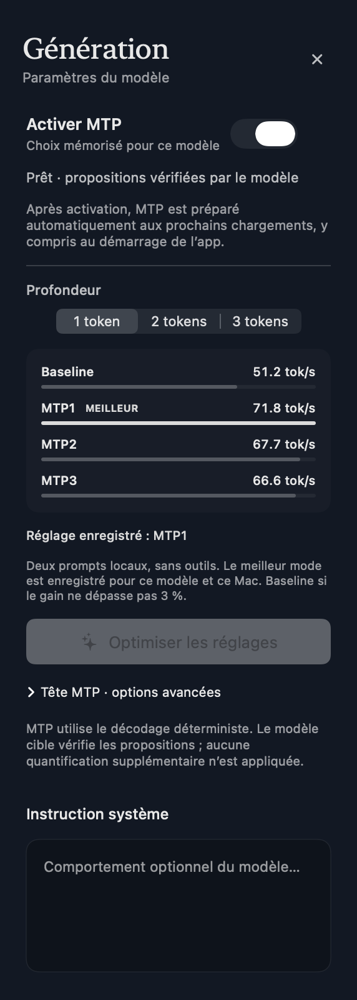

# Correction du panneau latéral MTP

Base `2b5a2df93666990487eaed5dcbbc9e69849286a2`, branche
`codex/desktop-pins-layout-mtp`. La capture utilisateur montre « Profondeur »
écrasé lettre par lettre à côté du sélecteur segmenté natif. Les captures
précédentes du panneau360points ne couvraient pas cette contrainte.

Le titre est maintenant placé au-dessus. Le sélecteur masque son libellé
horizontal, garde son nom d’accessibilité et utilise la taille native small.
Les trois choix restent lisibles à200points. Aucun changement de profondeur,
de préférence, de calibration, de score ou de calcul MTP.

Le chemin affecté est `GenerationInspector` / panneau MTP →
`MTPSettingsContent` → `MTPTuningControls`. La sélection conserve son binding
vers `setMTPDepth` et reste désactivée pendant la génération.

## Vérification

- Régression reproduite avant correction : deux cas FR200points échouent,
  avec et sans résultats ; journal d’échec et capture conservés.
- Nouveau test de rendu sur le vrai contrôle : **16cas** FR/EN,
  largeurs200/244/280/320points, sans puis avec quatre résultats synthétiques.
  Hauteur bornée à130points sans résultats et370points avec résultats ;
  après correction,78–102 et246–270points respectivement. Ce seuil détecte
  l’excès vertical de l’ancien titre ; les captures contrôlent aussi la
  lisibilité et le débordement horizontal.
- Inspection visuelle du vrai panneau complet à286points et du cas FR200 :
  titre sur une ligne, trois segments visibles, résultats correctement disposés.
- Test intégré à `scripts/check-desktop.sh`, déjà exécuté par la CI PR/push.
- Harnais hardening Desktop/MTP et expérience : voir journaux finaux conservés.
  Les suites moteur/Python et les comparaisons physiques ne sont pas relancées :
  ce correctif modifie uniquement le rendu du contrôle.
- Build release et bundle local signé strict reconstruits avec le moteur2.0.2.
  Aucun remplacement de l’application installée.

Le premier lanceur local de hardening s’est arrêté avant compilation car son
chemin relatif pointait vers `build/apps` ; le lanceur corrigé est conservé
avec les deux journaux. Swift n’a pas de vérificateur source configuré dans ce
dépôt : ces tests ne constituent pas une preuve formelle. Aucun gain de vitesse
ou RAM mesuré ou revendiqué. Les chiffres visibles des captures sont des
fixtures synthétiques de disposition, pas des mesures de performance.

Preuves et identités :
[`measurements/mtp-panel-layout-20261103`](measurements/mtp-panel-layout-20261103).
L’historique des preuves précédentes reste inchangé.

