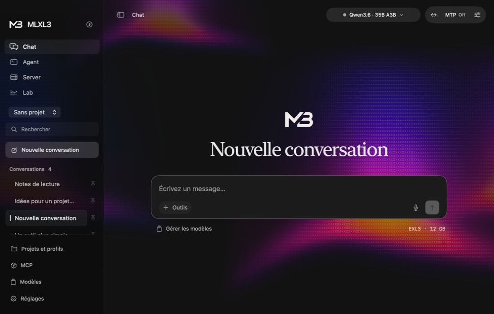

# MLXL3 Desktop 2.0.0

**The stable v2 release · Build 53 · Engine 2.0.10**

MLXL3 v2 brings Chat, Agent, Server and Lab into one local Apple Silicon app. This release brings together the work shipped across **all 21 v2 betas**, with the final ASCII interface, smoother conversation transitions and release fixes.

## A new Desktop

- **Animated ASCII aurora.** Violet, pink and amber light fills the workspace and the menu bar widget. Characters transform inside fixed cells as the light passes. The animation responds smoothly to generation and follows Reduce Motion.
- **Native glass controls.** The model selector, generation controls and New Conversation action share translucent surfaces with distinct hover, pressed and disabled states.
- **A calmer conversation screen.** The MLXL3 mark and serif welcome title give way to the conversation. A gentle transition moves the composer to the bottom after the first send.
- **The real MLXL3 logo throughout.** The Dock, sidebar, welcome screen and menu bar use the product artwork, with contrast adapted to light and dark appearances.
- **A redesigned menu bar widget.** See the active model, engine state, generation metrics and actual app memory. The popover resizes to its content.
- **Full-window settings and managers.** Settings, Models, MCP and Projects/profiles have dedicated screens, a shared Back action and locally saved preferences.

## Chat, documents and vision

- Stream responses with separate reasoning, syntax-colored code, line numbers, Copy actions and rendered math.
- Read long responses with more stable incremental layout and scrolling. Tables handle wrapped content, multiline cells, HTML line breaks and aligned borders across reading widths and text sizes.
- Attach documents and images together. LFM3-VL accepts PNG, JPEG and WebP through the file picker, drag and drop or Command-V. Clipboard TIFF images are converted to PNG.
- View images inline or open a larger preview. Saved conversations retain image bytes after the original file is removed. Invalid, oversized or incompatible images are rejected before sending.
- Pin conversations, branch or regenerate messages, search history and export conversations. New activity follows pinned items in the history.
- Use the compact composer for attachments, tools, dictation and sending. Dictation permission callbacks include the crash fix from the beta series.
- Open completed HTML with the inline Code/Preview control. Supported HTTPS module CDNs, import maps and relative project CSS/JavaScript work in the isolated WebKit preview.
- Keep MCP tools, structured JSON responses, project profiles and document retrieval available alongside ordinary conversation.

## Agent and project work

- **One isolated folder per task.** Import a project and let the model inspect, create and edit files in its task workspace.
- **Agent Studio.** Browse files, edit code, inspect additions and removals, view Git history, restore checkpoints and export a selected version as ZIP.
- **Review before applying.** Apply the exact reviewed revision back to the original project. Conflicting external changes and unreviewed workspace edits are refused.
- **Explicit tool permissions.** Control reading, writing and command execution independently. Commands use the native macOS sandbox, default to five seconds and support a 1–30 second limit.
- **Bounded task execution.** Tool rounds share a token budget and activity deadlines. Stop requests cancellation, with process cleanup for an unresponsive engine.
- Preserve unsaved drafts while navigating files and history. Historical HTML previews use resources from the selected checkpoint.

## Models, inference and conversion

- Browse recommended Qwen and LFM models at pinned Hugging Face revisions. LFM3, LFM3 Heretic NX and LFM3-VL recommendations select the standalone 8-bpw checkpoints.
- Read model cards with Markdown, tables and supported images inside the app. Expand model architecture and memory details when needed.
- Follow downloads in a compact panel, including with the sidebar hidden. Progress, transfer speed, pause/resume and cancellation follow the real transfer state.
- Choose a startup model, disable automatic loading, unload manually or use idle unloading. Chat/Agent navigation preserves an intentionally unloaded model.
- Each model remembers its MTP setting. Flash Next uses its integrated head; compatible Qwen models expose their supported head and depth controls.
- Configure experimental DFlash2 with a local draft or the compatible pinned download. Draft downloads include integrity checks, progress, resume and cancellation.
- **Quantization Studio.** Inspect a local model or pinned Hugging Face source, then use Simple 3/4/6-bpw presets or Expert calibration and precision settings. Conversion support is shown separately from inference support.
- Conversion runs in the bundled worker after unloading the interactive model. New output directories, completion checks and explicit library registration protect existing models.
- The bundled MLX engine retains the beta-series loading, allocator-cache, cancellation/recovery and Qwen expert-input improvements. Supported families include Qwen, LFM2, LFM3, LFM3-VL, Gemma 4 and Ling.

## Server, Lab and personalization

- **Server.** Start and stop the OpenAI-compatible API, choose context and port, copy the endpoint, key and test command, and inspect logs. Local access is the default. Optional LAN access uses a generated key over HTTP.
- **Private server-key delivery.** Desktop now passes the bearer key through a bounded private pipe. The key is absent from process arguments.
- **Lab.** Compare recorded model results, chart decode/prefill, latency, tokens and memory, inspect the Mac/runtime and export samples as JSON.
- **Appearance.** Choose System, Light or Dark with the new Iris accent, another preset or a custom color. Earlier theme selections migrate into these three appearances.
- Adjust response text size, font, bubble style, spacing, reading width and sidebar width. Preferences apply immediately and persist locally.
- Enable optional completion notifications for background generations. Settings release notes render as Markdown.
- **Independent updates.** Desktop and engine retain separate Stable/Beta channels, download progress, speed and SHA-256 verification. Build 53 upgrades from beta 21/build 52.

## Final fixes

- Removed the stationary halo trace and the deformation of ASCII glyphs.
- Preserved the final CLI event when stdout ends without a newline and bounded stderr-tail reads.
- Preserved drafts and unloaded-model state across navigation; fixed duplicate new conversations from Lab.
- Kept popover sizing, model-selector shape and disabled-control feedback consistent.
- Retained the beta-series safeguards for checkpoint identity, download phases, structured replies, bounded bridge frames, stale callbacks and cancellation.

## Install

Requires **Apple Silicon and macOS 26.2 or later**. Download the DMG below and drag **MLXL3 Desktop** into Applications, or update from Settings.

The DMG bundles engine 2.0.10, MLX libraries, Metal assets and the conversion environment. Download model weights separately. Agent project features use Git from Apple's Command Line Tools.

The app is ad-hoc signed. If macOS blocks first launch, approve this specific app in **System Settings → Privacy & Security**.

## Verification and limits

Local checks passed on an Apple M5 with 24 GiB of unified memory. They cover Desktop navigation and persistence, the updated server transport, installer/updater integrity, real text and vision generation, the mounted DMG and the bundled converter. Rust CPU checks passed **527 tests**, with **10 ignored**; the MLX library passed **461**, with **241 ignored**. The server validator also passed a bounded Kani check.

Physical M1–M4, macOS 26.2, Gemma/Ling generation and external audio devices remain untested in this campaign. MTP/DFlash2 results depend on the model, prompt, context and Mac. Lab samples and earlier beta measurements retain their own protocols. New inference throughput, rendering power and FPS were not benchmarked for this release.

Commands, bounds, retained failures and hosted CI scope are recorded in the [release validation](https://github.com/0xZKnw/mlxl3/blob/main/docs/releases/release-v2.0.0-validation.md).

## Source and download

- Compiled source revision `edee73ce2e4f56ed90fe4e2c973526d9cdfd518f`. Later release commits add documentation and source-inventory bookkeeping.
- `MLXL3-Desktop-v2.0.0-b53-Apple-Silicon.dmg` · **250,940,191 bytes**.
- SHA-256 `83b88363d90e2717b96cab1ebe508b863adb40e51aab09193975e717834f79fa`.
- Bundled [MLXL3 Engine 2.0.10](https://github.com/0xZKnw/mlxl3/releases/tag/engine-v2.0.10).

## Thank you

Thanks to [0xZKnw](https://github.com/0xZKnw) for MLXL3, the design direction and testing on Apple Silicon, and to [Lucas Bauduin / HENK0O](https://github.com/HENK0O) for appearance, startup, pinned chats, reading controls and per-model MTP contributions.

Thanks to [Apple MLX](https://github.com/ml-explore/mlx) for the array runtime, [ExLlamaV3](https://github.com/turboderp-org/exllamav3) for EXL3, [PonyExl3](https://github.com/beamivalice/PonyExl3) for conversion, [MTPLX](https://github.com/youssofal/mtplx) and [TensorFold](https://github.com/ashhart/TensorFold) for the existing speculative decoding work, and [SwiftMath](https://github.com/mgriebling/SwiftMath) for equation rendering.
