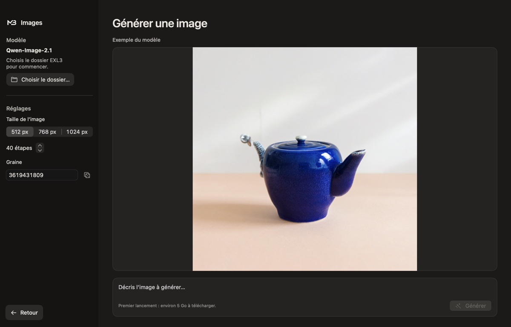

# Generate an image on Apple M5

In MLXL3 Studio, open **Image** in the sidebar. Choose **Base** or **Turbo**,
describe the image, then click **Generate**. Studio remembers a separate local
model folder for each variant.
The preview labels the bundled example until you generate your own image. **Back**
returns to the previous screen. You can reopen Images to resume your draft, follow an
active generation or reveal the finished PNG. **Cancel** stops an active generation.
The seed can be reused. **Show PNG** reveals the saved image in Finder.
Base accepts 2–50 steps. Start with 512 × 512 and 40 steps. Turbo uses its
trained eight-step sampling schedule. Saved generations record which variant
was used, and **Reuse settings** restores it.
The feature requires an Apple M5-family GPU, macOS 26.3 or later and TensorOps enabled.
Studio checks eligibility before it starts uv or downloads components. The physical validation used an M5 with 24 GiB of memory.

The first launch requires internet access and uv installed in ~/.local/bin,
/opt/homebrew/bin or /usr/local/bin. Studio sets up an isolated Python 3.12 environment. Package resolution is capped at 2026-11-22 20:00 UTC.
The tokenizer, Q4 text encoder and VAE come from a pinned snapshot of the
[MLX Community auxiliary weights](https://huggingface.co/mlx-community/Qwen-Image-2.1-mflux-q4/tree/746a58556820933a2df5c75887a2570f1ad200c0).
Both variants share this local auxiliary snapshot and the Python environment.

- **Base** uses the folder containing `manifest.json` and the 33 shards of the
  [3.56 GB Base conversion](https://huggingface.co/Henk0o/mlxl3-image21-exl3-4bpw).
- **Turbo** loads the [published EXL3 4-bit weights](https://huggingface.co/jyohukuchan/Qwen-Image-2.1-Turbo-EXL3/tree/f362145b8e8ebc88d6639c445eb9f31beab7c0b4/4bit)
  directly on Metal. Select the folder containing `quantization.json` and the
  225 safetensors files (3.77 GB). Studio also detects them in
  `~/Library/Application Support/io.mlxl3.desktop/ImageModels/Qwen-Image-2.1-Turbo-EXL3-4bit/`.
  Keep the accompanying license and notice with the weights.

Studio verifies the denoiser file hashes before generation.
Generation uses the [MFLUX image pipeline](https://github.com/mflux-community/mflux/tree/d39c9639e6ac22407a725432cc221a83fab19f1b/src/mflux/models/qwen21).
Built with Qwen. Model use is subject to the [upstream research license](https://huggingface.co/Qwen/Qwen-Image-2.1/blob/d26bb61231c349cf6b7896fa83353113880e1ba3/LICENSE).
