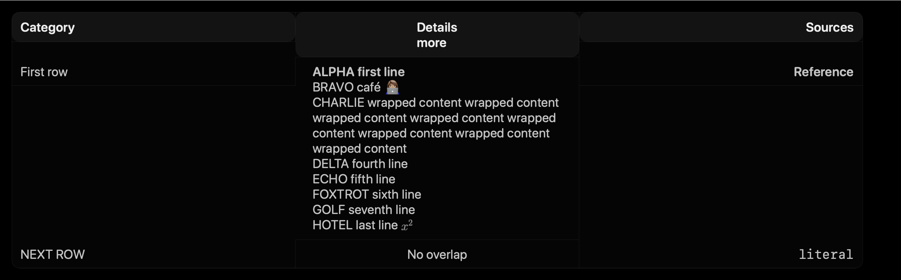

# Markdown table line breaks — 6 November 2026

Status: corrected and verified locally. No app installation, push or release was performed.

The table renderer now interprets ` `, ` `, ` ` and case/space variants as newlines in header/body prose. Inline code, escaped tags, math, incomplete/unrelated tags and non-table prose remain unchanged. Stored/copied Markdown is preserved. Cells receive a definite 260-point column width (scaled by text settings) before measuring their full text height, with top alignment; long text no longer overlaps the following row. Horizontal scrolling remains available.

The isolated fix starts at Desktop beta 7 source `accabf48a8a6c2a57fb1daa05703adc7f41be330`, branch `codex/desktop-table-breaks`. The same targeted production changes were applied to the original modified workspace after confirming its parser matched the tested baseline; existing local changes were preserved. Both apps build with SDK 26.5. Engine code and published release artifacts were not changed.

Verification:

- The baseline regression failed: HTML-cell table height 127 pixels versus a 231-pixel real-newline reference.
- 24 actual AppKit bitmap comparisons pass at widths 360/800/1200, font scales 0.85/1/1.4/1.8 and streaming/final states. Each capture must contain visible ink and exactly match the independently supplied newline-cell reference. CPU-only OCR requires first-line ALPHA, last-line HOTEL and following-row NEXT ROW in the wide capture. The final image was visually inspected.
- 15 deterministic parser boundaries cover slash/case/whitespace, Unicode, escaped/inline-code tags, math delimiters, currency, malformed/partial tags and unchanged ordinary prose.
- The full affected Response UI suite passes: 786 append/fade cases, 63 drawing comparisons, 81 native streaming viewport frames, scroll/follow transitions, HTML preview lifecycle, 9 formulas × 2 styles, clipboard/history/bridge journeys, 63 parser/chunk preparation parity cases, stale work and cancellation. No cases were skipped in this focused suite.
- Swift 6 compilation with warnings as errors and `-Xfrontend -sil-verify-all` passes. This checks compiler invariants, not a formal proof of SwiftUI behavior. No practical behavioral SwiftUI verifier is configured. New test-file strict `swift-format` lint, shell syntax and diff whitespace checks pass.

The test is wired into the existing `scripts/check-desktop.sh` response suite, used by PR and main-push CI. Remote CI has not run for this local, unpushed fix. Full unrelated Desktop/engine suites and performance campaigns were not repeated.

Earlier attempts are retained: ImageRenderer produced black ScrollView captures, so those comparisons were rejected as raster evidence; real-window capture plus OCR then exposed a clipped final line in the flexible-width prototype. The unchanged OCR guard rejected it. The final definite-width implementation passes without lowering thresholds. Earlier failed logs and results remain under `build/table-breaks-20261106/`.

Commands: `swiftc -warnings-as-errors -swift-version 6 -parse-as-library -Xfrontend -sil-verify-all -sdk /Library/Developer/CommandLineTools/SDKs/MacOSX26.5.sdk` over the real app sources and concatenated production/test renderer; registered response fixture with a 120-second supervisor deadline; `swift build --package-path apps/MLXL3Studio --build-system native --sdk /Library/Developer/CommandLineTools/SDKs/MacOSX26.5.sdk`; `xcrun swift-format lint --strict tests/table-rendering-check.swift`; `zsh -n scripts/check-desktop.sh`; `git diff --check`. Exact source hashes and counts are in [result.json](measurements/table-breaks-20261106/result.json).

